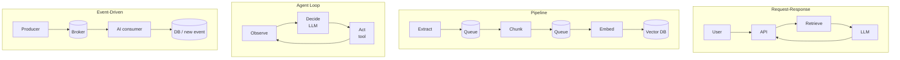

# Architecture Patterns for AI Applications



Many production AI failures come from the **system around the model**, not the model: slow request paths, fragile retrieval, missing backpressure, runaway agent loops, weak observability, and unclear ownership between the app and model layers. A strong model can't save an architecture that doesn't control **latency, cost, state, and failure**.

## 1. Why Architecture Matters More for AI
| Dimension | Traditional app | AI app |
|---|---|---|
| Latency | DB query: ms; service call: tens of ms | LLM call: seconds; long-context, reasoning, or multimodal calls take longer; RAG adds retrieve + filter + rerank + generate; agents chain many calls |
| User-visible choices | Mostly hidden | Sync vs. async, queue placement, streaming progress, caching all shape how the product feels |
| Cost | Mostly fixed infra | Every model call, embedding job, rerank, and image/audio op is billed; reprocessing and unbounded loops show up on the invoice |

Good AI architecture balances **latency, reliability, and unit economics** together.

## 2. Pattern 1: Request-Response
Flow: user query → API decides the work → optional retrieval (vector index / DB / search) → LLM → response. The standard HTTP cycle with an LLM call in the processing step.

**Fits when:** users expect direct answers (chat, search, Q&A); processing takes under ~10–15 s; requests are independent or need little history; simplicity matters most.

```python
@app.post("/search")
async def search(q: Query, user=Depends(auth)):
    if (hit := await answer_cache.get(q.text, user.tenant, KB_VERSION)):
        return hit
    snippets = await retriever.search(q.text, k=5, filter={"tenant": user.tenant})
    async def stream():
        async for tok in llm.stream(system=ANSWER_PROMPT, user=render(q.text, snippets)):
            yield tok
    return StreamingResponse(stream(), media_type="text/event-stream")
```

Latency levers:
- **Streaming**: same total work, much better perceived speed (time-to-first-token is what users feel).
- **Caching**: reuse answers, retrieved context, or prompt prefixes. Invalidate when the knowledge changes. Keep **application response caching** separate from **provider prompt caching**, which has provider-specific rules and short TTLs ([caching strategies](07-caching-strategies-for-llm-applications.md)).

Trade-off: the user waits on **every step on the critical path** (retrieval, rerank, policy checks, generation). Keep that path short and move anything optional off it.

## 3. Pattern 2: Pipeline
Ordered stages; each transforms, enriches, validates, or stores the previous stage's output. Canonical example is **document ingestion**: extract text → chunk → embed → store in a vector DB → optionally summarize.

Why not inline: the job takes minutes, and if embedding fails on chunk 47 of 200 you want to **resume from 47**, not restart. With durable queues or job records between stages, each stage is **observed, retried, and scaled independently**. The chunker publishes and moves on; the embedder consumes at a controlled rate, retries, and resumes after restarts.

Queues are **not a correctness guarantee**. You still need:
- idempotent writes (upsert by `(doc_id, chunk_idx, content_hash)`)
- dedupe keys
- retry limits
- dead-letter queues

```python
async def embed_worker():
    async for msg in queue.consume("chunks", prefetch=32):
        try:
            vec = await embed(msg.body["text"])                     # rate-limited client
            await vdb.upsert(id=f'{msg.body["doc_id"]}:{msg.body["idx"]}', vector=vec,
                             metadata=msg.body["meta"])              # idempotent
            await msg.ack()
        except RetryableError:
            await msg.nack(requeue=msg.attempts < 5)                 # then DLQ
        except Exception:
            await msg.dead_letter()
```

| Variant | Example |
|---|---|
| Fan-out | Embeddings and summary generated in parallel, merged on store |
| Conditional | OCR only for scanned PDFs; summarize only long docs |

AI stages (OCR, embedding, rerank, summarization) are slow, expensive, or rate-limited, so **scaling them separately** matters for throughput and cost. **Fits** sequential stages, long jobs, stage-level retries, and batch work. **Doesn't fit** interactive features that need an immediate answer.

## 4. Pattern 3: Agent Loop
In patterns 1–2 the application picks the sequence. In an agent loop the **model picks the next action**: observe → decide → act → repeat, until it answers without tool calls or the app stops it.

| Challenge | Why | Control |
|---|---|---|
| Unpredictable time | 2 tool calls or 20 | Timeouts, progress streaming, async mode for long tasks |
| Unpredictable cost | ≥1 model call per iteration, growing context | Budgets: max iterations, tool calls, tokens, wall-clock, per-tool limits |
| Accumulated context | History grows each turn | Summarize old steps, drop stale observations, store state outside the prompt, retrieve only what's needed |

```python
def research(question, max_iters=8):
    messages = [{"role": "user", "content": question}]          # messages = agent state
    for _ in range(max_iters):                                    # guard
        r = client.messages.create(model="claude-sonnet-5-5", max_tokens=2048,
                                   tools=TOOLS, messages=messages)
        messages.append({"role": "assistant", "content": r.content})
        if r.stop_reason != "tool_use":
            return text_of(r)                                     # exit 1: final answer
        messages.append({"role": "user", "content": run_tools(r.content)})
    return summarize_partial(messages)                            # exit 2: cap reached, still useful
```

**Fits:** multi-step tasks you can't predetermine, reacting to intermediate results, delegated open-ended work, tolerance for higher latency/cost. **Doesn't fit:** known steps (use a pipeline), tight predictable latency (request-response), tight cost, or highly repeatable/auditable flows.

## 5. Pattern 4: Event-Driven
Work starts when **something happens**: document uploaded, email arrives, code pushed, threshold crossed. Producers publish to a broker (Kafka, RabbitMQ, SNS/EventBridge, Pub/Sub); the AI component is just **another consumer** that writes results or emits a new event. It may run classification, embedding, a pipeline, or an agent loop.

| Benefit | Meaning |
|---|---|
| Decoupling | Producers don't know AI consumers exist; add/update consumers without touching producers (product and AI teams ship at different speeds) |
| Scalability | Consumers scale independently; the broker absorbs bursts |
| Resilience | Events wait while a consumer is down; resume from the last ack |

Requirements: correct acks, idempotent handlers, retry limits, DLQs. Without them, work is lost or duplicated.

```python
@consumer("documents.uploaded", group="auto-tagger")
async def auto_tag(evt):
    if await processed.exists(evt.id):            # idempotency
        return
    doc = await store.get(evt.doc_id)
    tags = await classify(doc.text[:8000], labels=TAXONOMY)
    await db.set_tags(evt.doc_id, tags)
    await bus.publish("documents.tagged", {"doc_id": evt.doc_id, "tags": tags})
    await processed.add(evt.id)
```

Events often **trigger** the other patterns: upload → ingestion pipeline; email → classify + draft reply; complex task → background agent. This separates *when AI runs* from *how the work is processed*.

**Fits:** system-triggered work, async OK, multiple consumers per event, independent scaling, durable background handling. **Doesn't fit:** synchronous answers, low scale (a background job is enough), strict ordering requirements.

## 6. Choosing a Pattern
1. **Who initiates?** A user waiting for an answer → request-response. A system event → event-driven.
2. **Steps known in advance?** Yes → pipeline. No, the model chooses → agent loop.
3. **Latency budget?**

| Budget | Pattern |
|---|---|
| Sub-second | Request-response + cache / precomputed results |
| A few seconds | Request-response + streaming |
| Minutes | Pipeline or bounded agent loop (async job + progress) |
| No user wait | Event-driven background processing |

| | Request-Response | Pipeline | Agent Loop | Event-Driven |
|---|---|---|---|---|
| Trigger | User request | Scheduled / triggered | User task | System event |
| Latency | Low (seconds) | Medium–high (minutes) | Variable | Async |
| Steps | Fixed, few | Fixed, many | Dynamic | Depends on consumer |
| Cost predictability | High | High | Low | High per event |
| Complexity | Low | Medium | High | Medium |
| Best for | Chat, search, Q&A | Ingestion, ETL, batch | Research, complex tasks | Monitoring, auto-processing |

## 7. Real Systems Combine Patterns
| Product | Composition |
|---|---|
| Customer support | Event-driven ticket intake → enrichment pipeline (history, sentiment) → request-response reply drafting |
| Code review | PR event → agent loop / workflow inspects diff → request-response for follow-up questions |
| Document intelligence | Upload → ingestion pipeline (OCR, chunk, embed) → request-response search and Q&A |

Know each pattern's boundaries and **compose deliberately**. Don't build one request path that mixes sync calls, background jobs, and agent loops.

## 8. Cross-Cutting Concerns (additions)
| Concern | Where it lives |
|---|---|
| Model access, retries, fallbacks, keys, cost | [AI gateway](05-the-ai-gateway-pattern.md) |
| Timeouts, circuit breakers, degraded modes | [Designing for reliability](02-designing-for-reliability.md) |
| Long-running work status | Job table `(id, state, progress, result_ref)` + SSE/WebSocket or polling |
| Durable multi-step execution | Temporal / Inngest / Restate ([building AI workflows](../10-agents/08-building-ai-workflows.md)) |
| Back-of-envelope sizing | Peak QPS × avg tokens/request = tokens/min vs. provider TPM; concurrency ≈ QPS × latency (Little's law). E.g., 20 QPS × 6 s = 120 in-flight calls ([scaling](04-scaling-ai-applications.md)) |

## Takeaways
- Four building blocks: request-response, pipeline, agent loop, event-driven. Real products compose them.
- Pick by initiator, step predictability, and latency budget.
- Queues give resilience but not correctness; add idempotency, dedupe, retry caps, and DLQs.
- Agent loops need hard budgets and exits that still return something useful.

## References
- Kleppmann, *Designing Data-Intensive Applications* · Fowler, *Patterns of Enterprise Application Architecture*
- OpenAI production best practices · Anthropic, *Building effective agents* · Microsoft event-driven architecture guide

## Related
- [Designing for reliability](02-designing-for-reliability.md) · [Scaling AI applications](04-scaling-ai-applications.md) · [AI gateway](05-the-ai-gateway-pattern.md)
- [What are AI agents](../10-agents/01-what-are-ai-agents.md) · [Building AI workflows](../10-agents/08-building-ai-workflows.md)
