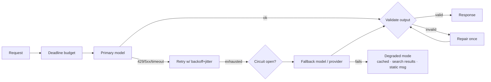

# Designing for Reliability



A demo can succeed on the happy path. Production also has to handle **provider errors, malformed outputs, stale retrieval, policy refusals, slow generations, tool failures**, and questions nobody tested. Reliability means making those failures **bounded, visible, and recoverable**, so the system **degrades deliberately** instead of failing in confusing ways.

## 1. Anatomy of Failures in AI Systems
| Layer | Failure | Detect | Typical handling |
|---|---|---|---|
| **Provider / infra** | 429, 5xx, 529 overloaded, timeouts, regional outage | Status codes, latency | Retry with backoff, fallback provider, circuit breaker |
| **Latency** | p99 generation 40 s; stuck streams | Deadline, TTFT and inter-token timers | Per-stage timeouts, stream idle timeout, cancel and fall back |
| **Output format** | Invalid JSON, missing fields, wrong enum | Schema validation | Structured outputs, repair prompt, stronger model |
| **Output content** | Hallucination, unsupported claims, off-policy | Groundedness check, judges, rules | Cite-or-abstain, verifier, refuse |
| **Refusal / safety filter** | Model declines legitimate request; content filter blocks | `stop_reason`, refusal classifier | Rephrase system prompt, route to human, explain to user |
| **Retrieval** | Empty, stale, wrong tenant, low relevance | Score thresholds, freshness metadata | "I don't know", fallback search, re-index |
| **Tool** | Downstream API errors, slow, wrong data | Typed errors | Retry if retryable, tell the model, skip optional tools |
| **Truncation** | `max_tokens` hit mid-answer | `stop_reason == "max_tokens"` | Continue or raise the limit; never parse truncated JSON |
| **Silent quality drift** | Model version update, prompt change, data drift | Online evals, feedback | Pin model versions; canaries; rollback |

Key difference from traditional systems: **a 200 OK can still be a failure**. Validate content, not just status codes.

## 2. Timeouts and Deadlines
- Give each request a **total deadline** (e.g., 20 s for chat) and split it across stages: retrieve 1 s, rerank 0.5 s, generate the remainder.
- Use separate timers for **connect**, **time to first token** (e.g., 5 s), and **stream idle** (e.g., 10 s with no tokens).
- Propagate the remaining budget downstream; don't start a 10 s fallback with 2 s left.

```python
async def with_deadline(coro, deadline):
    remaining = deadline - time.monotonic()
    if remaining <= 0:
        raise DeadlineExceeded()
    return await asyncio.wait_for(coro, timeout=remaining)
```

## 3. Retries Done Right
| Rule | Why |
|---|---|
| Retry only **retryable** errors (429, 500, 502, 503, 529, timeouts, connection resets) | 400/401/403/422 won't fix themselves |
| Exponential backoff + **full jitter**; honor `retry-after` | Avoid synchronized retry storms |
| Cap attempts (2–3 for interactive, more for batch) and total time | Retries consume the deadline |
| **Retry budget**: retries ≤ 10–20% of requests per window | Stops retries from amplifying an outage |
| Make side effects idempotent | Retried tool calls must not double-charge |
| Don't retry content-filter refusals blindly | Same input → same refusal |

```python
async def call_with_retry(fn, *, attempts=3, base=0.5, cap=8):
    for i in range(attempts):
        try:
            return await fn()
        except RetryableError as e:
            if i == attempts - 1 or not retry_budget.allow():
                raise
            delay = e.retry_after or random.uniform(0, min(cap, base * 2 ** i))
            await asyncio.sleep(delay)
```

## 4. Circuit Breakers and Fallbacks
- **Circuit breaker**: after N failures in a window (or error rate > X%), stop calling the provider for a cool-down, then send a few probes (half-open).
- **Fallback chain**: primary model → same model on another region/provider (Bedrock, Vertex, Azure) → smaller/cheaper model → degraded mode.

| Fallback | Caveats |
|---|---|
| Same model, other provider/region | Best quality parity; different rate limits and feature support |
| Different model family | Prompts may behave differently; **eval the fallback path** too |
| Smaller model | Lower quality; maybe restrict to simple intents |
| Cached / precomputed answer | Only if still valid for user, tenant, and data version |
| Non-AI path | Keyword search results, a form, "try again", human handoff |

```python
class Breaker:
    def __init__(self, threshold=5, cooldown=30):
        self.fails, self.opened_at, self.t, self.cd = 0, None, threshold, cooldown
    def allow(self):
        return self.opened_at is None or time.monotonic() - self.opened_at > self.cd
    def record(self, ok):
        if ok: self.fails, self.opened_at = 0, None
        else:
            self.fails += 1
            if self.fails >= self.t: self.opened_at = time.monotonic()

async def generate(req):
    for target in ROUTES[req.task]:                          # ordered fallback chain
        if not breakers[target].allow():
            continue
        try:
            out = await call_with_retry(lambda: llm(target, req))
            breakers[target].record(True)
            return out
        except (RetryableError, DeadlineExceeded):
            breakers[target].record(False)
    return degraded_response(req)
```

## 5. Graceful Degradation
Plan degraded modes per feature **before** the incident:
| Feature | Full | Degraded |
|---|---|---|
| RAG Q&A | Generated answer with citations | Top-5 search results with snippets |
| Summarization | LLM summary | First N sentences / extractive summary |
| Agent | Full tool use | Read-only tools; queue the write action for later |
| Recommendations | Personalized LLM rerank | Popularity-based list |
| Writing assistant | Inline suggestions | Feature hidden with a banner |

Show the user what happened ("AI answers are temporarily limited; showing search results").

## 6. Output Validation as a Reliability Layer
- Structured outputs / JSON schema mode where supported; Pydantic validation always.
- Business-rule checks in code (totals add up, dates in range, ids exist).
- Grounding checks for RAG: every claim cites a retrieved chunk; abstain if retrieval is weak.
- One repair attempt with the validation error, then escalate (stronger model or human). See [building AI workflows](../10-agents/08-building-ai-workflows.md).

## 7. Isolation and Blast Radius
- **Bulkheads**: separate concurrency pools/quotas per feature or tenant so a batch job can't starve interactive chat.
- **Load shedding**: reject low-priority work early under pressure ([rate limiting](08-rate-limiting-and-api-management.md)).
- **Feature flags / kill switches** per model, prompt version, and tool.
- **Pin model versions** (dated snapshots) and roll out new ones as canaries.

## 8. SLOs for AI Features (additions)
| SLI | Example SLO |
|---|---|
| Availability (non-error responses incl. degraded) | 99.9% |
| Full-quality availability (non-degraded) | 99% |
| TTFT p95 | < 1.5 s |
| End-to-end p95 | < 8 s |
| Valid-output rate | > 99.5% |
| Groundedness / judge pass rate on sampled traffic | > 95% |
| Fallback rate | < 2% (alert on spikes) |

Error budgets apply: if quality SLOs burn, freeze prompt/model changes.

## Takeaways
- AI failures include "successful" responses that are wrong, truncated, or refused; validate outputs.
- Deadlines, bounded retries with jitter, circuit breakers, and fallback chains contain provider failures.
- Design a degraded mode per feature and eval the fallback paths.
- Isolate workloads and pin model versions to limit blast radius.

## References
- Google SRE Book: *Handling Overload*, *Addressing Cascading Failures* · AWS Builders' Library: *Timeouts, retries, and backoff with jitter*
- Nygard, *Release It!* (circuit breakers, bulkheads) · Anthropic / OpenAI error code docs

## Related
- [Architecture patterns](01-architecture-patterns-for-ai-applications.md) · [AI gateway](05-the-ai-gateway-pattern.md) · [Rate limiting](08-rate-limiting-and-api-management.md)
- [Agent reliability and debugging](../10-agents/05-agent-reliability-and-debugging.md) · [Handling production incidents](../12-production-deployment/04-handling-production-incidents.md)
