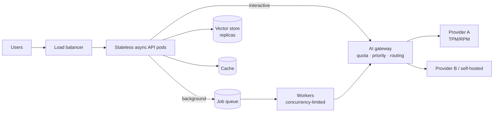

# Scaling AI Applications



Many AI apps work in a pilot because traffic is low, prompts are short, and someone is watching the logs. Scaling exposes different constraints: **long-running requests, provider rate limits, token throughput, queue backlog, budget ceilings, and data stores not built for concurrent retrieval**. Scaling an AI application means treating **concurrency and cost as first-class resources**. More web servers only help if the **model provider, vector store, and budget** can absorb the extra work.

## 1. Why AI Workloads Are Different
| Property | Typical web request | LLM request |
|---|---|---|
| Duration | 10–200 ms | 1–60 s (agents: minutes) |
| Bottleneck | CPU / DB | External provider quota (TPM/RPM), GPU |
| Cost per request | ~$0.00001 | $0.001–$0.50+ |
| Size variance | Small | 100 to 200K input tokens; output length unknown up front |
| Connections | Short | Long-lived streams (SSE/WebSocket) |
| Scale limit | Add servers | Quota, spend, GPU capacity |

## 2. The Math: Little's Law and Token Throughput
- **Concurrency = arrival rate × latency.** 50 req/s × 8 s average = **400 in-flight** requests. Your API, connection pools, and provider concurrency must all hold 400.
- **Token throughput**: 50 req/s × (3,000 in + 500 out) = 175K tokens/s ≈ **10.5M tokens/min**. Compare with provider TPM limits per model and per org.
- **Cost**: 50 req/s × 86,400 s × $0.004 per request ≈ **$17K/day**. Check this before launch, not after.

```python
def capacity(qps, avg_in, avg_out, latency_s, price_in_per_m, price_out_per_m):
    return {
        "in_flight": qps * latency_s,
        "tpm": qps * 60 * (avg_in + avg_out),
        "usd_per_day": qps * 86_400 * (avg_in * price_in_per_m + avg_out * price_out_per_m) / 1e6,
    }
# capacity(50, 3000, 500, 8, 3, 15) → in_flight 400, tpm 10.5M, ~$71K/day
```
Plan for **peak** (2–5× average), not average.

## 3. Application Tier
- **Async I/O everywhere** (FastAPI/asyncio, Node, Go). A sync worker blocked for 8 s per request needs 400 threads; an event loop handles that on a few cores.
- **Stateless pods**: conversation state lives in Redis/Postgres, so any pod serves any turn.
- **Connection pooling / HTTP keep-alive** to providers; reuse clients.
- **Streaming connections**: tune LB idle timeouts (≥ 60–300 s), use SSE heartbeats, and scale on **concurrent connections**, not CPU.
- **Autoscale on the right signal**: in-flight requests, queue depth, or p95 latency. CPU is near-idle while waiting on the LLM.

## 4. Sync vs. Async Work
| Work | Mode |
|---|---|
| Chat answer | Sync + streaming |
| Report generation, long agent tasks | Async job: return `job_id`, stream progress, notify on completion |
| Bulk enrichment, evals, re-embedding | Batch APIs (~50% cheaper, 24 h SLA) or offline workers |
| Ingestion | Event-driven pipeline |

Moving non-interactive work to queues **flattens peaks** and frees interactive quota.

## 5. Queues and Backpressure
- Workers pull at a rate the provider quota allows (token-bucket on TPM, not just RPM).
- **Bounded queues**: when depth exceeds N, reject or defer low-priority jobs instead of growing latency forever.
- **Priority lanes**: interactive > paid tier > free tier > batch.
- **Per-tenant fairness**: weighted fair queuing so one big customer's bulk job doesn't starve others.

```python
class TokenBucket:
    def __init__(self, tpm):
        self.capacity, self.tokens, self.rate, self.t = tpm, tpm, tpm / 60, time.monotonic()
    async def acquire(self, n):
        while True:
            now = time.monotonic()
            self.tokens = min(self.capacity, self.tokens + (now - self.t) * self.rate); self.t = now
            if self.tokens >= n:
                self.tokens -= n; return
            await asyncio.sleep((n - self.tokens) / self.rate)

async def worker(bucket):
    async for job in queue.consume(priority=True):
        await bucket.acquire(estimate_tokens(job))   # reserve before calling
        await process(job)
```

## 6. Provider Capacity
| Lever | Effect |
|---|---|
| Raise tier / request quota increase | More TPM/RPM; needs spend history |
| Multiple regions / deployments (Azure, Bedrock, Vertex) | Separate quotas; spread load via the gateway |
| Multiple providers | Capacity + resilience; requires prompt portability and evals |
| **Provisioned throughput** (PTU, Bedrock provisioned, reserved capacity) | Guaranteed throughput, predictable latency; pay for idle |
| Priority / flex tiers | Pay more for priority or less for best-effort |
| Self-hosting (vLLM, SGLang, TGI) | Capacity = GPUs; economical at high steady utilization ([self-hosting](../13-llm-optimization/05-self-hosting-models.md)) |

## 7. Reduce the Work
Usually the cheapest way to scale:
- **Cache**: exact, semantic, and provider prompt caching ([caching](07-caching-strategies-for-llm-applications.md)).
- **Route**: small models for easy requests ([model routing](../13-llm-optimization/03-model-selection-and-routing.md)).
- **Trim context**: fewer, better chunks; summarize history; cap `max_tokens`.
- **Batch** offline work; **dedupe** identical in-flight requests (request coalescing).

## 8. Data Tier
- Vector DB: read replicas, sharding by tenant, HNSW in memory, and **filter-aware** indexes ([scaling vector search](../06-embeddings-vector-search/05-scaling-vector-search.md)).
- Embedding at query time is a provider call too; cache query embeddings.
- Postgres: connection poolers (PgBouncer) since long-lived requests hold connections; don't hold a DB transaction open across an LLM call.

## 9. Budget as a Scaling Constraint
- Per-tenant and per-feature **spend limits** enforced in the gateway; soft alerts at 80%, hard caps at 100%.
- Unit economics: **cost per successful task** vs. revenue per user; free tiers need tighter model/route choices.
- Load test with realistic token distributions, using a **mock LLM server** with latency sampled from production to test your stack without burning quota.

## 10. Scaling Checklist (additions)
| Area | Check |
|---|---|
| Capacity math | Peak QPS × latency, TPM per model, $/day |
| App | Async, stateless, streaming timeouts, autoscale on in-flight |
| Work placement | Interactive vs. job vs. batch split |
| Flow control | Token buckets, priority lanes, bounded queues, load shedding |
| Provider | Multi-region/provider, provisioned throughput where steady |
| Efficiency | Caching, routing, context trimming |
| Data | Vector DB replicas, pooled DB connections |
| Money | Budgets per tenant/feature, cost dashboards, alerts |

## Takeaways
- Concurrency = QPS × latency, and LLM latency is seconds, so in-flight counts explode.
- The binding limits are provider TPM/RPM, GPU capacity, and budget, not web servers.
- Move non-interactive work to queues and batch APIs; protect interactive traffic with priority and backpressure.
- The cheapest scale is less work: cache, route, trim.

## References
- Little, *A Proof for the Queuing Formula L = λW* (1961) · OpenAI rate limits and Batch API docs · Anthropic rate limits / Message Batches docs
- Azure OpenAI provisioned throughput docs · Google SRE Book, *Handling Overload*

## Related
- [Architecture patterns](01-architecture-patterns-for-ai-applications.md) · [Rate limiting and API management](08-rate-limiting-and-api-management.md) · [AI gateway](05-the-ai-gateway-pattern.md)
- [Understanding AI application costs](../13-llm-optimization/01-understanding-ai-application-costs.md) · [Latency optimization](../13-llm-optimization/04-latency-optimization.md)
