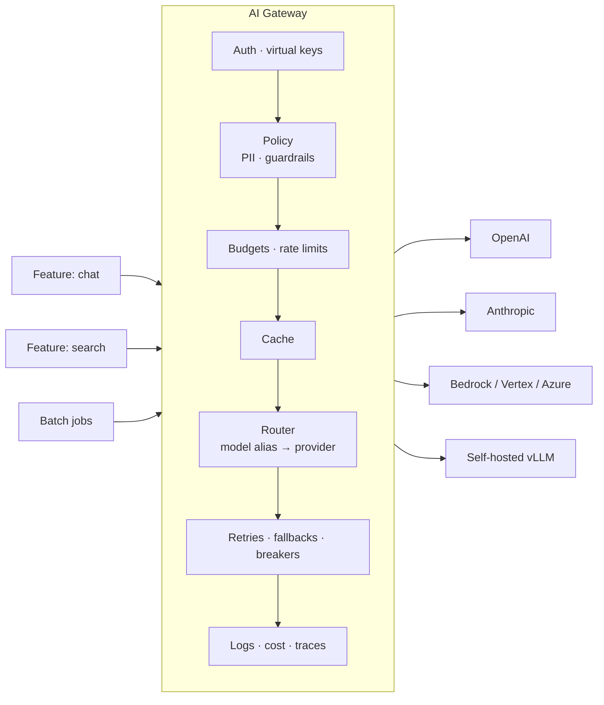

# The AI Gateway Pattern



As AI apps grow, they use **multiple models, providers, tools, and policy rules**. When every feature integrates providers directly, teams get **duplicated retry logic, inconsistent logging, scattered API keys, and no reliable view of cost**. Provider APIs also shift: models get renamed, pricing changes, rate-limit behavior differs, and some capabilities don't transfer across vendors.

The **AI gateway** is a central layer between the application and providers. Features send model requests through it instead of calling providers directly. It owns **routing, retries, fallbacks, logging, budget controls, access control, and policy enforcement**.

## 1. What Is an AI Gateway?
An API gateway specialized for model traffic. It understands **tokens, models, streaming, and prompts**, not just HTTP routes.

| Concern | Without gateway | With gateway |
|---|---|---|
| API keys | In every service's env | One vault; services get scoped **virtual keys** |
| Retries/fallbacks | Re-implemented per feature | One tested policy |
| Model upgrades | Code change in N services | Change the alias `chat-default → claude-sonnet-5-5` |
| Cost visibility | Monthly invoice | Per feature, team, tenant, user in real time |
| Rate limits | Each service hits 429 independently | Shared quota management, priority |
| Compliance | Unknown what data went where | Central log, PII redaction, provider allowlist |
| Provider outage | Every feature breaks | Automatic failover |

## 2. Responsibilities
| Layer | Functions |
|---|---|
| **Unified API** | One request shape (often OpenAI-compatible) translated to each provider; streaming passthrough |
| **Identity & access** | Virtual keys per service/team; which models each key may use; tenant tagging |
| **Routing** | Model aliases; weighted A/B splits; route by task, cost, latency, region, or data class |
| **Resilience** | Timeouts, retries with jitter, circuit breakers, fallback chains, multi-region load balancing |
| **Quotas & budgets** | RPM/TPM per key, $ budgets per team/tenant, priority lanes |
| **Caching** | Exact and semantic response cache; prompt-cache-friendly request shaping |
| **Policy & safety** | PII redaction, prompt-injection and jailbreak classifiers, output moderation, provider/region allowlists |
| **Observability** | Request logs, tokens, cost, latency (TTFT, total), errors, OpenTelemetry traces |
| **Governance** | Audit log, data retention rules, model catalog / approval |

## 3. Minimal Gateway from First Principles
```python
ROUTES = {
    "chat-default": [("anthropic", "claude-sonnet-5-5"), ("bedrock", "claude-sonnet-5-5"), ("openai", "gpt-4.1")],
    "cheap-classify": [("openai", "gpt-4.1-mini"), ("anthropic", "claude-haiku-5-5")],
}

@app.post("/v1/chat/completions")
async def proxy(req: ChatRequest, key: VirtualKey = Depends(auth)):
    if req.model not in key.allowed_models:
        raise HTTPException(403, "model not allowed for this key")
    await budgets.check(key.team, estimate_cost(req))            # 402/429 if over budget
    await limiter.acquire(key, tokens=estimate_tokens(req))      # per-key TPM
    req = policy.redact_pii(req) if key.redact_pii else req
    if (hit := await cache.get(req, scope=key.tenant)):
        return hit
    for provider, model in ROUTES[req.model]:
        if not breakers[provider].allow():
            continue
        try:
            t0 = time.monotonic()
            resp = await adapters[provider].chat(model, req, timeout=key.timeout)
            breakers[provider].record(True)
            await usage.log(key, provider, model, resp.usage, cost(provider, model, resp.usage),
                            latency=time.monotonic() - t0, request_id=req.id)
            await cache.set(req, resp, scope=key.tenant)
            return resp
        except RetryableError:
            breakers[provider].record(False)
    raise HTTPException(503, "all providers unavailable")
```
Real gateways also handle streaming (count tokens as chunks arrive, bill on completion), tool-call format translation, and per-provider features (prompt caching headers, reasoning params).

## 4. Build vs. Open Source vs. Managed
| Option | Examples | Pros | Cons |
|---|---|---|---|
| **Custom-built** | Internal FastAPI/Go service | Full control, fits your auth/billing, no extra vendor | You maintain adapters for every provider change |
| **Open-source proxy** | LiteLLM Proxy, Portkey Gateway (OSS), Envoy AI Gateway, Kong AI Gateway, Apache APISIX AI plugins | 100+ providers, virtual keys, budgets, fallbacks; self-host for data control | Operate it yourself; abstractions may lag new features |
| **Managed service** | Cloudflare AI Gateway, Portkey Cloud, OpenRouter, Vercel AI Gateway, Azure API Management AI gateway, Kong Konnect | Fast setup, dashboards, global edge | Data passes a third party; vendor lock-in; extra latency hop |
| **Client SDK abstraction** | LiteLLM SDK, Vercel AI SDK, LangChain models | Simple, no extra hop | No central control, keys still in services |

Heuristic: start with an SDK abstraction (1 team) → OSS proxy (several teams, need budgets/keys) → custom or enterprise gateway (strict compliance, deep integration with internal billing/auth).

## 5. Routing Strategies
| Strategy | Use |
|---|---|
| Alias | Decouple code from model names; upgrade centrally |
| Fallback chain | Availability |
| Weighted split | Canary a new model at 5% and compare evals/feedback |
| Least-latency / least-load | Across regions or deployments with separate quotas |
| Cost/complexity routing | Classifier sends easy queries to small models ([routing](../13-llm-optimization/03-model-selection-and-routing.md)) |
| Data-class routing | Restricted data → self-hosted or zero-retention endpoint only |
| Sticky routing | Keep a conversation on one provider for prompt-cache hits and consistency |

## 6. Pitfalls
| Pitfall | Mitigation |
|---|---|
| Single point of failure | Run HA (multi-AZ), stateless, horizontally scaled; client-side fallback to a direct path in emergencies |
| Added latency | Co-locate; keep the hot path in-memory; target < 10–20 ms overhead |
| Lowest-common-denominator API | Allow provider-specific passthrough params |
| Breaking streaming | Test SSE passthrough, backpressure, and client disconnect → upstream cancel |
| Logging sensitive data | Redact or hash prompts by policy; retention limits; access controls on logs |
| Silent fallback hides quality drops | Tag responses with the actual model; alert on fallback rate; eval fallback models |

## 7. MCP and Tool Gateways (additions)
The same pattern applies to **tools**: an MCP gateway centralizes tool auth (OAuth tokens), allowlists which servers/tools each agent may call, logs every tool call, and enforces rate limits on downstream APIs. See [production MCP patterns](../09-mcp/04-production-mcp-server-patterns.md) and [agent sandboxing](../14-agentic-ai/06-agent-sandboxing-and-security.md).

## Takeaways
- A gateway turns model access into a platform: one place for keys, routing, resilience, budgets, policy, and logs.
- Code calls aliases, not model ids, so upgrades and failovers are config changes.
- Choose custom vs. OSS (LiteLLM, Portkey, Envoy/Kong) vs. managed (Cloudflare, OpenRouter) by control, compliance, and team count.
- Make it highly available, low-overhead, streaming-correct, and transparent about which model served each request.

## References
- LiteLLM Proxy docs · Portkey Gateway docs · Cloudflare AI Gateway docs · Envoy AI Gateway · Azure APIM GenAI gateway capabilities
- Thoughtworks Technology Radar: *LLM gateways*

## Related
- [Designing for reliability](02-designing-for-reliability.md) · [Rate limiting and API management](08-rate-limiting-and-api-management.md) · [Caching strategies](07-caching-strategies-for-llm-applications.md)
- [Model selection and routing](../13-llm-optimization/03-model-selection-and-routing.md) · [Monitoring and observability](../12-production-deployment/03-monitoring-and-observability.md)
