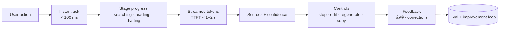

# Building AI-Powered UX



Traditional software fails in familiar ways: a click triggers a predictable action and finishes in under a second. AI features change four things:
- **Latency varies.** A simple answer may take ~2 s; a complex one ~15 s.
- **Results vary.** Two runs differ, so users need ways to inspect, regenerate, and steer.
- **Correctness isn't guaranteed.** Users must be able to verify claims.
- **Work has stages.** Retrieval, tool calls, and generation can each fail separately.

So the interface has to show **progress, uncertainty, sources, and control**. A bare spinner hides too much.

## 1. Streaming UI Patterns
| Pattern | When | Detail |
|---|---|---|
| **Token streaming** | Chat, drafting | Render markdown incrementally; buffer partial code fences/tables to avoid flicker |
| **Stage streaming** | RAG, agents | Emit events `retrieving → reading 6 sources → drafting → checking`; show the current step |
| **Structured streaming** | Forms, cards, JSON | Stream partial objects (fill fields as they arrive); validate on completion |
| **Skeleton + fill** | Known layout (summary card, report sections) | Draw the structure first, fill each section as it completes |
| **Background job** | > 30 s tasks | Return immediately with a job card; progress bar; notify on completion; resumable after refresh |

Event protocol over SSE (keeps text and status on one channel):
```python
async def answer_events(q, user):
    yield sse("status", {"stage": "retrieving"})
    docs = await retrieve(q, user)
    yield sse("sources", [{"id": d.id, "title": d.title, "url": d.url} for d in docs])
    yield sse("status", {"stage": "drafting"})
    async for tok in llm.stream(render(q, docs)):
        yield sse("token", tok)
    yield sse("done", {"answer_id": aid, "model": MODEL, "grounded": check(docs)})

def sse(event, data):
    return f"event: {event}\ndata: {json.dumps(data)}\n\n"
```
Client essentials: a **Stop** button that aborts the fetch and cancels upstream; reconnect with `Last-Event-ID`; auto-scroll that pauses when the user scrolls up.

## 2. Latency Perception
| Threshold | User perception | Design |
|---|---|---|
| < 100 ms | Instant | Echo the message, disable send, show the "thinking" state |
| < 1 s | Flow kept | Target TTFT here for chat |
| 1–10 s | Attention holds with feedback | Stream or show stage progress |
| > 10 s | Users switch tasks | Background job, notifications, partial results |

Tricks: stream **reasoning summaries or plan steps** for slow models; show sources first (they're ready before the answer); precompute likely next actions; use optimistic UI for reversible actions.

## 3. Designing for Variable Results
- **Regenerate** with versions (`< 2/3 >`) instead of overwriting.
- **Edit and resend** the prompt; **branch** conversations.
- **Steering chips**: "shorter", "more formal", "add examples", "explain like I'm new".
- **Multiple candidates** for creative tasks (3 headlines), single answer for factual ones.
- **Inline editing**: AI output is a draft the user owns; track accepted vs. edited vs. discarded.
- Preserve user edits when regenerating parts (regenerate *this* section only).

## 4. Trust: Sources, Uncertainty, Verification
| Element | Implementation |
|---|---|
| **Inline citations** | `[1]` markers linked to the exact passage; hover preview; open at the highlighted span ([citations](../07-rag/04-rag-with-citations-and-grounding.md)) |
| **Source list** | Title, date, owner; flag stale docs |
| **Abstention** | "I couldn't find this in your docs" + a search link, instead of guessing |
| **Uncertainty cues** | Qualitative ("based on 1 source", "conflicting sources") beats fake confidence percentages |
| **Provenance labels** | "AI-generated", the model used, the time; required in some jurisdictions (EU AI Act transparency) |
| **Verification affordances** | For numbers/code: show calculation, run tests, link to the record |

Calibrate trust: show uncertainty when it exists, but don't hedge every sentence. Over-hedging makes users ignore warnings.

## 5. Control and Safety for Actions
| Risk of action | UX |
|---|---|
| Read-only | Just do it; show what was read |
| Reversible write (draft email, add tag) | Do it, show **Undo** |
| Irreversible / external (send, pay, delete, deploy) | **Preview + explicit confirm**, show the exact diff/payload |
| Bulk | Dry-run summary ("will update 312 records"), sample, confirm |

Show agent plans before execution for long tasks; allow **interrupt and redirect** mid-run. See [human-in-the-loop patterns](../10-agents/07-human-in-the-loop-patterns.md).

## 6. Error and Degraded States
| Failure | Message |
|---|---|
| Provider down / fallback | "Using a faster model; answers may be less detailed" |
| Partial failure (1 of 3 tools failed) | Answer with what worked; name what's missing |
| Refusal | Explain the limit and offer an alternative path |
| Truncation | "Continue" button |
| Rate limit / quota | Clear wait time or upgrade path; never a raw 429 |

Errors should say **what happened, what still worked, and what the user can do**.

## 7. Input Design
- **Empty states with examples** that teach capability and scope.
- **Context visibility**: show attached files, selected text, and which data sources are in scope; let users remove items.
- **Slash commands / modes** for power users; plain language for everyone.
- **Ambiguity handling**: ask one clarifying question with options instead of guessing (when cost of a wrong guess is high).

## 8. Feedback and the Improvement Loop
| Signal | Type | Use |
|---|---|---|
| 👍/👎 + reason tags | Explicit | Triage bad answers; eval set |
| Copy, accept, insert | Implicit positive | Quality proxy |
| Regenerate, edit-heavy, abandon | Implicit negative | Find failure clusters |
| Correction text | Explicit, high value | Golden examples, few-shot, fine-tune data |

Log `answer_id` with prompt version, model, retrieved doc ids, and feedback so every signal is traceable ([iterating in production](../12-production-deployment/05-iterating-in-production.md)).

## 9. Accessibility and Rendering (additions)
- Announce streamed content politely (`aria-live="polite"`), not per token; announce on completion or per sentence.
- Respect reduced motion; no typing animation for screen readers.
- Sanitize model-generated markdown/HTML (XSS): no raw HTML, safe link schemes, no auto-loading images from model-supplied URLs (data exfiltration via image URLs).
- Mobile: collapsible sources, sticky Stop button.

## Takeaways
- Replace spinners with stage progress and streaming; target sub-second acknowledgment and TTFT.
- Treat outputs as drafts: regenerate, edit, steer, branch.
- Earn trust with citations, abstention, and honest uncertainty, not confidence theater.
- Gate actions by reversibility: undo for reversible, preview + confirm for irreversible.
- Instrument feedback so UX signals feed evals.

## References
- Google PAIR, *People + AI Guidebook* · Microsoft, *Guidelines for Human-AI Interaction* (Amershi et al., CHI 2019)
- Nielsen Norman Group: response-time limits, AI UX articles · Vercel AI SDK UI docs (streaming patterns)

## Related
- [Streaming and conversation management](../03-first-ai-application/04-streaming-and-conversation-management.md) · [RAG with citations](../07-rag/04-rag-with-citations-and-grounding.md)
- [Human-in-the-loop patterns](../10-agents/07-human-in-the-loop-patterns.md) · [Designing for reliability](02-designing-for-reliability.md) · [Latency optimization](../13-llm-optimization/04-latency-optimization.md)
