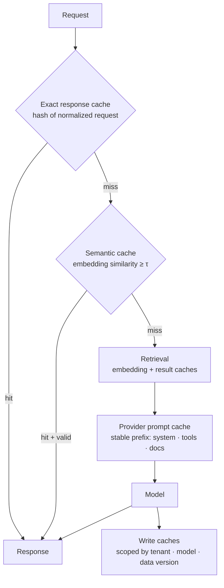

# Caching Strategies for LLM Applications



LLM calls are slow and expensive, and apps repeat a lot of work: the same system prompt on every request, similar user questions, identical retrieval results, repeated embeddings, common support answers. Caching avoids paying for that work twice.

A cached result is only valid if it still fits the **user, tenant, permissions, model, and data version**. This lesson covers the cache layers, how to key them, and how caching fails.

## 1. The Three Cache Layers
| Layer | What's reused | Hit condition | Savings | Main risk |
|---|---|---|---|---|
| **Exact response cache** | Full answer | Identical normalized request | 100% of call | Low hit rate for free text |
| **Semantic cache** | Full answer for a similar question | Embedding similarity ≥ threshold | 100% of call | **Wrong answer** for a subtly different question |
| **Provider prompt cache** | Model's processed prefix (KV cache) | Byte-identical prefix | ~50–90% of input cost, lower TTFT | Prefix churn kills hits |

Supporting caches: **embedding cache** (text hash → vector), **retrieval cache** (query → doc ids), **tool result cache** (API responses with TTL), **rerank cache**.

## 2. Exact Caching
Key on everything that changes the output:
```python
def cache_key(req, user):
    payload = {
        "v": CACHE_SCHEMA_VERSION,
        "model": req.model, "prompt_version": PROMPT_VERSION,
        "messages": normalize(req.messages),          # trim whitespace, lowercase where safe
        "params": {k: req.params[k] for k in ("temperature", "max_tokens", "tools", "response_format")},
        "tenant": user.tenant, "acl": acl_fingerprint(user),
        "kb_version": KB_VERSION,
    }
    return "llm:" + hashlib.sha256(json.dumps(payload, sort_keys=True).encode()).hexdigest()
```
- Good for: classification, extraction, deterministic transforms, eval reruns, popular FAQs, `temperature=0` calls.
- Batch/offline jobs get the biggest win (re-running a pipeline re-hits everything).
- Store `created_at`, TTL, and source doc ids for invalidation.

## 3. Semantic Caching
Embed the query, look up the nearest cached query, reuse its answer if similarity ≥ τ.
```python
async def semantic_lookup(q, user):
    v = await embed(q)
    hits = await cache_index.search(v, k=1, filter={"tenant": user.tenant, "acl": acl_fingerprint(user),
                                                    "kb_version": KB_VERSION, "model": MODEL})
    if hits and hits[0].score >= 0.95 and not has_volatile_entities(q):
        return hits[0].answer
    return None
```
| Risk | Example | Mitigation |
|---|---|---|
| False positive | "cancel my order" vs. "don't cancel my order"; "refund policy in EU" vs. "in US" | High threshold (0.95+), entity/negation check, verifier LLM on hits, cache only canonical FAQ intents |
| Personalization | "What's my balance?" | Never semantic-cache user-specific or tool-derived answers |
| Staleness | Policy changed | Key on KB version; invalidate by source doc ids |
| Poisoning | Bad answer cached and served to many | Cache only answers with positive signals or that passed checks; easy purge |

Tune τ on a labeled set of query pairs (precision of "same answer" at each threshold). Tools: GPTCache, Redis vector search / LangCache, gateway semantic caches.

## 4. Provider Prompt Caching
The provider stores the model's computed state for a prompt **prefix**; later requests with the same prefix skip recomputing it.
| Provider | Mechanism (check current docs) |
|---|---|
| Anthropic | Explicit `cache_control` breakpoints; cache reads billed at a fraction of input price, writes at a premium; short default TTL (minutes) with an extended option |
| OpenAI | Automatic for long prompts (≥ ~1K tokens); discounted cached input tokens |
| Google Gemini | Implicit caching + explicit context caching with TTL and storage cost |
| Self-hosted (vLLM, SGLang) | Automatic prefix caching / RadixAttention |

Prompt layout for hits: **stable → volatile**.
```
[system prompt][tool definitions][few-shot examples][static docs]  ← cacheable prefix
[conversation history]                                             ← grows; cache up to last turn
[current user message + fresh retrieval]                           ← volatile
```
```python
resp = client.messages.create(
    model="claude-sonnet-5-5", max_tokens=1024,
    system=[{"type": "text", "text": LONG_SYSTEM_PROMPT, "cache_control": {"type": "ephemeral"}}],
    tools=TOOLS,
    messages=messages,
)
print(resp.usage.cache_read_input_tokens, resp.usage.cache_creation_input_tokens)
```
Hit killers: timestamps or request ids in the system prompt, reordering tools, per-user data early in the prompt, randomizing few-shot order, switching models mid-conversation, routing a conversation across providers. Monitor **cache read ratio** per route.

## 5. Caches Below the Model
| Cache | Key | TTL / invalidation |
|---|---|---|
| Embeddings | `(model, sha256(text))` | Never expires for a fixed model version |
| Retrieval results | `(normalized query, filters, index version)` | Index version bump |
| Rerank scores | `(query hash, doc id, reranker version)` | Version bump |
| Tool/API results | `(tool, args)` | Data-specific TTL (weather 10 min, catalog 1 h) |
| Precomputed answers | Top FAQ intents | Regenerate on doc change |

## 6. Invalidation
| Strategy | Use |
|---|---|
| **Version in the key** (model, prompt, KB, schema) | Safest; old entries simply stop matching |
| TTL | Volatile data; bounds staleness |
| Event-driven purge | Doc updated/deleted → purge entries whose `source_doc_ids` include it |
| Tenant/user purge | Permission change, GDPR erasure |
| Manual purge / kill switch | Bad answer reported |

## 7. How Caching Fails
| Failure | Consequence | Guard |
|---|---|---|
| Missing tenant/ACL in key | **Data leak** across users | Scope every key; test cross-tenant isolation |
| Stale answer after doc change | Confidently wrong | KB version in key, event purge |
| Semantic false positive | Wrong answer to a different question | High threshold, intent allowlist, verifier |
| Caching non-deterministic creative output | Users get identical "fresh" ideas | Don't cache, or cache per user |
| Cache stampede on popular miss | Burst of identical LLM calls | Request coalescing (single-flight) |
| Caching errors/refusals | Failure persists | Cache only successful, validated responses |
| Hidden quality regression | Old model's answers served after upgrade | Model + prompt version in key |
| Metrics confusion | Latency looks great, quality unknown | Log cache hits; include hits in quality sampling |

```python
inflight: dict[str, asyncio.Future] = {}
async def single_flight(key, fn):
    if key in inflight:
        return await inflight[key]
    fut = asyncio.get_running_loop().create_future(); inflight[key] = fut
    try:
        res = await fn(); fut.set_result(res); return res
    except Exception as e:
        fut.set_exception(e); raise
    finally:
        inflight.pop(key, None)
```

## 8. Measuring (additions)
- Hit rate per layer, **cost saved** (tokens avoided × price), latency on hit vs. miss.
- Quality on hits (sample and judge) to catch semantic false positives.
- Cache read ratio for prompt caching = `cache_read_tokens / total_input_tokens`.
- Expected value: `savings = hit_rate × cost_per_call − lookup_cost − false_hit_rate × cost_of_wrong_answer`.

## Takeaways
- Three layers: exact response, semantic response, provider prompt prefix. Plus embedding/retrieval/tool caches.
- The key must include tenant, permissions, model, prompt version, and data version.
- Semantic caching trades correctness for savings; restrict it to safe, high-volume intents.
- Order prompts stable-to-volatile to maximize prompt-cache hits.
- Version keys, purge on data change, coalesce misses, and never cache errors.

## References
- Anthropic prompt caching docs · OpenAI prompt caching guide · Gemini context caching docs
- Zilliz GPTCache · vLLM Automatic Prefix Caching · SGLang RadixAttention (Zheng et al., 2023)

## Related
- [AI gateway](05-the-ai-gateway-pattern.md) · [Scaling AI applications](04-scaling-ai-applications.md) · [Data architecture](03-data-architecture-for-ai.md)
- [Understanding AI application costs](../13-llm-optimization/01-understanding-ai-application-costs.md) · [Latency optimization](../13-llm-optimization/04-latency-optimization.md) · [Context engineering](../05-prompt-engineering/04-context-engineering.md)
