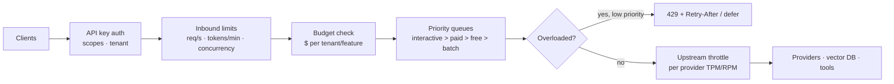

# Rate Limiting and API Management



AI apps depend on constrained services: model providers, embedding APIs, vector DBs, browser tools, code sandboxes, and third-party APIs. They impose limits on **requests, tokens, concurrency, daily quotas, spend tiers, and safety throttles**. Without control, traffic spikes cause 429s, retries amplify them, and cost overruns look like growth until the bill arrives.

This lesson covers rate limits, priority queues, budgets, upstream throttling, load shedding, and API key hygiene.

## 1. Rate Limiting Algorithms for AI Endpoints
| Algorithm | How | Pros | Cons | Fit |
|---|---|---|---|---|
| Fixed window | Count per minute bucket | Simple | 2× burst at window edges | Daily quotas |
| Sliding window log/counter | Weighted counts over a rolling window | Smooth, accurate | More state | Per-user RPM |
| **Token bucket** | Bucket of capacity B refills at rate r; each request takes n | Allows bursts up to B, average r | Needs cost estimate | **TPM limits** (n = tokens) |
| Leaky bucket | Queue drains at fixed rate | Smooth output | Adds latency | Upstream pacing |
| **Concurrency limit** (semaphore) | Max in-flight | Matches long LLM calls | Doesn't bound tokens | Streaming, agents, sandboxes |

For LLMs, request counts are insufficient: one request can be 100 tokens or 200K. Limit on **tokens** and **concurrency** too.

**Token cost is unknown until completion.** Reserve `input_tokens + max_tokens` up front, then refund the difference after the response:
```python
async def admit(key, req):
    est = count_tokens(req.messages) + req.max_tokens
    ok = await redis_token_bucket(f"tpm:{key.id}", cost=est, rate=key.tpm / 60, burst=key.tpm)
    if not ok:
        raise TooManyRequests(retry_after=bucket_wait(f"tpm:{key.id}", est))
    return est

async def settle(key, reserved, usage):
    await refund(f"tpm:{key.id}", reserved - (usage.input_tokens + usage.output_tokens))
```

Distributed limiter: Redis with an atomic Lua script (or Envoy/Kong rate-limit service). Local in-process buckets are fine per pod for upstream pacing, but global per-tenant limits need shared state.

```lua
-- KEYS[1]=bucket, ARGV: rate, burst, now, cost
local b = redis.call('HMGET', KEYS[1], 'tokens', 'ts')
local tokens = tonumber(b[1]) or tonumber(ARGV[2])
local ts = tonumber(b[2]) or tonumber(ARGV[3])
tokens = math.min(tonumber(ARGV[2]), tokens + (tonumber(ARGV[3]) - ts) * tonumber(ARGV[1]))
if tokens < tonumber(ARGV[4]) then return 0 end
redis.call('HSET', KEYS[1], 'tokens', tokens - tonumber(ARGV[4]), 'ts', ARGV[3])
redis.call('EXPIRE', KEYS[1], 120)
return 1
```

## 2. What to Limit, at Which Scope
| Dimension | Scope | Example |
|---|---|---|
| Requests/min | User, API key, IP | 60 RPM free, 600 paid |
| Tokens/min | Tenant, key, model | 200K TPM per tenant on the large model |
| Concurrent requests | User, tenant | 3 concurrent streams per user |
| Agent steps / tool calls | Per task | 30 steps, 10 browser actions |
| Daily/monthly quota | Plan tier | 1M tokens/month on free |
| Spend | Tenant, feature, team | $500/day per tenant, hard cap |
| Expensive ops | Per user | 20 image generations/day; 5 deep-research runs |

Return standard headers: `Retry-After`, `X-RateLimit-Limit/Remaining/Reset` (or the IETF `RateLimit` / `RateLimit-Policy` headers), and separate token-limit headers like the providers do.

## 3. Priority Queues and Fairness
- Classes: **interactive** (user waiting) > **paid** > **free** > **batch/background**.
- Reserve capacity per class (e.g., 60% of TPM for interactive), let lower classes borrow unused capacity.
- **Weighted fair queuing** across tenants so one tenant's bulk job doesn't starve the rest.
- Deadline-aware: drop queued interactive requests whose user already gave up (client disconnected or deadline passed).

```python
QUEUES = {"interactive": asyncio.PriorityQueue(), "batch": asyncio.PriorityQueue()}
async def dispatcher(bucket):
    while True:
        q = QUEUES["interactive"] if not QUEUES["interactive"].empty() or bucket.level < 0.4 else QUEUES["batch"]
        _, job = await q.get()
        if job.deadline and time.monotonic() > job.deadline:
            job.fail(DeadlineExceeded()); continue
        await bucket.acquire(job.est_tokens)
        asyncio.create_task(job.run())
```

## 4. Upstream Throttling (Respecting Provider Limits)
| Practice | Detail |
|---|---|
| Pace below the limit | Client-side token bucket at ~90% of provider TPM/RPM per model/region |
| Read provider headers | `x-ratelimit-remaining-tokens`, `retry-after`; adapt the local rate (AIMD: cut on 429, increase slowly) |
| Separate buckets | Per provider × model × region; embedding vs. chat quotas are distinct |
| Batch APIs for offline work | Separate, larger quota, ~50% cheaper |
| Spread across deployments | Multiple regions/accounts via the gateway (within provider terms) |
| Throttle tools too | Vector DB QPS, browser sessions, sandbox concurrency, third-party API limits |

## 5. Retry Amplification
Under a 429 storm, naive retries multiply load (3 retries × 3 layers = 27× calls).
- Retry at **one layer only** (usually the gateway).
- Honor `retry-after`; exponential backoff with jitter.
- **Retry budget** (≤ 10–20% extra load), and circuit breakers ([reliability](02-designing-for-reliability.md)).
- Don't retry 429s from **your own** limiter on the client automatically without backoff.

## 6. Load Shedding
When saturated, fail fast and cheap instead of queuing everything:
| Signal | Action |
|---|---|
| Queue depth / wait > threshold | Reject batch and free tier with 429 + `Retry-After` |
| Provider error rate high | Route to fallback model; degrade features (shorter `max_tokens`, no agent mode) |
| Budget near cap | Switch to cheaper model; disable expensive features |
| Extreme | Serve cached/static responses; maintenance banner for non-critical features |

Shed at the **edge**, before doing expensive retrieval or prompt assembly.

## 7. Budgets and Cost Controls
- Track spend in real time from usage (`input/output/cached tokens × price`), not from monthly invoices.
- Per-tenant, per-feature, per-key budgets: soft alert (80%), throttle/downgrade (95%), hard stop (100%).
- **Per-request caps**: `max_tokens`, max context, max agent iterations, max tool calls, max wall-clock.
- Anomaly detection on spend per key (leaked key or runaway loop shows as a spike).
- Provider-side limits as a backstop (org/project spend limits).

## 8. API Key Hygiene
| Practice | Detail |
|---|---|
| Never ship provider keys to clients | Browser/mobile call your backend; use short-lived tokens for realtime APIs (ephemeral session keys) |
| Secrets manager | Vault / AWS Secrets Manager / GCP Secret Manager; no keys in repos, images, or logs |
| Scoped keys | Per environment, service, and team (provider projects, gateway virtual keys) |
| Rotation | Scheduled + on-incident; support two active keys for zero-downtime rotation |
| Leak detection | GitHub secret scanning, pre-commit hooks (gitleaks, trufflehog) |
| Least privilege | Keys limited to the models and features needed; read-only for analytics |
| Audit | Log key id (not value) on every request; attribute usage and cost |

## 9. Abuse Patterns (additions)
| Abuse | Defense |
|---|---|
| Free-tier farming (many accounts) | Phone/payment verification, device fingerprinting, per-IP/ASN limits |
| Prompt flooding with huge contexts | Max input tokens per tier |
| Denial-of-wallet (forcing long outputs, agent loops) | Output caps, iteration caps, per-user spend caps |
| Scraping / model distillation | Rate limits, anomaly detection, ToS |
| Resource-heavy jailbreak attempts | Moderation pre-checks (cheap model) before expensive calls |

OWASP LLM Top 10 lists this as **Unbounded Consumption**.

## Takeaways
- Limit tokens and concurrency, not just requests; reserve `input + max_tokens`, then refund.
- Prioritize interactive work, keep tenants fair, and drop requests whose deadline passed.
- Pace below provider limits, adapt to their headers, and retry at one layer with a budget.
- Shed load early; enforce real-time spend budgets; keep keys server-side, scoped, and rotated.

## References
- Stripe engineering, *Scaling your API with rate limiters* · IETF draft *RateLimit header fields for HTTP*
- OpenAI / Anthropic rate limit docs · Google SRE Book, *Handling Overload* · OWASP Top 10 for LLM Applications (LLM10: Unbounded Consumption)

## Related
- [Scaling AI applications](04-scaling-ai-applications.md) · [AI gateway](05-the-ai-gateway-pattern.md) · [Designing for reliability](02-designing-for-reliability.md)
- [Understanding AI application costs](../13-llm-optimization/01-understanding-ai-application-costs.md) · [Agent sandboxing and security](../14-agentic-ai/06-agent-sandboxing-and-security.md)
