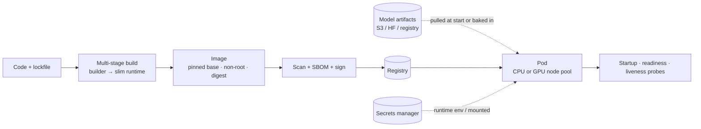

# Containerizing AI Applications



A prototype can tolerate a messy environment; a production service can't. AI apps are **especially sensitive to small environment differences**: Python version, CUDA runtime, PyTorch build, tokenizer package, system libraries, and model files can each change startup behavior, latency, memory use, or whether the service starts at all.

Containers don't make an AI system reliable on their own. They give you a **repeatable unit you can build, scan, deploy, roll back, and debug**. A good AI image is **reproducible, reasonably small, secure by default, and explicit about its CPU/memory/GPU needs and model artifacts**.

## 1. Why AI Containers Need More Care
| Issue | Traditional web app | AI app |
|---|---|---|
| Image size | 100–300 MB | 2–15 GB with PyTorch + CUDA; more if weights are baked in |
| Native deps | Few | CUDA, cuDNN, NCCL, libgomp, ffmpeg, poppler, tesseract |
| Version coupling | Loose | Driver ↔ CUDA ↔ torch ↔ flash-attn must match |
| Startup | Seconds | Minutes (download weights, load to GPU, warm up) |
| Memory | Predictable | Model size + KV cache + batch; OOM kills |
| Hardware | Any node | GPU type/count, node selectors, tolerations |

Two very different kinds of services:
| | API-calling app (hosted models) | Model-serving container (self-hosted) |
|---|---|---|
| Base | `python:3.12-slim` | `nvidia/cuda:*-runtime` or `vllm/vllm-openai` |
| Size | ~200–500 MB | 5–20 GB |
| Scaling | CPU / in-flight requests | GPUs, queue depth, KV-cache utilization |
| Key risk | Secrets, dependency drift | Driver mismatch, cold start, OOM |

## 2. Pinned Dependencies
- Lockfile with hashes: `uv.lock`, `poetry.lock`, or `pip-compile --generate-hashes`.
- Pin the **base image by digest** (`python:3.12-slim@sha256:...`), not just by tag.
- Pin model SDKs and tokenizers (`anthropic`, `openai`, `tiktoken`, `transformers`): a minor bump can change token counts, defaults, or tool-call parsing.
- For GPU stacks, pin the matching torch wheel index (`--index-url https://download.pytorch.org/whl/cu124`).

```dockerfile
# syntax=docker/dockerfile:1.7
FROM python:3.12-slim@sha256:<digest> AS builder
COPY --from=ghcr.io/astral-sh/uv:0.5 /uv /bin/uv
WORKDIR /app
COPY pyproject.toml uv.lock ./
RUN --mount=type=cache,target=/root/.cache/uv uv sync --frozen --no-dev --no-install-project
COPY src ./src
RUN uv sync --frozen --no-dev

FROM python:3.12-slim@sha256:<digest>
RUN useradd -u 10001 -m app && apt-get update && apt-get install -y --no-install-recommends \
      libgomp1 && rm -rf /var/lib/apt/lists/*
WORKDIR /app
COPY --from=builder --chown=app /app /app
ENV PATH="/app/.venv/bin:$PATH" PYTHONUNBUFFERED=1 PYTHONDONTWRITEBYTECODE=1
USER app
EXPOSE 8000
CMD ["uvicorn", "src.main:app", "--host", "0.0.0.0", "--port", "8000", "--timeout-keep-alive", "75"]
```
Layer order: OS packages → lockfile deps → code, so code changes don't rebuild the dependency layer. Add a `.dockerignore` (`.git`, `.venv`, `data/`, `*.ipynb`, `.env`).

## 3. Runtime Secrets
- **Never** bake API keys into images or build args (they persist in layers and image history).
- Inject at runtime: Kubernetes Secrets via External Secrets Operator / CSI driver from Vault, AWS Secrets Manager, GCP Secret Manager.
- Prefer **workload identity** (IRSA, GKE Workload Identity) for cloud model endpoints (Bedrock, Vertex, Azure OpenAI) over static keys.
- Build-time secrets (private package index): `RUN --mount=type=secret,id=pip_token`.
- Don't log env vars on startup; redact config dumps.

## 4. Model Artifact Strategy
| Strategy | Pros | Cons | Use |
|---|---|---|---|
| **Bake weights into image** | Immutable, one artifact, no network at start | Huge images, slow pulls, rebuild per model change | Small models (embedders, classifiers < 1 GB) |
| **Download at startup** (S3/GCS/HF) | Small image, swap models by config | Slow cold start, network dependency, rate limits | Medium models with caching |
| **Shared volume / node cache** (PVC, hostPath, local NVMe) | Fast restarts, shared across pods | Ops complexity, cache invalidation | Large LLMs |
| **Model streaming loaders** (Run:ai Model Streamer, safetensors from object storage) | Load while downloading | Tooling-specific | Large LLMs, fast scale-up |
| **Init container / sidecar fetch** | Separates fetch from serving | More moving parts | K8s deployments |

Rules: reference models by **immutable version + checksum** (`s3://models/reranker/v7/` + sha256), never `latest`; record the model version in logs and `/info`; use `safetensors` (not pickle) for safety and speed.

## 5. Health Checks
| Probe | Checks | AI-specific note |
|---|---|---|
| **Startup** | Process up, weights loaded | Generous threshold (minutes) so slow model loads aren't killed |
| **Readiness** | Can serve now | Model loaded + warm-up inference passed + dependencies reachable; fail while draining |
| **Liveness** | Not deadlocked | Cheap; **don't** call the LLM provider (a provider outage would restart every pod) |

```python
@app.get("/healthz")          # liveness: process + event loop alive
async def healthz(): return {"ok": True}

@app.get("/readyz")           # readiness
async def readyz():
    if not state.model_loaded or state.draining:
        raise HTTPException(503)
    return {"model": state.model_version, "prompt_version": PROMPT_VERSION, "git_sha": GIT_SHA}
```
Graceful shutdown: on SIGTERM, flip readiness to failing, finish in-flight streams (set `terminationGracePeriodSeconds` > the longest stream), then exit.

## 6. CPU vs. GPU Boundaries
- Split services: **API/orchestration on CPU** (cheap, scales fast) and **inference on GPU** (expensive, scales slowly). Don't put a FastAPI app with business logic on a GPU node.
- CPU-side preprocessing (PDF parsing, OCR, audio decoding) in separate workers so it doesn't stall GPU batches.
- GPU scheduling: `resources.limits: nvidia.com/gpu: 1`, node selectors/taints for GPU pools, MIG or time-slicing for small models.
- Set explicit `requests`/`limits` for memory; LLM servers should cap KV-cache memory (`--gpu-memory-utilization 0.9` in vLLM).
- Host driver must support the container's CUDA version (forward compatibility has limits).

```yaml
resources:
  requests: { cpu: "4", memory: 32Gi, nvidia.com/gpu: 1 }
  limits:   { memory: 32Gi, nvidia.com/gpu: 1 }
nodeSelector: { cloud.google.com/gke-accelerator: nvidia-l4 }
tolerations: [{ key: nvidia.com/gpu, operator: Exists, effect: NoSchedule }]
startupProbe: { httpGet: { path: /readyz, port: 8000 }, periodSeconds: 10, failureThreshold: 60 }
```

## 7. Image Security and Supply Chain
- Non-root user, read-only root filesystem, drop capabilities, no shell in distroless images where feasible.
- Scan (Trivy, Grype), generate an SBOM (Syft), sign (cosign) and verify on admission.
- Minimize: no compilers, git, or curl in the runtime stage.
- Third-party model weights are supply chain too: verify source, checksum, license; avoid `trust_remote_code=True` unless reviewed.

## 8. Cold Starts and Image Size (additions)
| Technique | Effect |
|---|---|
| Multi-stage builds, slim/distroless base | Smaller image, faster pull |
| Pre-pull images on GPU nodes (DaemonSet), image streaming (GKE), lazy pulling (stargz/SOCI) | Pull time drops from minutes to seconds |
| Keep a min replica count warm | No cold start for interactive traffic |
| Warm-up request at startup | Triggers CUDA graph capture / JIT before readiness |
| Separate weights from image | Image pulls stay small |

## 9. Local Dev Parity (additions)
`docker compose` with the app, Postgres + pgvector, Redis, and a **mock LLM server** (returns canned/stochastic responses with realistic latency) for offline tests and load tests without spending tokens.

## Takeaways
- Pin everything: base image digest, lockfile with hashes, SDK and tokenizer versions, model version + checksum.
- Secrets at runtime (or workload identity), never in layers.
- Choose bake vs. download vs. shared cache by model size and cold-start budget.
- Probes: generous startup, honest readiness, cheap liveness that never calls the provider.
- Separate CPU orchestration from GPU inference; declare resources explicitly.

## References
- Docker docs: multi-stage builds, build secrets, cache mounts · uv Docker integration guide
- NVIDIA Container Toolkit / CUDA compatibility docs · Kubernetes probes and GPU scheduling docs
- vLLM Docker deployment docs · SLSA framework, Sigstore cosign

## Related
- [CI/CD for AI applications](02-ci-cd-for-ai-applications.md) · [Monitoring and observability](03-monitoring-and-observability.md)
- [Self-hosting models](../13-llm-optimization/05-self-hosting-models.md) · [Scaling AI applications](../11-ai-system-architecture/04-scaling-ai-applications.md) · [Agent sandboxing](../14-agentic-ai/06-agent-sandboxing-and-security.md)
