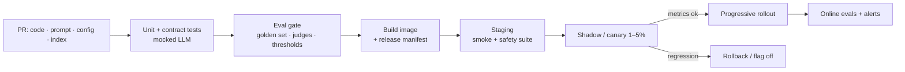

# CI/CD for AI Applications



CI/CD for AI follows the same idea as any CI/CD: run checks, build a repeatable artifact, deploy carefully, roll back when needed. The difference is that **behavior can change for reasons other than code**: **prompts, retrieval data, model settings, and safety rules**. A hosted provider may even update the model behind an alias you use in production.

Good pipelines **make these changes visible before users see them** and give the team a fast way to **pause, roll back, or limit exposure** when the release signal is unclear: repeatable builds, clear release checks, traceable artifacts, staged rollout, and a practical rollback path.

## 1. What Counts as a Release
| Change | Versioned how | Gate |
|---|---|---|
| Application code | Git SHA, image digest | Unit/integration tests + eval subset |
| Prompt / system instructions | Prompt registry id or file in repo + hash | **Eval gate** |
| Model id / params (temperature, max_tokens, reasoning effort) | Config file in repo | Full eval + canary |
| Tool schemas / descriptions | Repo | Agent eval (tool-selection accuracy) |
| Retrieval config (chunking, k, reranker, embedding model) | Pipeline version, index alias | Retrieval eval (recall@k) + answer eval |
| Knowledge base content | Index version / snapshot | Data quality checks, spot evals |
| Guardrail / safety rules | Repo | Red-team + false-positive suite |
| Provider-side model update | **Pin dated snapshots** (`claude-sonnet-5-5-YYYYMMDD`, `gpt-4.1-2025-04-14`) | Scheduled re-eval of aliases |

Rule: anything that changes behavior lives in version control (or a registry with history) and appears in a **release manifest**.

```yaml
# release.yaml — attached to every deploy and logged on every request
release: 2026-10-19.3
image: registry/app@sha256:ab12...
git_sha: 3f9c2e1
models: { answer: claude-sonnet-5-5, router: gpt-4.1-mini }
prompts: { answer: answer_v14@a91f, router: route_v6@77c0 }
retrieval: { index_alias: kb, index: kb_te3l_20261015, k: 8, reranker: rerank-v3.5 }
guardrails: policy_v9
eval_run: evals/runs/8812   # gate results
```

## 2. Pipeline Stages
| Stage | Checks | Speed |
|---|---|---|
| Lint/type/unit | Pure logic, prompt rendering, schema validation, parsers | Seconds |
| **Contract tests with a mocked LLM** | Tool-call handling, retries, error paths, streaming | Seconds; deterministic |
| Prompt snapshot tests | Rendered prompt diff for review (not model output) | Seconds |
| **Eval gate (smoke)** | 50–200 golden cases on every PR touching prompts/config | Minutes, ~$1–10 |
| **Eval gate (full)** | 500–5,000 cases + safety/red-team suite before release or nightly | Tens of minutes |
| Build + scan + sign | Image, SBOM | Minutes |
| Staging | End-to-end smoke against real providers | Minutes |
| Progressive delivery | Shadow → canary → ramp, with automated analysis | Hours–days |

Run evals **only when relevant paths change** (`prompts/**`, `config/models.yaml`, `src/retrieval/**`) to keep CI cost down; cache LLM responses keyed by (model, prompt hash, input) for unchanged cases.

## 3. What Evaluation Gates Can and Cannot Prove
| Can show | Cannot show |
|---|---|
| No regression on known cases | Behavior on inputs you didn't collect |
| Format validity, tool-call correctness, refusal rate on the set | Real user satisfaction or task success |
| Relative comparison (candidate vs. baseline) | Absolute quality (judge bias, rubric gaps) |
| Known attacks are blocked | Novel jailbreaks are blocked |

So gates are **necessary but not sufficient**; staged rollout and online monitoring cover the rest.

Gate design:
- Compare against the **current production baseline on the same set**, not a fixed number only.
- Account for **non-determinism**: run 3× or use enough cases; use confidence intervals; treat small deltas as noise.
- Per-slice thresholds (language, customer tier, intent) so a bad segment can't hide in the average.
- **Hard blockers** (any failure fails): safety violations, PII leaks, schema-invalid outputs on critical paths. **Soft metrics** (tolerance band): quality score, latency, cost.

```python
def gate(candidate, baseline, slices):
    fails = []
    if candidate.safety_violations > 0: fails.append("safety")
    if candidate.schema_valid_rate < 0.995: fails.append("schema")
    for s in slices:
        delta = candidate.score[s] - baseline.score[s]
        if delta < -max(0.02, 2 * candidate.stderr[s]): fails.append(f"quality:{s} {delta:+.3f}")
    if candidate.p95_latency > 1.2 * baseline.p95_latency: fails.append("latency")
    if candidate.cost_per_case > 1.15 * baseline.cost_per_case: fails.append("cost")
    return fails   # non-empty → block merge, post a report on the PR
```
Post the eval diff on the PR: score changes per slice, **examples that flipped** pass→fail and fail→pass, cost/latency change.

## 4. Progressive Delivery
| Technique | How | Catches |
|---|---|---|
| **Shadow** | Send a copy of live traffic to the candidate; don't show output; compare offline (judge/diff) | Quality and latency on real inputs, zero user risk (costs 2×; mind side effects; shadow must not call write tools) |
| **Canary** | 1–5% of traffic (or internal users first) | Error rate, latency, feedback, cost |
| **A/B experiment** | Randomized split with a success metric | Real product impact ([iterating in production](05-iterating-in-production.md)) |
| **Ring rollout** | Internal → beta tenants → 10% → 50% → 100% | Segment-specific breakage |
| **Feature flags** | Per prompt version, model, tool, tenant (LaunchDarkly, Unleash, OpenFeature, homegrown) | Instant off-switch without redeploy |

Automated canary analysis: compare canary vs. control on error rate, p95 latency, valid-output rate, thumbs-down rate, fallback rate, and cost per request; auto-rollback on breach (Argo Rollouts / Flagger analysis templates).

Use **sticky assignment** (hash of user id) so a user doesn't flip between versions mid-conversation.

## 5. Rollback
- Prompt/model/config changes should roll back via **flag or config**, in seconds, without a rebuild.
- Keep the previous index alive after an alias swap so retrieval can roll back too.
- Data migrations (new embedding model) are **expand → migrate → contract**: run both, switch, then remove the old.
- Rollback is a test: practice it in staging; time it.
- You can't roll back a provider's silent model update unless you pinned a snapshot; pin and re-eval new snapshots on purpose.

## 6. Prompt Management
| Option | Pros | Cons |
|---|---|---|
| Prompts as files in the repo | Code review, same release as code, simple | Non-engineers need PRs |
| Prompt registry (Langfuse, PromptLayer, Braintrust, LangSmith) | Edit without deploy, versions, playground | Out-of-band changes; must still gate and pin by version |
| Hybrid | Registry for authoring; CI exports pinned versions into the release | Extra sync step |

Whatever you choose: the app fetches a **pinned version**, never "latest", in production.

## 7. Scheduled Pipelines (additions)
- **Nightly full eval** against production config (catches provider drift and data changes).
- **Weekly red-team** run with refreshed attack sets.
- **Index rebuild pipeline** with its own retrieval gate and alias swap ([data architecture](../11-ai-system-architecture/03-data-architecture-for-ai.md)).
- **Dependency bump bots** (Renovate/Dependabot) gated by contract tests + eval smoke.

## 8. CI/CD Checklist
| Area | Check |
|---|---|
| Versioning | Prompts, models (dated snapshots), retrieval, guardrails in the release manifest |
| Tests | Mocked-LLM contract tests; prompt render snapshots |
| Evals | Smoke on relevant PRs, full before release; per-slice; hard safety blockers |
| Delivery | Shadow/canary with automated analysis; sticky assignment |
| Rollback | Flags for prompt/model; previous index retained; drill done |
| Traceability | Every request logs release id → reproducible |

## Takeaways
- Prompts, model ids, retrieval config, data, and safety rules are all releases; version them and log them per request.
- Eval gates catch regressions on known cases; they can't prove real-world quality, so stage the rollout.
- Gate on deltas vs. baseline, per slice, with hard blockers for safety and format.
- Roll back prompts/models by flag in seconds; pin provider snapshots.

## References
- Google, *Rules of ML* & *ML Test Score* (Breck et al., 2017) · Sato, Wider, Windheuser, *Continuous Delivery for Machine Learning* (martinfowler.com)
- Argo Rollouts / Flagger analysis docs · OpenFeature spec · promptfoo / Braintrust / LangSmith CI integration docs

## Related
- [Containerizing AI applications](01-containerizing-ai-applications.md) · [Iterating in production](05-iterating-in-production.md) · [The AI engineering lifecycle](06-the-ai-engineering-lifecycle.md)
- [Evaluating RAG systems](../07-rag/05-evaluating-rag-systems.md) · [Agent evaluation and testing](../10-agents/06-agent-evaluation-and-testing.md) · [Prompt templates and pipelines](../05-prompt-engineering/05-prompt-templates-and-pipelines.md)
