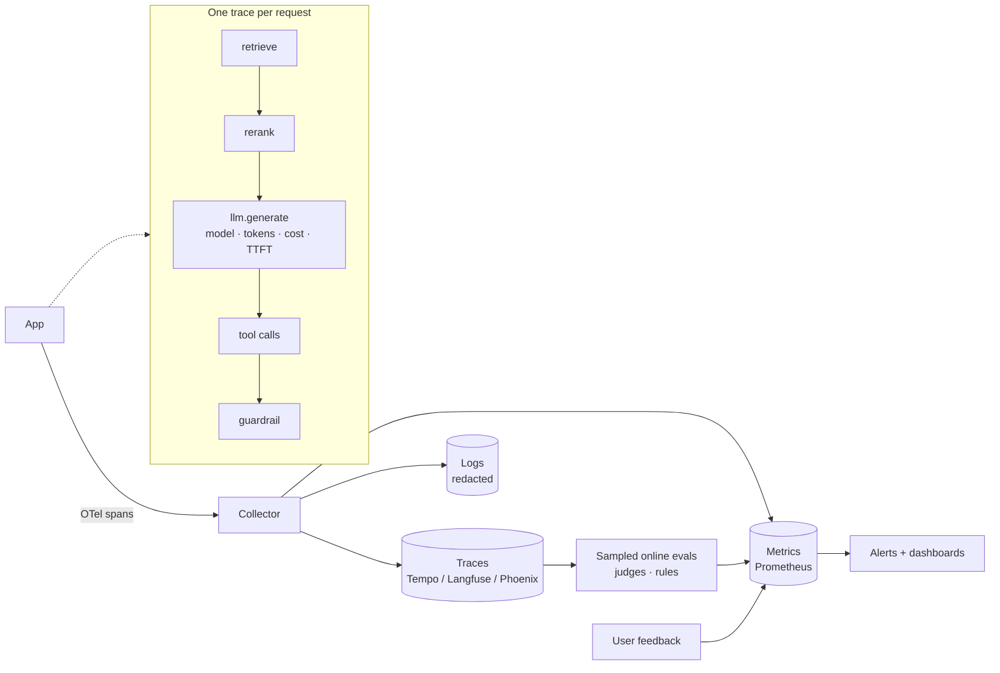

# Monitoring and Observability



An AI app can pass basic health checks and still fail. The endpoint returns success, the DB and provider are up, yet users get **stale answers, unsupported claims, malformed JSON, unsafe tool calls, or surprise costs**. **Monitoring** tells you whether the system looks healthy; **observability** helps explain what went wrong when it isn't.

AI systems need **traditional service telemetry plus AI-specific signals**: prompts, retrieved context, model configuration, token usage, tool calls, safety decisions, and sampled quality checks. This chapter covers what to capture, what to aggregate, what to alert on, and what not to log without a clear reason and permission.

## 1. Why AI Observability Is Different
| Traditional | AI-specific |
|---|---|
| Errors are exceptions/status codes | Wrong-but-200 answers are the main failure |
| Deterministic: replay reproduces | Non-deterministic: need full inputs, params, and model version to investigate |
| Latency = one number | TTFT, inter-token latency, total; varies with output length |
| Cost ≈ infra | Per-request variable cost (tokens, tools, retries) |
| Logs are small | Prompts/contexts are large and may contain PII |
| Quality = uptime | Quality needs evaluation (judges, feedback, rules) |

## 2. What to Capture per Request (the Trace)
| Span / field | Capture |
|---|---|
| Request | request id, user/tenant id (pseudonymous), feature, **release id** (prompt/model/index versions), channel |
| Retrieval | query (rewritten), filters, index version, doc ids + scores, latency, result count |
| LLM call | provider, model (exact snapshot), params, input/output/cached tokens, **cost**, TTFT, total latency, stop_reason, retry/fallback count |
| Prompt & output | Rendered prompt + output (or hash + pointer to secured store, per policy) |
| Tools | name, args (redacted), result status, latency, side-effect id |
| Guardrails | which checks ran, decision, scores, what was blocked/redacted |
| Agent | step count, loop exits (final / cap / error), total tokens |
| Outcome | validation pass/fail, user feedback, downstream action (copied, accepted, escalated) |

Use **OpenTelemetry GenAI semantic conventions** (`gen_ai.request.model`, `gen_ai.usage.input_tokens`, `gen_ai.response.finish_reasons`, ...) so traces work across backends.

```python
from opentelemetry import trace
tracer = trace.get_tracer("rag")

async def answer(q, user):
    with tracer.start_as_current_span("rag.answer", attributes={"app.release": RELEASE, "app.tenant": user.tenant}):
        with tracer.start_as_current_span("retrieve") as s:
            docs = await retrieve(q, user)
            s.set_attributes({"retrieval.k": len(docs), "retrieval.top_score": docs[0].score if docs else 0,
                              "retrieval.doc_ids": [d.id for d in docs][:20]})
        with tracer.start_as_current_span("chat claude-sonnet-5-5") as s:
            s.set_attribute("gen_ai.request.model", "claude-sonnet-5-5")
            r = await llm.create(model="claude-sonnet-5-5", messages=build(q, docs), max_tokens=800)
            s.set_attributes({"gen_ai.usage.input_tokens": r.usage.input_tokens,
                              "gen_ai.usage.output_tokens": r.usage.output_tokens,
                              "gen_ai.response.finish_reasons": [r.stop_reason],
                              "app.cost_usd": price(r.usage)})
        return r
```
Tooling: Langfuse, Arize Phoenix, LangSmith, Braintrust, Helicone, Datadog LLM Observability, OpenLLMetry/Traceloop, plus standard Grafana/Prometheus/Tempo.

## 3. What to Aggregate (Metrics)
| Category | Metrics |
|---|---|
| **Traffic & errors** | RPS, error rate by type (provider 429/5xx, timeout, validation, guardrail block) |
| **Latency** | TTFT p50/p95/p99, total latency, per-stage latency (retrieve, rerank, generate, tools) |
| **Tokens & cost** | Tokens in/out/cached per request; **$ per request, per feature, per tenant, per successful task**; cache hit ratio |
| **Reliability** | Retry rate, fallback rate, circuit-breaker state, truncation (`max_tokens`) rate |
| **Output health** | Schema-valid rate, refusal rate, empty/"I don't know" rate, avg output length |
| **Retrieval** | No-result rate, top-score distribution, index freshness lag |
| **Quality (sampled)** | Judge scores (groundedness, relevance, helpfulness), rule-check pass rate |
| **User signals** | Thumbs-down rate, regenerate rate, edit rate, escalation-to-human rate, abandonment |
| **Agents** | Steps per task, cap-hit rate, tool error rate, task success rate |
| **Safety** | Injection detections, PII redactions, blocked outputs, policy violations found in sampling |

Slice everything by **release id, model, feature, tenant tier, language**; regressions hide in averages.

## 4. Online Evaluation
- Sample production traffic (e.g., 1–5%, plus 100% of thumbs-down and flagged traces).
- Run cheap **rule checks** on 100% (schema, citation presence, banned phrases, PII patterns).
- Run **LLM judges** on the sample (groundedness against retrieved context, answer relevance, policy compliance).
- Route low scores to a **review queue**; reviewed traces feed the eval set ([iterating in production](05-iterating-in-production.md)).
- Calibrate judges against human labels periodically; track judge agreement.

## 5. What to Alert On
| Alert | Example condition | Severity |
|---|---|---|
| Error rate | > 2% for 5 min | Page |
| Provider fallback rate | > 10% for 10 min | Page if sustained |
| TTFT p95 | > 2× baseline for 10 min | Ticket/page |
| Schema-valid rate | < 99% on a critical path | Page |
| **Cost burn** | $/hour > 2× forecast; any tenant > daily budget | Page (could be a loop or leaked key) |
| Refusal rate | Jumps > 3× after a release | Ticket (possible prompt/model regression) |
| Judge groundedness | Rolling mean drops > 5 pts | Ticket |
| Thumbs-down rate | > 2× baseline for a release | Ticket |
| Index freshness | Lag > SLO | Ticket |
| Agent cap-hit rate | > 5% | Ticket |

Prefer **SLO burn-rate alerts** (multi-window) over raw thresholds to cut noise. Annotate dashboards with release events so changes line up with metric shifts.

## 6. What Not to Log (Without Reason and Permission)
| Data | Default |
|---|---|
| Raw prompts/outputs with user content | Retain only if consented/contracted; short retention; restricted access; redact PII before storage |
| Secrets, tokens, credentials in tool args | Never; scrub at the SDK layer |
| Regulated data (health, financial, children's) | Don't log raw; hash or tokenize; follow HIPAA/GDPR/DPDP |
| Full retrieved documents | Log doc ids + versions, not text (you can re-fetch) |
| Biometric/audio/images | Pointer to secured store with retention policy, if at all |

Practical setup: **metadata always**, **content sampled and redacted**, **full content only in a restricted store** with access audit and TTL (e.g., 30 days), and honor deletion requests across logs and eval datasets. Provider zero-data-retention settings don't cover your own logs.

## 7. Dashboards (additions)
| Dashboard | Panels |
|---|---|
| Service health | RPS, errors by type, TTFT/total p95, fallback rate, breaker state |
| Cost | $/hour, $/request by feature and model, top tenants, cache savings, forecast vs. budget |
| Quality | Judge scores by release, thumbs-down rate, refusal rate, validation failures, top failing intents |
| Retrieval | No-result rate, score distributions, freshness lag per source |
| Agents | Steps/task histogram, cap-hit rate, tool error heatmap |

## 8. Debugging Workflow
1. Start from the symptom (user report, alert) → find the **trace by request id**.
2. Check the release id: did prompt/model/index change recently?
3. Inspect retrieval: right docs? right tenant? fresh?
4. Inspect the prompt as rendered: context order, truncation, instructions.
5. Inspect the output: stop_reason, validation errors, guardrail decisions.
6. **Replay** with the same inputs and params against the current and previous release.
7. Add the case to the eval set before fixing.

## Takeaways
- 200 OK isn't success; capture AI-specific signals and sampled quality checks.
- One trace per request with release id, retrieval, model call (tokens, cost, TTFT), tools, and guardrails.
- Aggregate by release/model/feature/tenant; alert on cost burn, fallback rate, validity, and quality drops.
- Log metadata always; content sampled, redacted, access-controlled, and time-limited.

## References
- OpenTelemetry Semantic Conventions for Generative AI · Google SRE Workbook, *Alerting on SLOs*
- Langfuse / Arize Phoenix / LangSmith docs · Hamel Husain, *Your AI product needs evals*

## Related
- [Handling production incidents](04-handling-production-incidents.md) · [Iterating in production](05-iterating-in-production.md) · [CI/CD for AI applications](02-ci-cd-for-ai-applications.md)
- [Designing for reliability](../11-ai-system-architecture/02-designing-for-reliability.md) · [Agent reliability and debugging](../10-agents/05-agent-reliability-and-debugging.md)
