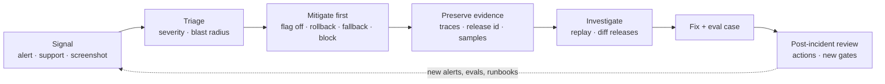

# Handling Production Incidents



An incident isn't necessarily a sign the team failed. Usually the system met a **real-world condition it wasn't designed for**. AI incidents are often **subtler** than outages: quality degrades, retrieval goes stale, the model refuses valid requests, or a prompt change breaks one customer segment, **all while the app stays up**. The first signal often comes from **support, sales, trust and safety, or a customer screenshot**, not a dashboard.

The order matters: **reduce exposure, preserve evidence, then investigate**. Don't spend 20 minutes debating root cause while bad outputs keep reaching users. This lesson covers runbooks, feature flags, rollback paths, sampling workflows, and post-incident reviews.

## 1. Common AI Production Incidents
| Incident | Typical trigger | First signal | First mitigation |
|---|---|---|---|
| **Quality regression** | Prompt/model change, provider silent update | Thumbs-down spike, support tickets | Roll back prompt/model flag; pin snapshot |
| **Hallucinated policy/price/promise** | Missing retrieval, weak grounding instruction | Customer screenshot, legal | Disable feature for the affected intent; add a refusal rule |
| **Stale or wrong retrieval** | Ingestion job failed, bad index swap | Freshness alert, "outdated" complaints | Swap index alias back; rerun ingestion |
| **Cross-tenant data leak** | Missing ACL filter, cache key bug | Customer report, security review | **Kill feature**; purge caches; security incident process |
| **Over-refusal** | Safety rule or model update | Refusal rate jump | Roll back guardrail version |
| **Prompt injection exploited** | Malicious doc/email/web page | Abnormal tool calls, T&S report | Disable the tool / require approval; quarantine source |
| **Unsafe/brand-damaging output** | Jailbreak, edge input | Social media, T&S | Tighten output filter; block the pattern; consider pausing |
| **Agent runaway** | Loop, tool error retries | Cost spike, cap-hit rate | Lower step caps; disable agent mode |
| **Cost explosion** | Leaked key, loop, traffic abuse, prompt bloat | Spend alert | Revoke key; per-tenant hard cap; shed abusive traffic |
| **Provider outage / 429 storm** | Upstream | Error/fallback rate | Fail over model/region; degrade features |
| **Malformed output** | Model/format change | Validation failure rate | Repair/retry path; roll back; switch to strict structured output |
| **Latency degradation** | Prompt growth, cache miss, provider slowness | TTFT alert | Restore prompt cache layout; route to faster model |

## 2. Severity
| Sev | Definition (AI examples) | Response |
|---|---|---|
| **SEV1** | Data leak, safety harm, legally risky promises at scale, full outage | Page now, incident commander, exec + legal/T&S comms, kill switch allowed without debate |
| **SEV2** | Major quality regression for many users, key feature down, cost runaway | Page on-call, mitigate within an hour |
| **SEV3** | Degraded segment, elevated refusals, slow responses | Business hours, ticket |
| **SEV4** | Isolated bad outputs | Add to eval backlog |

Escalate on **blast radius × reversibility**: one wrong answer in a chat is SEV4; the same wrong answer emailed to 10K customers by an agent is SEV1.

## 3. Mitigation Levers (Build Them Before You Need Them)
| Lever | Scope | Time to effect |
|---|---|---|
| **Kill switch per feature** | Disable AI feature, show fallback UX | Seconds |
| Prompt/model/guardrail version flag | Roll back to last-known-good | Seconds |
| Per-tenant / per-segment flags | Isolate affected customers | Seconds |
| Tool disable / require approval | Stop side effects | Seconds |
| Index alias swap | Restore previous knowledge base | Seconds–minutes |
| Model failover | Different provider/region | Seconds (via gateway) |
| Rate/spend caps | Stop cost bleeding | Seconds |
| Block patterns | Input/output filter rules | Minutes |
| Cache purge | Remove bad cached answers | Minutes |
| Image rollback | Code issues | Minutes |

```python
# Flags are evaluated per request, so rollback needs no deploy.
cfg = flags.get("support_answer", user=user)   # {"enabled": True, "prompt": "answer_v13", "model": "claude-sonnet-5-5",
if not cfg["enabled"]:                         #  "tools": ["search_kb"], "require_approval": ["issue_refund"]}
    return fallback_response(user)             # static help article + "talk to an agent"
```
Test levers regularly (game days): an untested kill switch is a guess.

## 4. Preserve Evidence
Before you change anything you can't recover (purging logs, rebuilding indexes):
- Record **release ids** active during the incident window (prompt, model, index, guardrail versions).
- Export affected **traces** (request ids from screenshots/tickets → traces).
- Snapshot the bad index/cache entries before purging.
- Save provider response ids and headers (useful for provider support tickets).
- Freeze the timeline in the incident channel: what was seen, when, what was changed.

Provider zero-retention settings and short log TTLs can erase evidence; extend retention for the incident's traces where policy allows.

## 5. Investigate
1. **Scope**: which features, tenants, languages, intents? Query traces by release id and time.
2. **Diff releases**: what changed in the window (prompt, model snapshot, data ingest, dependency)? Check the provider status page and changelog.
3. **Sample**: pull 50–100 affected traces; label failure modes quickly (spreadsheet is fine).
4. **Replay**: rerun inputs against last-known-good and current release; does the old release fix it?
5. **Isolate the stage**: retrieval wrong → data/index; retrieval right but answer wrong → prompt/model; answer right but displayed wrong → app.
6. **Reproduce minimally** and turn it into eval cases.

```python
def replay(trace_ids, releases):
    rows = []
    for tid in trace_ids:
        t = traces.get(tid)
        for rel in releases:
            out = run_pipeline(t.input, release=rel, tools="dry_run")   # never re-execute side effects
            rows.append({"trace": tid, "release": rel, "pass": judge(t.input, out, t.expected)})
    return pd.DataFrame(rows).pivot(index="trace", columns="release", values="pass")
```

## 6. Runbook Template
```markdown
# Runbook: <feature> quality regression
Detect: thumbs-down rate > 2× baseline 30 min; judge groundedness drop > 5 pts
Triage: dashboard <link>; slice by release/tenant/intent
Mitigate: 1) flag support_answer.prompt → last-known-good  2) if tenant-specific, disable for tenant
          3) if retrieval stale, swap alias kb → previous
Evidence: export traces (query <link>), note release ids
Escalate: SEV1 if PII/safety/legal → security + legal on-call
Comms: status page template <link>; support macro <link>
Owner: <team>  Last drilled: <date>
```

## 7. Communication
- One incident channel, one incident commander, one scribe.
- Internal updates on a fixed cadence (every 30 min for SEV1/2).
- Give support a macro: what to tell customers, what workaround exists.
- External: status page for outages; direct notification for data exposure (may be legally required: GDPR 72-hour breach notification, contractual DPAs).
- Don't promise the root cause before you know it.

## 8. Post-Incident Review (Blameless)
| Section | Content |
|---|---|
| Summary | What users saw, duration, blast radius |
| Timeline | Detection → mitigation → resolution, with timestamps |
| Detection gap | How did we find out? How could we have found out sooner? |
| Root cause(s) | Technical + process (e.g., "prompt change bypassed eval gate") |
| What went well / poorly | Levers that worked; missing levers |
| Actions | New eval cases, alert, gate, runbook step, flag; each with owner + date |

AI-specific action types: **add failing cases to the golden set**, add a slice to the eval gate, add an online check, pin a model snapshot, add a tool approval, tighten a cache key.

## 9. Preparedness Checklist (additions)
| Item | Done when |
|---|---|
| Kill switch per AI feature | Tested in prod within the last quarter |
| Version flags for prompt/model/guardrails | Rollback < 1 min |
| Previous index retained | Alias swap documented |
| Trace lookup by request id | Support can give ids (show them in the UI or error page) |
| Spend caps | Per tenant and global |
| Runbooks | For top 5 incident types, drilled |
| On-call knows the AI stack | Has dashboard + replay access |
| Comms templates | Status page, support macro, breach notice |

## Takeaways
- AI incidents are often silent quality failures while the service looks healthy; expect reports from humans first.
- Mitigate first (flags, rollback, kill switch), preserve evidence, then investigate.
- Severity scales with blast radius and reversibility, especially for agent side effects.
- Every incident ends with new eval cases, alerts, or gates, so the same failure gets caught earlier next time.

## References
- Google SRE Book, *Managing Incidents* and *Postmortem Culture* · PagerDuty Incident Response docs
- AI Incident Database (incidentdatabase.ai) · OWASP Top 10 for LLM Applications · NIST AI RMF (Manage function)

## Related
- [Monitoring and observability](03-monitoring-and-observability.md) · [CI/CD for AI applications](02-ci-cd-for-ai-applications.md) · [Iterating in production](05-iterating-in-production.md)
- [Designing for reliability](../11-ai-system-architecture/02-designing-for-reliability.md) · [Production MCP server patterns](../09-mcp/04-production-mcp-server-patterns.md) · [Agent sandboxing and security](../14-agentic-ai/06-agent-sandboxing-and-security.md)
