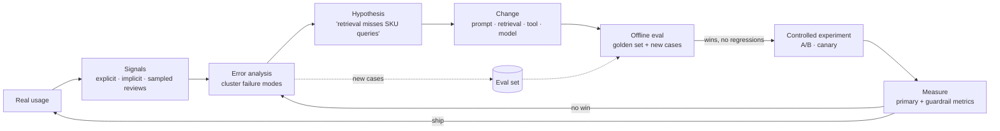

# Iterating in Production



Launch is where learning starts. Real users find cases the team didn't think of: **unexpected formats, different vocabulary, messy data, language switching, unclear tool behavior, and gaps in the eval set**. The goal is to improve from real usage **without running careless experiments on users**.

The loop: **collect signals responsibly → turn them into hypotheses → test against offline evals → release through controlled experiments → measure whether the change actually helped**.

## 1. Collecting Feedback That Engineers Can Use
| Signal | Examples | Strength | Weakness |
|---|---|---|---|
| **Explicit** | Thumbs up/down, ratings, "report", free-text comments | Direct | Sparse (often < 1–5% of sessions), skews negative, vague |
| **Implicit** | Copy, accept suggestion, edit distance of accepted draft, regenerate, abandon, follow-up rephrase, escalate to human, time-to-resolution | High volume | Ambiguous (copy ≠ correct; short session ≠ failure) |
| **Outcome** | Ticket resolved without reopen, PR merged, refund not reversed, conversion | Ties to value | Delayed, confounded |
| **Sampled review** | Expert labels on traces | Accurate | Expensive, slow |
| **Online judges/rules** | Groundedness, schema, policy | Scalable | Judge bias; needs calibration |

Make feedback **actionable**: attach it to the trace id + release id; ask for a reason on thumbs-down (chips: "wrong", "outdated", "didn't follow instructions", "unsafe", "too long"); let reviewers label a failure category, not just a score.

```python
@app.post("/feedback")
async def feedback(f: Feedback, user=Depends(auth)):
    await db.insert("feedback", {
        "trace_id": f.trace_id, "release": lookup_release(f.trace_id), "user": user.pseudonymous_id,
        "rating": f.rating, "reasons": f.reasons, "comment": redact(f.comment)[:2000],
        "consent_to_review": f.consent,   # gate human review of the content on this
    })
    if f.rating < 0:
        await review_queue.add(f.trace_id, priority="high" if "unsafe" in f.reasons else "normal")
```

## 2. Error Analysis (the Highest-Leverage Habit)
1. Pull a sample of 50–200 traces (weight toward negatives, but include random ones).
2. Read them. Write a short note on what went wrong in each (open coding).
3. Group notes into **failure modes** (axial coding): "missed table content in PDFs", "answered from general knowledge instead of docs", "wrong tool for date questions".
4. Count frequency × severity per mode; pick the top 1–3.
5. For each, write eval cases that reproduce it, then a hypothesis for the fix.

| Failure mode | Count /200 | Severity | Likely stage | Hypothesis |
|---|---|---|---|---|
| Ignores product-version filter | 31 | High | Retrieval | Add version extraction to query rewriting |
| Over-long answers | 27 | Low | Prompt | Add length guidance + examples |
| Wrong language reply | 9 | Med | Prompt | Instruct "reply in the user's language"; test |
| Hallucinated SKU | 6 | High | Generation | Require citation of SKU from tool result |

Tip: build a lightweight internal trace viewer with one-click labeling; review time is the bottleneck, so make it fast.

## 3. Forming Hypotheses
A good hypothesis names **stage, change, expected effect, and metric**:
> "For product-spec questions, adding product-version extraction before retrieval will raise recall@5 from 0.71 → 0.85 on the 'version' slice and reduce thumbs-down on that intent by 30%, without hurting other slices."

Fix the cheapest stage first: data/ingestion bug < retrieval config < prompt < tool design < model change < fine-tuning.

## 4. Offline Before Online
- Add the new failure cases to the eval set **before** fixing (so the fix is measured, and regressions are caught forever).
- Run candidate vs. production on the full set + the target slice.
- Look at **flips** both ways; a fix that breaks 5 other cases may not be a win.
- Keep a **held-out** portion of production-derived cases you never tune against, to detect overfitting the eval set.

## 5. Controlled Experiments
| Design choice | Guidance |
|---|---|
| Unit of randomization | User (sticky) for conversational products; session or request for stateless tools |
| Primary metric | One, tied to value: task success, resolution rate, acceptance rate |
| **Guardrail metrics** | Latency p95, cost/request, refusal rate, safety flags, complaint rate: must not regress |
| Sample size | Power analysis; small effects on noisy metrics need many users |
| Duration | Cover weekly cycles; beware novelty effects |
| Exposure | Start with 5–10%; internal/beta first for risky changes |
| Stopping | Pre-register; avoid peeking without sequential methods |

```python
from statsmodels.stats.proportion import proportions_ztest
# primary: resolution without escalation
stat, p = proportions_ztest([treat_resolved, ctrl_resolved], [treat_n, ctrl_n])
lift = treat_resolved / treat_n - ctrl_resolved / ctrl_n
ship = p < 0.05 and lift > 0 and guardrails_ok(treat, ctrl)   # cost, latency, safety within bands
```
AI-specific pitfalls:
- **Non-stationarity**: provider updates mid-experiment; pin snapshots for both arms.
- **Contamination**: shared caches across arms (key caches on arm/release).
- **Proxy hacking**: longer answers raise thumbs-up but lower resolution; watch the primary metric.
- **Interference**: agents acting on shared resources (inventory, queues) affect both arms.
- When traffic is low, use **interleaving** (for ranking/retrieval) or paired offline judge comparisons instead.

## 6. The Data Flywheel
| Asset | Grows from | Used for |
|---|---|---|
| Golden eval set | Reviewed production failures + edge cases | Regression gates |
| Preference pairs | Regenerate choices, edited drafts vs. originals | Judge calibration, DPO/fine-tuning |
| Query logs | Real vocabulary | Query rewriting, synonyms, retrieval tuning |
| Unanswered questions | No-result / "I don't know" | Content gaps → docs team |
| Tool error logs | Agent traces | Better tool descriptions and schemas |

Privacy: only reuse content with consent/contract terms; strip PII; honor deletion; separate eval data access.

## 7. Content and Product Gaps (additions)
Many "AI failures" are **content failures**: the answer isn't in the knowledge base. Report weekly top unanswered intents to the doc owners. Track **coverage** (share of queries with a high-score retrieved source) alongside quality.

## 8. Iteration Cadence (additions)
| Cadence | Activity |
|---|---|
| Daily | Triage review queue; check dashboards by release |
| Weekly | Error analysis session (1 h, whole team reads traces); pick top failure modes |
| Per change | Offline eval → canary/A/B → ship or revert |
| Monthly | Refresh eval set from production; recalibrate judges; review cost per success |
| Quarterly | Re-evaluate model choice against new releases; retire dead features |

## Takeaways
- Launch starts learning: real usage surfaces vocabulary, formats, and failures no eval set had.
- Capture explicit, implicit, and outcome signals tied to trace + release ids; read traces regularly.
- Error analysis → named failure modes → hypotheses → eval cases → offline win → controlled experiment.
- Always pair the primary metric with guardrail metrics (cost, latency, safety) and pin model versions during experiments.

## References
- Hamel Husain & Shreya Shankar, *A Field Guide to Rapidly Improving AI Products* / error-analysis writing · Shankar et al., *Who Validates the Validators?* (2024)
- Kohavi, Tang, Xu, *Trustworthy Online Controlled Experiments* (2020) · Chip Huyen, *AI Engineering* (2025), ch. on feedback

## Related
- [Monitoring and observability](03-monitoring-and-observability.md) · [CI/CD for AI applications](02-ci-cd-for-ai-applications.md) · [The AI engineering lifecycle](06-the-ai-engineering-lifecycle.md)
- [Evaluating RAG systems](../07-rag/05-evaluating-rag-systems.md) · [Building AI-powered UX](../11-ai-system-architecture/06-building-ai-powered-ux.md)
