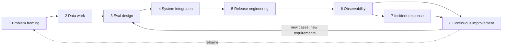

# The AI Engineering Lifecycle



AI engineering is the work of **turning model behavior into a product system that can be tested, deployed, monitored, improved, and trusted within clear limits**. A demo shows that a model *can* do something; a product shows it does it reliably enough, safely enough, and cheaply enough for real users.

The lifecycle has eight stages: **problem framing, data work, eval design, system integration, release engineering, observability, incident response, and continuous improvement**. Each stage **produces artifacts the next stage depends on**. This chapter closes the Production section by connecting them.

## 1. The Lifecycle at a Glance
| # | Stage | Key question | Output artifact | Feeds |
|---|---|---|---|---|
| 1 | **Problem framing** | Should AI do this, and what does "good" mean? | Problem brief: users, task, success metric, risk tier, constraints, non-goals | Everything |
| 2 | **Data work** | What knowledge, examples, and permissions exist? | Source inventory, ingestion pipeline, ACL model, sample set | Evals, retrieval |
| 3 | **Eval design** | How will we know it works? | Golden set, rubrics, judges, thresholds per slice | Integration, gates |
| 4 | **System integration** | What architecture meets the bar? | Prompts, retrieval, tools, guardrails, model choice, fallbacks | Release |
| 5 | **Release engineering** | How do changes reach users safely? | Release manifest, CI eval gate, flags, rollout plan, rollback | Production |
| 6 | **Observability** | Is it working right now? | Traces, metrics, dashboards, alerts, online evals | Incidents, improvement |
| 7 | **Incident response** | What do we do when it fails? | Runbooks, kill switches, postmortems | Evals, gates |
| 8 | **Continuous improvement** | What should we fix next? | Error analyses, experiments, refreshed eval set | Back to 3 (and 1) |

## 2. Stage 1: Problem Framing
| Question | Why it matters |
|---|---|
| Is the task tolerant of occasional errors? | Decides automation vs. assistance vs. no AI |
| What's the baseline (human, rules, search)? | You need something to beat |
| What does one failure cost? | Sets the risk tier, review requirements, guardrails |
| What's the cost/latency budget per task? | Constrains model choice and architecture |
| Who's accountable for outputs? | Ownership for incidents and policy |

Autonomy ladder: **suggest → draft for review → act with approval → act and report → fully autonomous**. Start one rung lower than you think, and climb with evidence.

Kill criteria: write down what result would make you stop (e.g., "if task success < 70% after 6 weeks, revert to search UX").

## 3. Stage 2: Data Work
- Inventory sources, owners, freshness, formats, and **permissions** (who may see what).
- Collect **real examples** of inputs early (support tickets, documents, queries): they become eval cases.
- Decide retention, PII handling, and consent before ingesting anything.
- Output: ingestion pipeline with versioned indexes ([data architecture](../11-ai-system-architecture/03-data-architecture-for-ai.md)).

## 4. Stage 3: Eval Design (Before Building)
- 50–200 cases to start, covering common intents, edge cases, adversarial inputs, and "should refuse/escalate" cases.
- Per-criterion rubrics (correct, grounded, format, tone, safety) rather than one vague score.
- Code checks where possible; LLM judges calibrated against human labels where not.
- Thresholds per slice, and hard blockers for safety.
- This is the spec. If you can't write the evals, the problem isn't framed yet.

## 5. Stage 4: System Integration
Pick the **simplest architecture that passes the evals** ([architecture patterns](../11-ai-system-architecture/01-architecture-patterns-for-ai-applications.md)):
single call → + retrieval → + tools → workflow → agent. Decide model per step on quality/cost/latency ([model selection](../13-llm-optimization/03-model-selection-and-routing.md)), add guardrails and fallbacks ([reliability](../11-ai-system-architecture/02-designing-for-reliability.md)).

## 6. Stages 5–8 in One Line Each
| Stage | Core practice | Lesson |
|---|---|---|
| Release engineering | Everything versioned; eval gates; staged rollout; flag rollback | [CI/CD](02-ci-cd-for-ai-applications.md) |
| Observability | One trace per request with release id; quality sampling; cost per success | [Monitoring](03-monitoring-and-observability.md) |
| Incident response | Mitigate → preserve evidence → investigate → add evals | [Incidents](04-handling-production-incidents.md) |
| Continuous improvement | Error analysis → hypothesis → offline → experiment | [Iterating](05-iterating-in-production.md) |

## 7. How Artifacts Connect
```
problem brief ──► eval rubric & thresholds ──► CI gate config
source inventory ──► ingestion pipeline ──► index version ──► release manifest
golden set ◄── production failures (review queue, incidents)
release manifest ──► every trace ──► dashboards sliced by release ──► rollback decisions
postmortem actions ──► new eval cases + alerts + runbook steps
```
If any arrow is missing (e.g., incidents don't create eval cases), the same failures repeat.

## 8. Maturity Levels (additions)
| Level | Characteristics |
|---|---|
| **0 Demo** | Notebook, vibe checks, hardcoded key |
| **1 Prototype in prod** | Deployed, basic logging, no evals, manual prompt edits |
| **2 Managed** | Golden set, prompts versioned, traces with cost, manual rollout |
| **3 Gated** | CI eval gates, release manifests, flags, canaries, alerts on quality and cost |
| **4 Improving** | Weekly error analysis, A/B testing, production-fed eval set, runbooks drilled |
| **5 Optimized** | Per-step model routing, cost per success tracked and reduced, automated online evals, governance reporting |

## 9. Roles and Ownership (additions)
| Responsibility | Typical owner |
|---|---|
| Problem brief, success metric | PM + domain expert |
| Eval set and rubrics | AI engineer + domain expert (labels) |
| Prompts, retrieval, tools | AI engineer |
| Ingestion, ACLs | Data/platform engineer |
| Gateway, limits, deploy | Platform / SRE |
| Safety policy, red-teaming | Trust & safety / security |
| Compliance (EU AI Act risk tier, DPIA) | Legal / governance |

## 10. Governance Touchpoints (additions)
- **Risk classification** at framing (e.g., EU AI Act tiers; NIST AI RMF Map function).
- **Model and system cards** describing intended use, limits, eval results.
- **Data protection impact assessment** when personal data is involved.
- **Audit trail**: release manifests + traces show what the system did and why.
- **Human oversight** design proportional to risk (approval gates, escalation paths).

## Takeaways
- AI engineering turns model behavior into a testable, deployable, observable, improvable product.
- Eight stages, each producing an artifact the next needs: brief → data → evals → system → release → observability → incidents → improvement.
- Write evals before building; choose the simplest architecture that passes them.
- Close the loop: production failures and incidents must become eval cases and gates.

## References
- Chip Huyen, *AI Engineering* (O'Reilly, 2025) · Google, *Rules of Machine Learning* · Sculley et al., *Hidden Technical Debt in ML Systems* (2015)
- NIST AI Risk Management Framework 1.0 · EU AI Act (Regulation (EU) 2024/1689) · Anthropic, *Building effective agents* (2024)

## Related
- [Iterating in production](05-iterating-in-production.md) · [CI/CD for AI applications](02-ci-cd-for-ai-applications.md) · [Monitoring and observability](03-monitoring-and-observability.md)
- [Architecture patterns](../11-ai-system-architecture/01-architecture-patterns-for-ai-applications.md) · [Understanding AI application costs](../13-llm-optimization/01-understanding-ai-application-costs.md)
