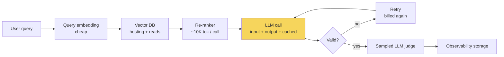

# Understanding AI Application Costs



The cost of an AI application is **not** the main LLM call. It is inference **plus embeddings, retrieval, re-ranking, evaluation, retries, storage, observability, and idle GPU capacity** between traffic spikes. Optimizing only the main call often leaves most of the bill unchanged. RAG and agent systems can spend much of their budget on **context assembly, repeated tool calls, validation retries, and background evaluation**.

The aim is to make cost decisions from **measured spend**, not surprise invoices.

## 1. How Token Pricing Works
| Component | What it includes | Pricing note |
|---|---|---|
| **Input tokens** | System prompt, user message, retrieved docs, **tool definitions**, conversation history | Base rate |
| **Output tokens** | Generated response | Typically **several times** the input rate (generation is sequential) |
| **Cached input** | Repeated prompt prefix | Discounted (often ~10% of base for reads; writes may cost extra) |
| **Reasoning tokens** | Thinking / reasoning effort | Billed as output-like tokens, sometimes separately |
| **Multimodal / extras** | Images, audio, web search grounding, code execution, regional processing | Own rates; text-only estimates will be wrong |

A **mostly cacheable 6,000-token prompt can cost less than a 3,000-token prompt whose start changes every request**. Prefix layout is a cost decision.

Prices change often: **keep prices in versioned config**, check provider pricing pages, think in tiers.

### Model tiers
| Tier | Typical role | Cost pattern |
|---|---|---|
| Frontier / reasoning | Hard reasoning, coding, agents, high-risk answers | Highest input + output |
| Mid-tier | General features, short analysis, chat | Good default |
| Small / nano | Classification, extraction, rewriting, routing, query cleanup | Low cost, narrower reliability |
| Embedding | Query + document vectors | Much cheaper than generation |
| Hosted open-weight | High-volume specialized tasks | Depends on host + hardware |

Also check: **batch discounts** (often ~50%), cached-input discounts, **long-context surcharges**, web-search charges, data-residency multipliers, dedicated/provisioned capacity.

Patterns:
- Route classification, extraction, short summaries, control decisions to cheaper models when quality allows.
- **Output tokens dominate** many bills, especially verbose responses.
- Caching + batch APIs change the economics of long, repetitive prompts.
- In RAG, most input comes from **retrieved context and history**, not the question: a 15-token question can trigger 6,000 input tokens.

## 2. The Hidden Costs
### Embedding generation
- Query embedding per request: cheap.
- **Indexing** is the big one: 100,000 chunks × 500 tokens ≈ **50M tokens**.
- Reopened by document updates, chunking changes, and **embedding-model migrations** (full re-embed).

| Embedding tier | Cost | Use |
|---|---|---|
| Small | Lowest | General search, support docs, FAQs |
| Large | Higher | Better recall on hard retrieval |
| Domain-focused | Varies | Code, multilingual, legal, biomedical |
| Self-hosted | Infra | High volume, strict data control |

### Re-ranking
- An extra model call on the hot path; cross-encoders score query + candidate jointly (better relevance, more latency and spend).
- Priced per search, per token, or per request unit.
- top-k 20 × 500-token chunks ≈ **10K tokens per re-rank**.

### Evaluation
- LLM-as-judge on **every** response ≈ a **second inference pipeline**.
- **Sample** production (1–5%) for monitoring; full evaluation for releases, regression, high-risk flows.

### Retries and fallbacks
- API errors, 429s, **structured outputs failing validation**: every retry is billed.
- Validation retries often hide inside helper libraries (instructor-style re-asks).
- 5% retry rate ≈ +5% spend on that path (if similar size); poorly constrained JSON extraction can be far worse.

### Vector database hosting
- Managed: capacity, replicas, pods, serverless read/write units.
- Self-hosted (Qdrant, Weaviate, Milvus, pgvector): compute, storage, backups, ops.
- Negligible when small; significant at **tens of millions of vectors with regional replicas**.

### The full picture
| Component | $/query |
|---|---|
| LLM call | 0.010 |
| Embedding + vector reads | 0.001 |
| Re-ranking | 0.003 |
| Sampled judge | 0.002 |
| Retries | 0.001 |
| Vector DB + observability (amortized) | 0.003 |
| **Total** | **0.020** |

The untracked $0.010 per query at 10,000 queries/day ≈ **$3,000/month**.

## 3. Building Cost Tracking into the Application
Every model call logs usage + cost, tagged with metadata, so you can answer "which feature is most expensive?" and "which users cost the most?".

```python
import json, time, hashlib
from dataclasses import dataclass, asdict

PRICES = load_yaml("pricing/2026-10.yaml")   # versioned, outside the code path
# {"claude-sonnet-5-5": {"in": 3.0, "out": 15.0, "cached_in": 0.30}, ...}  # $ per 1M tokens

@dataclass
class CostEvent:
    ts: float; feature: str; user: str; model: str
    input_tokens: int; cached_input_tokens: int; output_tokens: int
    cost_usd: float; latency_ms: int; is_retry: bool; price_sheet: str

def cost(model, u):
    p = PRICES[model]
    uncached = u.input_tokens - u.cached_input_tokens
    return (uncached * p["in"] + u.cached_input_tokens * p["cached_in"] + u.output_tokens * p["out"]) / 1e6

async def tracked_call(feature, user_id, model, is_retry=False, **kw):
    t0 = time.perf_counter()
    r = await llm.create(model=model, **kw)
    ev = CostEvent(time.time(), feature, hashlib.sha256(user_id.encode()).hexdigest()[:16], model,
                   r.usage.input_tokens, r.usage.cached_input_tokens, r.usage.output_tokens,
                   cost(model, r.usage), int((time.perf_counter() - t0) * 1000), is_retry, PRICES["_version"])
    emit(json.dumps(asdict(ev)))   # JSONL locally; metrics pipeline / warehouse in prod
    return r
```

| Field | Why |
|---|---|
| `feature` | Which product surface generated the cost |
| `user` (pseudonymized) | Heavy use or abuse |
| `cached_input_tokens` | Is prompt caching actually working? |
| `is_retry` | Spend on recovery logic |
| `price_sheet` | Which prices applied during a billing investigation |

## 4. Building a Cost Dashboard
Questions: $ per query, per feature, per user, per day, **per successful task**.

```sql
SELECT feature,
       SUM(cost_usd)                          AS spend,
       SUM(cost_usd) / SUM(SUM(cost_usd)) OVER () AS spend_share,
       COUNT(*) * 1.0 / SUM(COUNT(*)) OVER () AS call_share,
       AVG(input_tokens) AS avg_in, AVG(output_tokens) AS avg_out,
       SUM(cached_input_tokens) * 1.0 / SUM(input_tokens) AS cache_ratio,
       AVG(CASE WHEN is_retry THEN 1 ELSE 0 END) AS retry_rate
FROM cost_events WHERE ts > now() - interval '7 days'
GROUP BY feature ORDER BY spend DESC;
```

Sample findings it should surface:
- `rag_qa` = **59% of spend from 42% of calls** → look at retrieved context size, model tier, output length.
- `user_892` costs **~2× average per query** → heavy legit use, abuse, or an over-expanding retrieval path.

Granular data turns "AI is too expensive" into specific fixes: classification on an oversized model, too many chunks, one account needing a quota.

## 5. Budgets and Alerts
Dashboards show the past; **budgets stop runaway pipelines**. Enforce per feature, per user, and globally, with a **pre-flight check** before each expensive call.

```python
async def preflight(feature, user, est_cost):
    for scope, key, limit in [("global", "all", GLOBAL_DAILY), ("feature", feature, FEATURE_DAILY[feature]),
                              ("user", user, USER_DAILY)]:
        spent = await redis.get_float(f"spend:{scope}:{key}:{today()}")
        if spent + est_cost > limit:
            return Degrade(scope)                       # caller decides how to degrade
        if spent + est_cost > 0.8 * limit:
            await alert_once(f"{scope}:{key} at 80% of daily budget")
    return None
```

Deliberate degradation options: **cached response → cheaper model → shorter context → lower `max_tokens` → queue → graceful error**.

| Tip | Why |
|---|---|
| Observe ~1 week before setting limits | Need a baseline |
| Alert at 80% before blocking | Time to investigate |
| Budget at several levels | Global cap catches everything; per-feature shows what misbehaves |
| Per-user limits | One account sending 10,000 queries can exhaust the budget |

## 6. Estimation Math (additions)
Back-of-envelope monthly cost:

```
monthly = requests/day × 30 × [ (in_uncached × p_in + in_cached × p_cached + out × p_out) / 1e6 ] × (1 + retry_rate)
          + judge_sample_rate × judge_cost + fixed (vector DB, observability, GPUs)
```

Worked example (prices illustrative, $/1M tokens: in 3, cached 0.30, out 15):
| Item | Value |
|---|---|
| Requests/day | 50,000 |
| Input | 6,000 tokens (4,500 cacheable prefix, 1,500 dynamic) |
| Output | 400 tokens |
| Per request | (1,500×3 + 4,500×0.30 + 400×15)/1e6 = **$0.01185** |
| Without caching | (6,000×3 + 400×15)/1e6 = $0.024 |
| Monthly (with caching, 3% retries) | 50,000 × 30 × 0.01185 × 1.03 ≈ **$18.3K** |

Output is 51% of the cached request's cost: **capping output length** is often the next lever.

**Unit economics**: compare cost per **successful task** with value per task (e.g., $0.04 per resolved ticket vs. $4 human handling). An agent that costs 10× more but resolves 3× more tickets end-to-end may be cheaper per success.

## 7. Cost Levers Overview (additions)
| Lever | Typical savings | Lesson |
|---|---|---|
| Prompt caching (stable prefix) | 50–90% of input cost on cached part | [Prompt optimization](02-prompt-optimization.md) |
| Trim context / fewer chunks | 20–60% input | [Prompt optimization](02-prompt-optimization.md) |
| Model routing / cascades | 40–80% | [Model selection and routing](03-model-selection-and-routing.md) |
| Output length limits, concise style | 10–50% output | [Prompt optimization](02-prompt-optimization.md) |
| Batch API for offline jobs | ~50% | Below |
| Semantic/exact response cache | Hit rate × cost | [Caching strategies](../11-ai-system-architecture/07-caching-strategies-for-llm-applications.md) |
| Self-hosting at steady high volume | Varies | [Self-hosting models](05-self-hosting-models.md) |
| Fewer retries (strict structured output) | Retry share | [Designing for reliability](../11-ai-system-architecture/02-designing-for-reliability.md) |

Use batch APIs for evals, backfills, nightly summarization, classification of historical data: anything that can wait up to 24 h.

## Takeaways
- Total cost = LLM + embeddings + retrieval + re-ranking + evals + retries + storage + idle capacity.
- Output tokens are expensive; cached prefixes are cheap; prompt layout matters.
- Log cost per call tagged by feature, user, model, retry, and price sheet; dashboard by feature and per success.
- Enforce budgets with pre-flight checks, 80% alerts, and deliberate degradation.

## References
- OpenAI API pricing · Anthropic API pricing (prompt caching, batch) · Google Gemini API pricing
- Chip Huyen, *AI Engineering* (2025), cost and latency chapter

## Related
- [Prompt optimization](02-prompt-optimization.md) · [Model selection and routing](03-model-selection-and-routing.md) · [Latency optimization](04-latency-optimization.md) · [Self-hosting models](05-self-hosting-models.md)
- [Monitoring and observability](../12-production-deployment/03-monitoring-and-observability.md) · [Rate limiting and API management](../11-ai-system-architecture/08-rate-limiting-and-api-management.md)
