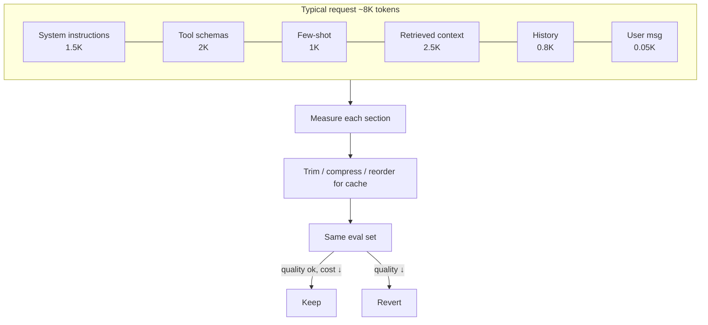

# Prompt Optimization



Prompt optimization means **removing tokens that don't change useful behavior, keeping the ones that do, and arranging repeated sections so the provider can cache them**. **A shorter prompt is not automatically a better prompt.**

The user message is usually a tiny part of the request. Most tokens are **system instructions, tool schemas, few-shot examples, retrieved context, and conversation history**, all resent on every call. Optimization is **empirical**: make a smaller or more cacheable variant, run the **same eval set**, compare cost, latency, and quality, and keep it only if the trade-off is acceptable.

## 1. The Prompt Cost Anatomy
| Section | Typical size | Changes per request? | Main lever |
|---|---|---|---|
| System instructions | 500–3,000 | No | Dedupe, tighten, **cache** |
| Tool definitions | 100–300 per tool; 2–10K with many tools | Rarely | Fewer tools per route, shorter descriptions, **cache** |
| Few-shot examples | 200–2,000 | No (or per intent) | Fewer, shorter, dynamic selection, **cache** |
| Retrieved context | 1,000–10,000 | Yes | Fewer/better chunks, compression |
| Conversation history | Grows unbounded | Appends | Window + summary |
| User message | 10–200 | Yes | n/a |
| **Output** | 100–2,000 | Yes | **Length limits, format** (priced several× input) |

Measure first:
```python
def anatomy(messages, tools, count=count_tokens):
    parts = {"system": count(messages[0]["content"]), "tools": count(json.dumps(tools)),
             "history": sum(count(m["content"]) for m in messages[1:-1]), "user": count(messages[-1]["content"])}
    total = sum(parts.values())
    return {k: (v, f"{v/total:.0%}") for k, v in parts.items()}
```

## 2. Prompt Caching: Order for Reuse
Providers cache **exact prefixes**. Anything that changes invalidates everything after it.

```
[tools] → [system instructions] → [few-shot] → [static docs]   ← stable prefix (cache)
        → [retrieved context] → [history] → [user message]      ← dynamic suffix
```

| Rule | Why |
|---|---|
| Put stable content first | Cache hits need an identical prefix |
| No timestamps, request ids, user names in the system prompt | One changing byte busts the cache |
| Deterministic tool ordering and JSON serialization | Sorted keys, stable order |
| Mark cache breakpoints (Anthropic `cache_control`) or rely on automatic prefix caching (OpenAI, ≥1,024 tokens) | Provider-specific |
| Keep cache warm on bursty traffic | TTLs are minutes (5 min default; 1 h option on some providers) |
| Track `cached_input_tokens / input_tokens` | Verify it actually works |

```python
r = client.messages.create(
    model="claude-sonnet-5-5", max_tokens=600,
    tools=TOOLS,                                              # stable, sorted
    system=[{"type": "text", "text": SYSTEM_PROMPT},
            {"type": "text", "text": POLICY_DOC, "cache_control": {"type": "ephemeral"}}],
    messages=history + [{"role": "user", "content": f"<context>{ctx}</context>\n\n{question}"}],
)
```

## 3. Trimming Instructions
| Anti-pattern | Fix |
|---|---|
| Same rule stated 3 ways | State once, clearly |
| "You are a world-class, highly intelligent…" | Role in one line if at all |
| Long lists of "don't"s for rare cases | Keep the ones evals show matter |
| Prose describing output format | A schema / structured output |
| Instructions for features this route never uses | Per-route prompts |
| ALL CAPS emphasis everywhere | Modern models over-apply it; use sparingly |

Do **ablations**: remove one section at a time and re-run evals; sections whose removal doesn't move scores are candidates to cut.

## 4. Tool Schemas
- Expose only the tools the current route/step needs (a router picks the toolset).
- Descriptions: what it does + when to use it; drop examples the model doesn't need.
- Use enums instead of prose for constrained args.
- For many tools (50+), use **tool search / deferred loading**: send names first, load full schemas on demand.

## 5. Few-Shot Examples
- Start with zero-shot + clear instructions; add examples only when evals improve.
- 2–3 diverse examples usually beat 10 similar ones.
- **Dynamic selection**: retrieve the most similar examples per request (but this breaks caching; trade off).
- Shorten example inputs to the parts that teach the pattern.

## 6. Retrieved Context
| Technique | Effect |
|---|---|
| Lower k after reranking (e.g., 20 → 5) | Often same quality, 4× fewer tokens |
| Score threshold (drop low-relevance chunks) | Fewer distractors too |
| Smaller chunks / sentence-window | Less irrelevant text |
| Dedupe near-identical chunks | Common with versioned docs |
| Extractive compression (keep relevant sentences) | 2–5× reduction; LLMLingua-style or a small model |
| Strip boilerplate (nav, footers, HTML) at ingestion | Free win |
| Structured data as compact tables/JSON, not prose | Fewer tokens |

## 7. Conversation History
```python
def build_history(turns, budget=2_000):
    recent = []
    for t in reversed(turns):                       # keep most recent turns verbatim
        if count_tokens(t) + sum(map(count_tokens, recent)) > budget: break
        recent.insert(0, t)
    older = turns[: len(turns) - len(recent)]
    summary = cached_summary(older) if older else None   # cheap model, updated incrementally
    return ([{"role": "user", "content": f"<summary>{summary}</summary>"}] if summary else []) + recent
```
Also drop old tool results (keep a one-line digest), and clear reasoning blocks from earlier turns when the API allows.

## 8. Output Tokens
- Set `max_tokens` per route from the observed p99 length, not a generous default.
- Ask for the format you need: "≤3 sentences", bullet list, JSON fields only.
- Structured outputs eliminate preamble ("Sure! Here's…") and parse retries.
- For reasoning models, choose the **lowest reasoning effort** that passes evals.
- Return ids/labels instead of echoing long text back.

## 9. Measuring an Optimization
| Variant | Input tok | Cached % | Output tok | $/req | p95 latency | Eval score |
|---|---|---|---|---|---|---|
| Baseline | 8,100 | 0% | 520 | 0.0321 | 4.1 s | 0.86 |
| + cache-friendly order | 8,100 | 72% | 520 | 0.0163 | 3.2 s | 0.86 |
| + k 10→5, compression | 5,600 | 82% | 510 | 0.0118 | 2.8 s | 0.87 |
| + ≤120-word answers | 5,600 | 82% | 230 | 0.0076 | 1.9 s | 0.85 |

Accept if quality is within the tolerance band on **every slice**; watch for silent losses (e.g., citations dropped when answers got shorter).

## 10. Automated Prompt Optimization (additions)
DSPy (MIPROv2), TextGrad, and provider prompt optimizers can search instruction/example variants against a metric. Useful when the eval set is solid; dangerous when it's small (overfits). See [Prompt optimization and DSPy](../05-prompt-engineering/07-prompt-optimization-and-dspy.md).

## Takeaways
- Most tokens are instructions, tools, examples, context, and history, not the user's message.
- Order prompts stable → dynamic so the prefix caches; never put changing values early.
- Cut via ablations, per-route toolsets, fewer chunks, history windows, and output limits.
- Every change is validated on the same eval set across slices; shorter isn't automatically better.

## References
- Anthropic, *Prompt caching* docs · OpenAI, *Prompt caching* guide · Jiang et al., *LLMLingua* (2023)
- Liu et al., *Lost in the Middle* (2023) · Khattab et al., *DSPy* (2023)

## Related
- [Understanding AI application costs](01-understanding-ai-application-costs.md) · [Model selection and routing](03-model-selection-and-routing.md) · [Latency optimization](04-latency-optimization.md)
- [Context engineering](../05-prompt-engineering/04-context-engineering.md) · [Caching strategies](../11-ai-system-architecture/07-caching-strategies-for-llm-applications.md)
