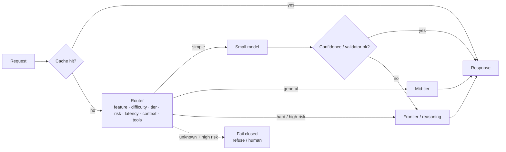

# Model Selection and Routing



Different requests need different models. A billing classifier, a one-line rewrite, a query-expansion step, and a multi-file code review have different needs for **accuracy, latency, and cost**. Sending every request to the largest model is simple but **usually poor engineering**. The goal isn't to make everything cheap; it's to **spend model capacity where it changes the outcome**. Simple tasks often work on small or mid-tier models; ambiguous, high-risk, or multi-step tasks justify a stronger model, or an **escalation path** that checks whether the cheaper answer is good enough.

**Model routing** is the component that decides which model handles each request. Inputs: **feature, query difficulty, user tier, risk level, latency budget, context length, tool requirements, observed confidence**. A good router **checks a cache first, tracks quality per route, and fails closed** when a wrong answer would be costly.

## 1. The Cost Gap Between Models
| Tier | Relative cost (input/output) | Relative latency | Good at |
|---|---|---|---|
| Nano / small (e.g., `claude-haiku-5-5`, `gpt-4.1-mini`, Gemini Flash-Lite) | 1× | Fastest | Classify, extract, rewrite, route, short summaries |
| Mid (e.g., `claude-sonnet-5-5`, GPT-4.1, Gemini Pro) | ~3–15× | Medium | General chat, RAG answers, most tool use |
| Frontier / reasoning (Opus-class, o-series/GPT-5 high effort) | ~15–100× | Slow (seconds of thinking) | Hard reasoning, coding, planning, high-stakes |
| Open-weight self-hosted (Llama, Qwen, Mistral, DeepSeek) | Infra-bound | Tunable | High-volume narrow tasks, data control |

A 10–50× price gap means **routing even 60% of traffic to a small model** cuts spend by more than half, if quality holds on that slice.

## 2. Selecting a Model per Task
1. Define the task and eval set per step (not per app).
2. Run candidates across tiers; record quality, $/task, p50/p95 latency, format validity.
3. Plot **quality vs. cost**; pick the cheapest model on the Pareto front that clears the bar.
4. Re-run quarterly or when new models ship.

| Step | Candidate tiers | Typical winner |
|---|---|---|
| Intent classification | Small | Small (or a fine-tuned classifier) |
| Query rewriting / expansion | Small | Small |
| RAG answer | Small vs. mid | Mid for nuanced docs; small for FAQs |
| Agent planning / tool orchestration | Mid vs. frontier | Mid, frontier for long horizons |
| Code generation across files | Mid vs. frontier | Frontier |
| Output validation / judge | Small vs. mid | Mid (calibrated) |

Don't forget non-LLM options: regex, rules, embeddings + nearest neighbor, or a classic classifier can beat any LLM on cost and latency for narrow tasks.

## 3. Routing Strategies
| Strategy | How | Pros | Cons |
|---|---|---|---|
| **Static by feature** | Config map: feature → model | Simple, predictable | Ignores per-request difficulty |
| **Rule-based** | Context length, tier, risk flags, tool needs | Transparent | Brittle heuristics |
| **Classifier router** | Small model / trained classifier predicts difficulty | Adapts per request | Needs labeled data; router errors |
| **Cascade** | Try cheap model → validate → escalate if fails | Pays for strong model only when needed | Adds latency on escalations |
| **Learned router** (RouteLLM, Martian, Not Diamond, OpenRouter auto) | Trained on preference data | Good cost/quality trade | Opaque; needs monitoring |
| **LLM-as-router** | Small LLM picks the route | Flexible | Extra call; may be wrong |

```python
ROUTES = {
    "classify":  {"model": "claude-haiku-5-5", "max_tokens": 20},
    "faq":       {"model": "claude-haiku-5-5", "max_tokens": 300},
    "rag":       {"model": "claude-sonnet-5-5", "max_tokens": 700},
    "complex":   {"model": "claude-opus-5-5", "max_tokens": 2000},
}

async def route(req, user):
    if (hit := await cache.get(req)): return hit
    if req.feature == "classify": return ROUTES["classify"]
    if req.risk == "high" and not user.verified: return FAIL_CLOSED          # e.g., refunds, legal
    if count_tokens(req.context) > 100_000: return ROUTES["complex"]          # long-context capable
    label = await difficulty_classifier(req.text)                             # easy | medium | hard
    return ROUTES[{"easy": "faq", "medium": "rag", "hard": "complex"}[label]]
```

## 4. Cascades with Verification
```python
async def cascade(req):
    cheap = await call("claude-haiku-5-5", req)
    ok = schema_valid(cheap) and await verifier(req, cheap) >= 0.8        # rule checks, judge, or self-consistency
    if ok: return cheap, "small"
    strong = await call("claude-sonnet-5-5", req)
    return strong, "escalated"
```
Confidence signals: schema validity, citations present and valid, judge score, agreement between 2 samples, token logprobs (where available), the model's own "not enough info" flag.

Expected cost: `c_small + p_escalate × c_strong`. Worth it when `p_escalate` is low and the verifier is cheap.

## 5. Track Quality per Route
| Metric | Per route |
|---|---|
| Traffic share | Is routing drifting? |
| Quality (judge, feedback) | Did the small route degrade? |
| Escalation rate | Cascade health |
| $/request, latency | Savings realized |
| **Router accuracy** | Sample: would the strong model have done better? |

Periodically **shadow** a sample of small-route traffic to the strong model and compare; that's your measure of routing loss.

## 6. Fail Closed
When the route is uncertain **and** the cost of a wrong answer is high (refunds, medical, legal, account changes): don't silently use a weak model. Use the strong model, require approval, or refuse and hand off to a human.

## 7. Multi-Provider Considerations (additions)
- A gateway (LiteLLM, Portkey, OpenRouter, cloud gateways) normalizes APIs and enables failover ([AI gateway](../11-ai-system-architecture/05-the-ai-gateway-pattern.md)).
- Prompts don't transfer perfectly across providers; keep per-model prompt variants and evals.
- Data policies (retention, region, training opt-out) can restrict which providers a request may go to: route on **data classification** too.
- Pin snapshots per route; re-evaluate when providers release new versions.

## 8. Fine-Tuning and Distillation as Routing (additions)
For a stable high-volume step, distill: collect strong-model outputs (or human labels), fine-tune a small model, route that step to it. Typical: 5–20× cheaper with comparable quality on that narrow task. Keep a fallback to the strong model for low-confidence cases.

## Takeaways
- Choose models per step, on the quality–cost–latency Pareto front, measured on your evals.
- Route by feature, difficulty, risk, context length, tools, and tier; check the cache first.
- Cascades pay for strong models only when a cheap answer fails verification.
- Track quality and router accuracy per route; fail closed for high-risk uncertain requests.

## References
- Ong et al., *RouteLLM: Learning to Route LLMs with Preference Data* (2024) · Chen et al., *FrugalGPT* (2023)
- Provider model comparison pages (Anthropic, OpenAI, Google) · LMArena / Artificial Analysis leaderboards

## Related
- [Understanding AI application costs](01-understanding-ai-application-costs.md) · [Prompt optimization](02-prompt-optimization.md) · [Latency optimization](04-latency-optimization.md) · [Self-hosting models](05-self-hosting-models.md)
- [The AI gateway pattern](../11-ai-system-architecture/05-the-ai-gateway-pattern.md) · [Architecture patterns](../11-ai-system-architecture/01-architecture-patterns-for-ai-applications.md)
