# Latency Optimization

```mermaid
gantt
    title RAG request: before (sequential) vs. after (parallel + streaming)
    dateFormat X
    axisFormat %L ms
    section Before
    auth + load history   :a1, 0, 120
    query rewrite (LLM)   :a2, after a1, 600
    embed                 :a3, after a2, 80
    vector search         :a4, after a3, 90
    fetch docs            :a5, after a4, 250
    rerank                :a6, after a5, 300
    generate (no stream)  :a7, after a6, 3000
    section After
    auth ∥ history        :b1, 0, 120
    embed raw query       :b2, 0, 80
    search ∥ BM25         :b3, after b2, 90
    rerank (cached docs)  :b4, after b3, 150
    TTFT                  :milestone, after b4, 0
    stream tokens         :b5, after b4, 2200
```



Latency is a **property of the whole pipeline**, not just the model call: **embedding, vector search, document fetches, prompt assembly, tool calls, validation, retries, and network placement** all add up. Teams usually optimize the model call first because it's the most visible part, which helps when the model is the bottleneck. In RAG and agent systems, though, the slow part is often **a chain of smaller delays**: sequential service calls, slow document fetches, cold caches, retries nobody logged.

Many fixes need no new infrastructure: **streaming** makes the app feel faster, **parallel execution** removes needless waiting, **caching and pre-computation** avoid repeated work, and **prompt changes and model routing** reduce both cost and wait time (when validated on real tasks). **Measure first**: optimizing without a latency breakdown usually improves the wrong number.

## 1. Profiling: Where Does the Time Go?
| Metric | Definition | Why |
|---|---|---|
| **TTFT** | Time to first token shown | Perceived responsiveness |
| **TPOT / ITL** | Time per output token | Reading speed; long answers |
| **E2E latency** | Request → last token / final result | Agents, batch, APIs |
| Per-stage latency | Each span | Find the bottleneck |
| p50 / p95 / p99 | Distribution | Tails matter more than means |

`E2E ≈ pre-LLM stages + TTFT_model + output_tokens × TPOT + post-processing (+ retries)`

Instrument every stage as a span ([monitoring](../12-production-deployment/03-monitoring-and-observability.md)), then look at the **critical path** in a waterfall.

```python
import time, contextlib, collections
timings = collections.defaultdict(list)

@contextlib.asynccontextmanager
async def stage(name):
    t0 = time.perf_counter()
    try: yield
    finally: timings[name].append((time.perf_counter() - t0) * 1000)

def report():
    for k, v in sorted(timings.items(), key=lambda kv: -np.percentile(kv[1], 95)):
        print(f"{k:20s} p50={np.percentile(v,50):6.0f}ms  p95={np.percentile(v,95):6.0f}ms")
```

Typical findings:
| Stage | Typical | Red flag |
|---|---|---|
| Query rewrite LLM call | 300–800 ms | On every request, even when unnecessary |
| Embedding (API) | 50–150 ms | Cross-region |
| Vector search | 10–100 ms | > 200 ms: index/filter issue |
| Doc fetch from object store | 50–300 ms | Sequential per doc |
| Rerank | 100–400 ms | k too large |
| TTFT (model) | 300 ms–2 s | Huge uncached prompt; reasoning effort high |
| Output (500 tok @ 50–150 tok/s) | 3–10 s | Verbose answers |
| Validation retry | +1 full call | Hidden in libraries |

## 2. Streaming (Perceived Latency)
- Stream tokens to the UI; TTFT becomes the felt latency.
- Stream **status** for slow pre-stages ("Searching docs…", "Running query…").
- For structured output, stream partial JSON or render fields as they arrive.
- Server: SSE end to end; disable proxy buffering (`X-Accel-Buffering: no`), flush often.
- Streaming doesn't reduce E2E; validation that needs the full output must be designed around it (stream, then retract/annotate, or validate incrementally).

## 3. Parallelize
```python
async def prepare(q, user):
    hist, emb, kw = await asyncio.gather(
        load_history(user),                  # independent
        embed(q),
        bm25_search(q, user.tenant),
    )
    vec = await vector_search(emb, user.tenant)
    docs = await asyncio.gather(*(fetch(d) for d in merge(vec, kw)[:20]))   # not a for-loop
    return hist, docs
```
| Opportunity | Example |
|---|---|
| Independent lookups | History, user profile, retrieval, feature flags |
| Hybrid search | Vector ∥ keyword |
| Multi-query retrieval | Subqueries in parallel |
| Parallel tool calls | Models can emit several tool calls per turn; execute concurrently |
| Guardrails | Input moderation ∥ retrieval (cancel if blocked) |
| Speculative work | Start retrieval on the raw query while rewriting runs; use whichever is ready |

## 4. Reduce Work on the Critical Path
| Technique | Effect |
|---|---|
| Skip unnecessary steps (rewrite only for follow-ups) | Removes a whole LLM call |
| Smaller model for intermediate steps | 2–5× faster per step |
| Fewer input tokens / cached prefix | Lower TTFT (prefill scales with uncached tokens) |
| Fewer output tokens | Linear E2E reduction |
| Lower reasoning effort | Seconds saved on reasoning models |
| Smaller rerank k / faster reranker | 100s of ms |
| Fewer agent steps (better tools, merged tools) | Each step = full LLM round trip |
| Move work offline (pre-summaries, precomputed embeddings, prebuilt answers) | Zero runtime cost |

## 5. Caching and Precomputation
- Exact/semantic response caches for repeated questions ([caching](../11-ai-system-architecture/07-caching-strategies-for-llm-applications.md)).
- Provider prompt caching: lower TTFT on long stable prefixes (often 50–80% TTFT reduction on long prompts).
- Embedding cache for frequent queries; document cache near the app.
- **Prefetch** on intent signals (user opens a ticket → precompute retrieval + summary).

## 6. Network and Placement
- Co-locate app, vector DB, and object store in one region; pick the provider region nearest the app.
- Keep-alive / HTTP/2 connection pools to providers (avoid TLS handshake per call).
- Avoid serial cross-region hops (each 50–150 ms).
- Edge for static UI; the AI backend lives near its data.

## 7. Tail Latency
| Cause | Fix |
|---|---|
| Provider slowness spikes | Timeouts + **hedged requests** (send a 2nd after p95, take the first) for idempotent calls |
| Retries on validation | Strict structured output, better prompts |
| Long outputs | `max_tokens`, length guidance |
| Cold starts (serverless, scaled-to-zero GPUs) | Min instances, warm pools |
| Queueing at rate limits | Priority queues, capacity reservations |

## 8. Model-Side Speedups (additions; self-hosted or provider options)
| Technique | What |
|---|---|
| Speculative decoding | Draft model proposes tokens, large model verifies (2–3× TPOT) |
| Quantization (FP8/INT4) | Faster, cheaper inference with small quality loss |
| Continuous batching, paged KV cache | Throughput without hurting latency much (vLLM, SGLang, TGI) |
| Prefix caching on the server | Reuse KV for shared prefixes |
| Priority / low-latency tiers | Some providers sell faster serving tiers |

See [Self-hosting models](05-self-hosting-models.md).

## 9. Latency Budget Example (additions)
Target: TTFT p95 < 1.5 s, E2E p95 < 6 s.
| Stage | Budget |
|---|---|
| Auth + history ∥ retrieval | 200 ms |
| Rerank | 200 ms |
| Prompt build | 20 ms |
| Model TTFT | 900 ms |
| Stream 300 tokens @ 80 tok/s | 3.75 s |
| Post-validate | 100 ms |

Each owner gets a budget; alert when a stage's p95 exceeds it.

## Takeaways
- Latency is pipeline-wide; profile every stage's p50/p95 before changing anything.
- Stream for perceived speed, parallelize independent work, and remove steps from the critical path.
- Fewer uncached input tokens lower TTFT; fewer output tokens lower E2E.
- Fight tails with timeouts, hedging, strict output formats, and warm capacity.

## References
- Anyscale / Databricks, *LLM inference performance engineering* posts · Leviathan et al., *Fast Inference via Speculative Decoding* (2023)
- vLLM (Kwon et al., *PagedAttention*, 2023) · Dean & Barroso, *The Tail at Scale* (2013)

## Related
- [Understanding AI application costs](01-understanding-ai-application-costs.md) · [Prompt optimization](02-prompt-optimization.md) · [Model selection and routing](03-model-selection-and-routing.md) · [Self-hosting models](05-self-hosting-models.md)
- [Building AI-powered UX](../11-ai-system-architecture/06-building-ai-powered-ux.md) · [Scaling AI applications](../11-ai-system-architecture/04-scaling-ai-applications.md)
