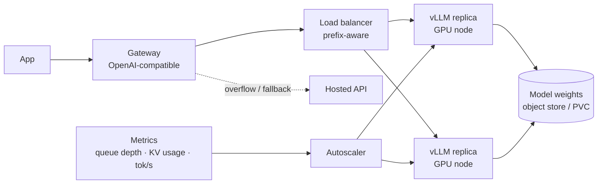

# Self-Hosting Models



Some constraints can't be solved by tuning API calls: **data residency, strict isolation, offline operation, custom model weights, predictable high-volume traffic, fine-grained latency control**. Self-hosting means **your team runs the model server, picks the hardware, manages scaling, and owns the failure modes**. Benefits: potentially **lower cost at scale and more control**. The main cost: operational work **moves from the provider's platform team to yours**.

The question isn't whether self-hosting is "better". It depends on **workload, risk profile, team capabilities, and traffic pattern**.

## 1. When Self-Hosting Makes Financial Sense
API cost scales with tokens; self-hosted cost scales with **GPU-hours** (whether busy or idle).

```
api_monthly   = tokens_in × p_in + tokens_out × p_out
self_monthly  = n_gpus × $/gpu_hour × 730 + ops_engineering + storage/network
break-even    when sustained utilization keeps tokens/GPU-hour high enough
```

Worked example (illustrative):
| Item | Value |
|---|---|
| Workload | 2B tokens/month (1.6B in, 0.4B out), steady |
| Hosted small/mid model | ~$0.50/M in, ~$2/M out → **$1,600/mo** |
| Self-hosted 8B model on 1× L40S / A10G-class (~$1–2/h) | ~$1,100/mo per GPU 24/7, ×2 for HA = **$2,200** + ops |
| Verdict | **API wins** at this volume |
| Same workload at 30B tokens/month | API ≈ $24K; self-host maybe 4–6 GPUs ≈ $6–10K + ops → **self-host can win** |

| Favors self-hosting | Favors APIs |
|---|---|
| High, **steady** volume (high utilization) | Spiky / low volume (idle GPUs) |
| Narrow task where a small open model suffices | Needs frontier quality |
| Fine-tuned/custom weights | Rapidly changing model landscape |
| Hard data residency / air-gapped | Standard DPAs / zero-retention acceptable |
| Team has GPU/infra skills | Small team, no on-call for GPUs |
| Latency control (co-location, no queueing at provider) | Global multi-region needs |

Middle grounds: **dedicated endpoints / provisioned throughput** (Bedrock, Azure, Vertex), **serverless open-model hosts** (Together, Fireworks, Groq, Baseten, Modal), cloud-hosted open weights inside your VPC.

## 2. Choosing a Model
| Factor | Notes |
|---|---|
| Quality on **your** evals | Leaderboards are a starting point only |
| Size vs. hardware | 7–9B: 1 GPU; 30–70B: 2–8 GPUs (or 1 with heavy quantization); MoE models: memory for all experts |
| License | Llama community license, Apache-2.0 (Qwen, Mistral many), MIT (DeepSeek); check commercial terms + acceptable use |
| Context length | KV cache memory grows with it |
| Tool calling / structured output | Supported by the model's chat template + server |
| Ecosystem | Quantized variants, fine-tune tooling, server support |

## 3. GPU Memory Sizing
```
weights   ≈ params × bytes_per_param           (FP16/BF16 = 2, FP8 = 1, INT4 ≈ 0.5)
kv_cache  ≈ 2 × layers × kv_heads × head_dim × bytes × tokens_in_flight
total     ≈ weights + kv_cache + ~10–20% overhead (activations, CUDA graphs)
```
Example: 8B model in BF16 ≈ 16 GB weights. Llama-3-8B-like (32 layers, 8 KV heads, head_dim 128, BF16): KV ≈ 2×32×8×128×2 = **128 KB/token** → 64K tokens in flight ≈ 8 GB. Fits on a 24 GB GPU tightly; 48 GB comfortably.

70B in BF16 ≈ 140 GB → 2× H100 80GB minimum (tensor parallel), more for KV headroom; FP8 ≈ 70 GB.

## 4. Serving Stack
| Server | Strengths |
|---|---|
| **vLLM** | PagedAttention, continuous batching, prefix caching, OpenAI-compatible API, wide model support |
| **SGLang** | RadixAttention prefix reuse, fast structured output, strong for agents/multi-call |
| TGI (Hugging Face) | Mature, HF ecosystem |
| TensorRT-LLM / Triton | Max NVIDIA performance, more build effort |
| llama.cpp / Ollama | CPU/Apple/edge, local dev |
| NVIDIA NIM, KServe, Ray Serve, BentoML | Packaging/orchestration layers |

```bash
vllm serve Qwen/Qwen3-8B --dtype bfloat16 --max-model-len 32768 \
  --gpu-memory-utilization 0.90 --enable-prefix-caching --max-num-seqs 128
```
```python
from openai import OpenAI
client = OpenAI(base_url="http://vllm.internal:8000/v1", api_key="unused")   # same client as hosted
r = client.chat.completions.create(model="Qwen/Qwen3-8B", messages=msgs, max_tokens=400)
```

## 5. Throughput and Latency Tuning
| Knob | Effect |
|---|---|
| Continuous batching / `max-num-seqs` | More concurrency → throughput ↑, per-request latency ↑ |
| Quantization (FP8, AWQ/GPTQ INT4) | Memory ↓, speed ↑, small quality loss: **eval it** |
| Prefix caching | Big TTFT win for shared system prompts |
| Speculative decoding (draft model / EAGLE / n-gram) | TPOT ↓ 1.5–3× |
| Tensor parallelism | Fit bigger models, lower latency; needs NVLink |
| Chunked prefill | Smooths latency mixing long prompts with decodes |
| Disaggregated prefill/decode | Advanced; separate pools for each phase |

Benchmark with your real prompt/output length distribution (vLLM `benchmark_serving`, GenAI-Perf) and report tokens/s/GPU at your latency SLO, not peak.

## 6. Operations You Now Own
| Area | Work |
|---|---|
| Capacity | GPU quota, reservations, multi-AZ; startup time of 1–10 min (weights load) |
| Autoscaling | On queue depth / KV cache utilization / pending requests, not CPU |
| Cold starts | Keep min replicas; preloaded weights on local NVMe; streaming loaders |
| Health | Readiness after weights load + warmup request; detect stuck GPUs (Xid errors) |
| Upgrades | Server + driver + CUDA compatibility matrix; canary new model versions |
| Observability | Tokens/s, TTFT, queue time, KV usage, GPU util/mem/temp (DCGM exporter) |
| Security | Weights provenance (hash), no public endpoints, tenant isolation, prompt logging policy |
| Fallback | Overflow or failover to a hosted API through the gateway |
| On-call | Someone must answer at 3 a.m. when a node dies |

## 7. Hybrid Patterns (additions)
- **Self-host the high-volume narrow step** (classification, embeddings, reranking, extraction) and call APIs for frontier reasoning.
- **Burst to API**: self-hosted baseline capacity sized at p50 traffic; overflow to hosted.
- **Fine-tune + self-host** distilled models for steps where a small model matches quality ([routing](03-model-selection-and-routing.md)).
- **Self-host embeddings** first: easiest win (small models, CPU/GPU cheap, no generation latency).

## 8. Decision Checklist
1. Do evals show an open model meets the bar for this step?
2. Is traffic steady enough for > 40–60% GPU utilization?
3. Total cost incl. HA replicas, engineers, on-call < API cost (with batch/caching discounts applied)?
4. Is there a hard requirement (residency, air-gap, custom weights) that decides it regardless?
5. Do we have a fallback and the skills to run it?

## Takeaways
- Self-hosting trades per-token bills for GPU-hours plus operational ownership.
- It pays off with high, steady volume on tasks an open model handles, or with hard residency/isolation needs.
- Size GPUs from weights + KV cache; serve with vLLM/SGLang; tune batching, quantization, prefix caching.
- Hybrid is common: self-host narrow high-volume steps, keep APIs for frontier work and overflow.

## References
- Kwon et al., *Efficient Memory Management for LLM Serving with PagedAttention* (vLLM, 2023) · Zheng et al., *SGLang* (2024)
- vLLM docs (production stack, benchmarks) · Hugging Face TGI docs · NVIDIA TensorRT-LLM docs

## Related
- [Understanding AI application costs](01-understanding-ai-application-costs.md) · [Model selection and routing](03-model-selection-and-routing.md) · [Latency optimization](04-latency-optimization.md)
- [Containerizing AI applications](../12-production-deployment/01-containerizing-ai-applications.md) · [Scaling AI applications](../11-ai-system-architecture/04-scaling-ai-applications.md)
