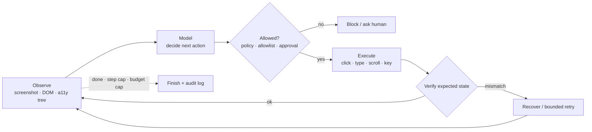

# Computer Use Agents



A lot of business work still happens in **GUIs**: legacy ERP screens, internal admin dashboards, government portals, bank sites, virtual desktops, old desktop apps. An agent that can only call APIs can't finish those workflows. **Computer use agents** operate the UI directly: they look at the screen, pick a mouse or keyboard action, run it, and check what happened.

Use cases: form filling, GUI regression testing, legacy system integration, dashboard extraction, cross-application workflows with no shared backend. Trade-off: **slower, more expensive, and more fragile than APIs**, because layouts shift, modals pop up, focus moves, and timing varies. Reliable systems need **verification, recovery, permissions, logging, and hard limits**.

## 1. The Screenshot-Action Loop
Observe → think → act, repeated until the task is done, a guardrail blocks an action, or a **step/budget limit** is hit.

| Property | Implication |
|---|---|
| Observations are pixels | Model must infer text, layout, clickable controls, disabled state, focus |
| Image inputs are expensive; many steps per task | Cap steps + spend; crop or downscale screenshots |
| Errors compound | One wrong click → wrong record/page/tab for every later step |
| Real side effects | Continuing after a failed action can corrupt the target system |

**Verify after important actions**: expected page loaded, value appears in the field, submit enabled, confirmation matches the task.

```python
async def run(task, env, model, max_steps=40, max_usd=2.0):
    spent, history = 0.0, []
    for step in range(max_steps):
        obs = await env.observe()                                   # screenshot (+ a11y tree if available)
        action, cost = await model.next_action(task, obs, history)
        spent += cost
        if spent > max_usd: return Abort("budget")
        if action.kind == "done": return await verify_final(env, task)
        if not policy.allows(action, env.state): return Escalate(action)   # deny-by-default
        await env.execute(action)
        if action.critical and not await env.expect(action.expected_state):
            history.append(("verify_failed", action)); continue    # model sees failure and replans
        history.append(("ok", action))
    return Abort("step_limit")
```

## 2. DOM vs. Screenshot Approaches
| Aspect | Screenshot-based | DOM-based |
|---|---|---|
| Works on | Any application | Browsers only |
| Model input | Image (high token cost) | Text/HTML (cheaper) |
| Accuracy | Depends on visual recognition | Often higher for structured elements |
| Speed | Slower | Faster |
| Dynamic content | Sees what's visible | May miss lazy/virtualized elements not yet rendered |
| Fragility | Visual changes | HTML structure changes |
| Targeting | Coordinates | Selectors, roles, aria labels |

**Production browser agents combine both**: DOM/accessibility tree for precise targeting, screenshots for layout and visual confirmation. Native desktops, remote desktops, and virtualized enterprise apps have no DOM, so they rely on screenshots, OCR, and OS accessibility APIs (quality varies a lot).

## 3. Computer Use Tooling
Provider tools change over time (OpenAI `computer` tool; Anthropic computer use is a versioned beta tool with beta headers). Check current docs. The architecture stays the same: **model requests an action → app checks it's allowed → executes it in a controlled environment → returns the next observation**.

| Capability | Contents | Privilege |
|---|---|---|
| Computer | Screenshot, mouse move/click, type, scroll, key combos | Medium |
| Browser automation | Navigate, selectors, form fill, screenshots, state | Lower |
| File / shell | Only when the task needs it | High: most business workflows need **none** |

Practical details:
- The display resolution declared to the tool **must match the screenshot coordinate space**. Retina scaling, browser zoom, RDP scaling, and CSS zoom cause near-miss clicks.
- Deterministic environment: fixed viewport, zoom, fonts, locale.
- **No personal accounts or secrets**; use sandboxed VMs, containers with virtual displays (Xvfb), or disposable browser profiles.

```python
# Anthropic-style computer tool loop (shape only; check current tool version + beta header)
tools = [{"type": "computer_20250124", "name": "computer",
          "display_width_px": 1280, "display_height_px": 800}]
while True:
    r = client.beta.messages.create(model="claude-sonnet-5-5", max_tokens=1024, tools=tools,
                                    messages=msgs, betas=["computer-use-2025-01-24"])
    calls = [b for b in r.content if b.type == "tool_use"]
    if not calls: break
    results = []
    for c in calls:
        out = sandbox.perform(c.input)                    # validates + executes in the VM
        results.append({"type": "tool_result", "tool_use_id": c.id,
                        "content": [{"type": "image", "source": b64_png(sandbox.screenshot())}]})
    msgs += [{"role": "assistant", "content": r.content}, {"role": "user", "content": results}]
```

## 4. Browser Automation with Playwright
For web work, full pixel-level computer use is often the wrong default. **Playwright** gives deterministic navigation, selectors, forms, screenshots, tracing, downloads, and network events: cheaper and more reliable. Pattern: **LLM decides, Playwright executes**; the observation is a **structured list of elements**, not an image.

```python
from playwright.async_api import async_playwright

async def elements(page):
    els = await page.locator("a, button, input, select, textarea, [role=button]").all()
    out = []
    for i, e in enumerate(els):
        if await e.is_visible():
            out.append({"i": i, "role": await e.evaluate("e => e.getAttribute('role') || e.tagName"),
                        "name": (await e.get_attribute("aria-label")) or (await e.inner_text())[:60]})
    return els, out

async def step(page, model, task):
    els, summary = await elements(page)
    act = await model.choose(task, page.url, summary)            # {"op": "click", "i": 5} | {"op": "fill", "i": 2, "text": ...}
    target = els[act["i"]]                                        # semantic: element survives small layout shifts
    if act["op"] == "click": await target.click()
    elif act["op"] == "fill": await target.fill(act["text"])
    await page.wait_for_load_state("networkidle")
```

Coverage gaps to handle: iframes, shadow DOM, canvas-heavy apps, virtualized lists, popups, downloads, auth flows, bot defenses. **Browser Use** (built on Playwright) adds element annotation, screenshot fallback, multi-tab handling, and state management. Others: Stagehand, Playwright MCP server (exposes a11y-tree snapshots as tools).

## 5. Desktop Automation
| Platform | Structured access | Input simulation |
|---|---|---|
| macOS | Accessibility API (`pyobjc`), AppleScript | `cliclick`, Quartz events |
| Windows | UI Automation (`pywinauto`) | SendInput |
| Linux | AT-SPI | `xdotool` |
| Cross-platform | none | `pyautogui` (simple, but blind to focus and control meaning) |

Naive scripts break: fixed `sleep`s, timed typing, assuming the UI responded. Production: **input simulation + observation/accessibility checks, verify each step**. Desktop a11y trees are inconsistent (some apps expose names/roles/values, others almost nothing); screenshot models fill the gaps. Isolate in VMs or containers; Xvfb lets you run agents in parallel.

## 6. Build vs. Browse: Choosing an Approach
| Scenario | Best approach | Why |
|---|---|---|
| Well-documented API | API | Faster, cheaper, reliable |
| No API at all | Computer use agent | GUI is the workflow |
| API incomplete | Hybrid | API mostly; UI for gaps |
| Many different sites | Browser automation / hybrid | Prefer stable APIs, UI for gaps |
| Needs 99.9%+ reliability | API | Computer use fails more |
| One-off web extraction | Browser automation | Quick, no ongoing reliability need |
| Testing your own web app | Browser automation | Playwright is built for it |
| Legacy desktop software | Computer use agent | No API or DOM |
| Behind MFA/SSO | Usually avoid full automation | Delegated access, human approval, official APIs |

**Rule of thumb: API → browser automation → full computer use.** Use computer use for legacy systems as **bridge coverage** while a real integration is built, not as a permanent dependency. Other good fits: exploratory testing, sites without APIs, repetitive form filling across non-integrated systems, cross-application processes.

At scale, humans notice an unexpected rendering and pause; agents may misread the new state and follow a stale plan. Require **explicit verification, bounded retries, human-review fallback, idempotency checks, and audit logs for every action**.

## 7. Safety Controls (additions)
| Control | Detail |
|---|---|
| Domain allowlist | Browser proxy blocks navigation off approved hosts |
| Action policy | Deny `submit`/`pay`/`delete` without approval; per-site rules |
| Screen-content injection | Treat on-screen text as untrusted data; providers ship injection classifiers; don't let page text grant new permissions |
| Credential handling | Agent never sees passwords; pre-authenticated session or vault-filled fields |
| Recording | Video/screenshot trail + action log per run (also great for debugging) |
| Kill switch | Operator can stop any run instantly |

See [Agent sandboxing and security](06-agent-sandboxing-and-security.md).

## 8. Evaluating Computer Use Agents (additions)
- Benchmarks: **OSWorld** (desktop tasks), **WebArena / VisualWebArena**, **WebVoyager**, **Mind2Web**; useful for models, not a substitute for your workflows.
- Build a task suite against a **staging copy** of the target app with deterministic seeds; score end state (DB row, confirmation id), not the trajectory.
- Track success rate, steps/task, $/task, human interventions, and **harmful actions** (should be 0).

## Takeaways
- Computer use agents cover GUI-only work, but cost more and fail more than APIs.
- Every iteration is observe–think–act; verify important actions and cap steps and spend.
- Combine DOM/accessibility data with screenshots; prefer Playwright-style semantic actions for the web.
- Prefer API → browser automation → computer use; sandbox, separate privileges, log every action.

## References
- Anthropic, *Computer use tool* docs · OpenAI, *Computer use* docs · Playwright for Python docs
- Browser Use (github.com/browser-use/browser-use) · pyautogui docs · Xie et al., *OSWorld* (2024) · Zhou et al., *WebArena* (2023)

## Related
- [Coding agents](02-coding-agents.md) · [Agent sandboxing and security](06-agent-sandboxing-and-security.md) · [Long-running agents](05-long-running-agents.md)
- [What are AI agents](../10-agents/01-what-are-ai-agents.md) · [Human-in-the-loop patterns](../10-agents/07-human-in-the-loop-patterns.md) · [Multimodal: vision models](../15-multimodal/01-vision-models-and-image-understanding.md)
