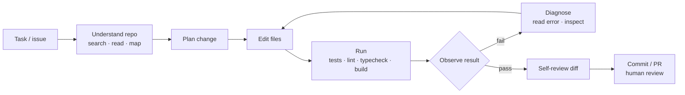

# Coding Agents



Language models can write useful code, but **a snippet isn't software engineering**. Real development means understanding the codebase, following its patterns, editing the right files, running tests, reading failures, debugging the environment, and knowing whether a change is **actually correct rather than just plausible**.

A **coding agent** inspects a repository, plans a change, edits files, runs commands, interprets failures, and revises its work, inside a real development environment. Its feedback signals are **search, file access, shell commands, linters, type checkers, test runners, package managers, and version control**. What separates a useful coding agent from a code generator with a shell: the **edit-run-observe loop, repository understanding, tool design, context management, and error recovery**.

## 1. The Edit-Run-Observe Cycle
| Phase | Agent does | Signal |
|---|---|---|
| Edit | Apply a targeted change | Diff |
| Run | Tests, linter, type checker, build, the app itself | Exit code, stdout/stderr |
| Observe | Read failures, stack traces, test names | Concrete error |
| Revise | Fix root cause, not the symptom | New diff |

The environment, not the model, decides correctness. Tight loops beat long thinking: a 2-second unit test run is the best feedback a model can get.

Pitfalls:
- **Editing tests to make them pass**, or special-casing the test input. Forbid in instructions, catch in review (diff touches `tests/` + `src/`).
- Running the whole suite each time (slow, noisy); run the relevant tests first, the full suite before finishing.
- Flaky or slow environments make the agent chase noise.
- Ignoring warnings and type errors the human would have fixed.

## 2. Repository Understanding
| Technique | Use |
|---|---|
| `grep`/`ripgrep` agentic search | Fast, exact; most effective general method in practice |
| File tree + README/CONTRIBUTING | Orientation, conventions |
| Symbol tools (LSP: go-to-definition, references) | Precise navigation in large codebases |
| Repo map (signatures per file, ranked; Aider-style) | Compact global view |
| Embedding search over code | Fuzzy "where is X handled" queries; weaker than grep for identifiers |
| Git history / blame | Why code is the way it is |
| Project memory file (`CLAUDE.md`, `AGENTS.md`) | Build/test commands, conventions, gotchas | <!-- noqa: filename -->

Read callers and similar code before editing; match surrounding style and existing helpers instead of inventing new ones.

## 3. Tool Design for Coding Agents
| Tool | Design choice | Why |
|---|---|---|
| Read file | Line ranges; line numbers in output | Large files; precise edits |
| Edit file | **Exact string replace** (old → new, must be unique) or patch/diff | Fewer whole-file rewrites; failures are explicit |
| Write file | For new files only | Avoid clobbering |
| Search | Regex + glob, result limits | Bounded output |
| Shell | Timeouts, cwd, output truncation (head + tail) | Prevent hangs and context floods |
| Test runner | Structured result: failed tests + first error | Signal, not 10K lines of logs |
| Git | status/diff/commit; no force-push | Reversibility |

Return **actionable errors** ("old_string matched 3 times; add context") so the model can self-correct. See [Designing tool schemas](../08-tool-use/02-designing-tool-schemas.md).

```python
def edit_file(path: str, old: str, new: str) -> str:
    src = Path(path).read_text()
    n = src.count(old)
    if n == 0: return f"ERROR: old string not found in {path}. Re-read the file; whitespace must match."
    if n > 1:  return f"ERROR: old string occurs {n} times in {path}. Include more surrounding lines."
    Path(path).write_text(src.replace(old, new, 1))
    return f"OK: edited {path}"

def run(cmd: str, timeout=120) -> str:
    p = subprocess.run(cmd, shell=True, capture_output=True, text=True, timeout=timeout, cwd=WORKDIR)
    out = (p.stdout + p.stderr)
    if len(out) > 8000: out = out[:3000] + "\n...[truncated]...\n" + out[-4000:]
    return f"exit={p.returncode}\n{out}"
```

## 4. Context Management
- Don't load the repo; **search, then read the relevant ranges**.
- Truncate tool output; summarize long logs to the failing part.
- **Compaction**: summarize old turns (decisions, files touched, open issues) when the window fills.
- **Subagents** for exploration: a fresh context searches and returns only conclusions.
- Keep a running plan/TODO list in context (or a file) so long tasks don't drift.
- Persist durable facts in a project memory file across sessions.

## 5. Error Recovery
| Failure | Recovery |
|---|---|
| Edit didn't apply | Re-read file, retry with exact text |
| Tests fail after change | Read the first failure, inspect code paths, fix root cause |
| Same error 3× | Change approach; step back and re-plan; or ask the human |
| Environment broken (deps, ports) | Diagnose (versions, lockfiles), don't hack around it silently |
| Went down a wrong path | `git stash`/checkout to a checkpoint; restart from the plan |
| Ambiguous requirement | Ask, rather than guess at large scope |

Checkpoints (git commits or snapshots) make bold attempts cheap to undo.

## 6. Autonomy Levels (additions)
| Level | Example | Human role |
|---|---|---|
| Autocomplete | Inline completion | Accept/reject per line |
| Chat edit | IDE chat edits a file | Review each diff |
| Agentic in IDE/CLI | Claude Code, Cursor agent, Copilot agent mode, Aider | Approve commands/edits; steer |
| Background / async | Agents that take an issue and open a PR (Codex cloud, Copilot coding agent, Claude Code in CI/GitHub Actions) | Review PR |
| Fleet | Many agents on many tasks, orchestrated | Triage + review |

More autonomy needs stronger sandboxing, tests, and review.

## 7. Making a Codebase Agent-Friendly (additions)
- Fast, deterministic tests runnable with one command; document it.
- Linters, formatters, type checkers in CI and locally.
- `AGENTS.md`/`CLAUDE.md`: setup, commands, architecture notes, do/don't. <!-- noqa: filename -->
- Small modules with clear names; good error messages.
- Reproducible dev environment (devcontainer, Nix, Docker).

## 8. Evaluating Coding Agents (additions)
| Benchmark | Measures |
|---|---|
| **SWE-bench Verified** | Resolve real GitHub issues (500 human-validated tasks); hidden tests decide |
| SWE-bench Pro / Multimodal / multilingual variants | Harder, contamination-resistant, other languages |
| **Terminal-Bench** | Command-line tasks in containers |
| HumanEval / MBPP / LiveCodeBench | Function-level codegen (saturated / contamination-aware) |
| Aider polyglot | Edit-format reliability across languages |

For your own team: replay closed internal issues/PRs in a sandbox; score with the merged PR's tests; track pass rate, cost/task, turns, and **review rejection reasons**.

## 9. Safety (additions)
- Run in a container/VM with the repo mounted; no prod credentials; network allowlist (package registries only).
- Approval gates for destructive commands (`rm -rf`, `git push --force`, migrations, deploys).
- Watch for **prompt injection in code, issues, READMEs, dependency files** that tell the agent to exfiltrate secrets.
- Human review on every merge; CI must pass; protected branches.

## Takeaways
- Coding agents differ from code generators through the edit-run-observe loop against real tools.
- Search-then-read for repo understanding; match existing patterns.
- Tools should be precise (exact-replace edits, bounded output, actionable errors).
- Manage context with truncation, compaction, subagents, and plans; recover by diagnosing root causes and checkpointing.

## References
- Jimenez et al., *SWE-bench* (2023) · Yang et al., *SWE-agent: Agent-Computer Interfaces* (2024)
- Anthropic, *Claude Code best practices* · Aider docs (repo map, edit formats) · OpenAI Codex docs

## Related
- [Computer use agents](01-computer-use-agents.md) · [Long-running agents](05-long-running-agents.md) · [Agent sandboxing and security](06-agent-sandboxing-and-security.md)
- [Agent reliability and debugging](../10-agents/05-agent-reliability-and-debugging.md) · [Agent evaluation and testing](../10-agents/06-agent-evaluation-and-testing.md) · [Context engineering](../05-prompt-engineering/04-context-engineering.md)
