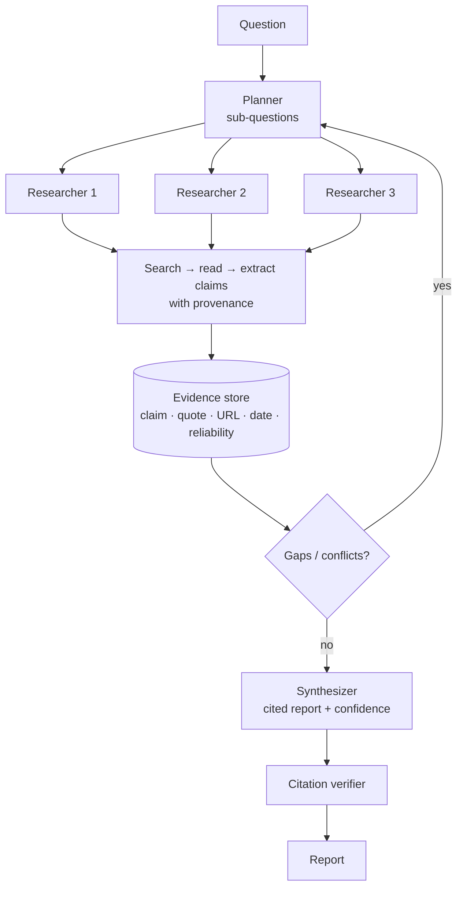

# Deep Research Agents



Many real questions can't be answered reliably by a single model call. They require **searching multiple sources, reading original material, separating evidence from interpretation, reconciling conflicting claims, and producing an answer that can be verified**.

A **deep research agent** plans sub-questions, searches the web or private corpora, reads sources, extracts claims, **tracks provenance**, identifies gaps, searches again, and synthesizes a **cited report**. The goal isn't to sound confident; it's to be **transparent about how it got from question to evidence**. Core parts: the **search-read-synthesize loop, source reliability, contradiction handling, confidence estimation**, and an architecture that produces useful output instead of polished speculation.

## 1. The Search-Read-Synthesize Loop
| Phase | Work | Output |
|---|---|---|
| Plan | Decompose into sub-questions; define what "answered" means | Research plan |
| Search | Several queries per sub-question (synonyms, entities, date ranges) | Candidate URLs/docs |
| Triage | Rank by relevance + reliability; dedupe syndicated copies | Reading list |
| Read | Fetch full text; extract claims with exact supporting quotes | Evidence records |
| Reflect | What's still unknown or contradicted? | New queries or stop |
| Synthesize | Structure answer; cite every non-trivial claim | Draft report |
| Verify | Check each citation supports its sentence | Final report |

Stop conditions: sub-questions answered with ≥2 independent sources, diminishing new information, or budget (searches, pages, tokens, wall time).

## 2. Architecture
**Orchestrator-workers** is the common pattern: a lead agent plans and spawns parallel researcher subagents, each with its own context window; they return **condensed findings**, not raw pages. Anthropic reported a multi-agent research setup beating a single agent by ~90% on their internal eval, at roughly **15× the tokens** of chat: use it where the value justifies the cost.

```python
@dataclass
class Evidence:
    claim: str; quote: str; url: str; title: str; published: str | None
    source_type: str          # primary | peer_reviewed | gov | news | blog | forum | vendor
    retrieved_at: str; subq: str

async def research(question, budget):
    plan = await planner(question)                                   # list of sub-questions
    store: list[Evidence] = []
    for round_ in range(budget.rounds):
        results = await asyncio.gather(*(researcher(sq, budget.per_worker) for sq in plan.open()))
        for r in results: store += r.evidence
        plan = await reflect(question, plan, store)                  # mark answered, add follow-ups, flag conflicts
        if plan.done() or budget.exhausted(): break
    report = await synthesize(question, store)                        # every claim → evidence ids
    return await verify_citations(report, store)
```

Keep evidence **outside the context window** (store + ids) so the synthesizer can cite precisely and the run can resume.

## 3. Source Reliability
| Signal | Higher reliability | Lower reliability |
|---|---|---|
| Type | Primary data, filings, standards, peer-reviewed, official docs | Content farms, anonymous posts, SEO aggregators |
| Proximity | Original source | Re-reporting of re-reporting |
| Recency | Dated, current | Undated or stale for a fast-moving topic |
| Incentives | Neutral | Vendor marketing about own product |
| Corroboration | Independent sources agree | Many copies of one press release |

Prefer following links to the **original**. Count corroboration by **independent origins**, not by URL count.

## 4. Contradiction Handling
1. Detect: claims on the same fact with different values (numbers, dates, yes/no).
2. Explain: different definitions, time periods, populations, methodology, or one source is wrong/outdated.
3. Resolve: prefer primary + recent + methodologically sound; or present both with reasons.
4. Report: never silently pick one; state the disagreement.

## 5. Confidence Estimation
| Level | Criteria |
|---|---|
| High | ≥2 independent reliable sources agree; primary source available |
| Medium | One reliable source, or agreement among weaker sources |
| Low | Single weak source, inference, or unresolved conflict |
| Unknown | Not found; say so explicitly |

Attach confidence per finding, not just per report. Distinguish **evidence** ("X reports 12%") from **interpretation** ("this suggests…").

## 6. Synthesis and Citations
- Structure: executive summary → findings by sub-question → conflicts/uncertainties → method & sources.
- Every factual sentence carries citation ids; quotes stored so a verifier (or a human) can check.
- **Citation verification pass**: for each (sentence, source) pair, a judge checks support; unsupported sentences are cut or flagged. See [RAG with citations and grounding](../07-rag/04-rag-with-citations-and-grounding.md).

## 7. Tools and Infrastructure (additions)
| Need | Options |
|---|---|
| Web search API | Provider web-search tools (Anthropic, OpenAI, Gemini grounding), Brave, Tavily, Exa, Bing/SerpAPI |
| Fetch + clean | HTTP fetch + readability extraction; headless browser for JS; PDF parsing |
| Private corpora | RAG over internal docs; MCP servers for Drive/Confluence/Slack |
| Data work | Code execution sandbox for tables, charts, calculations |
| Caching | URL → content cache; avoid re-fetching across runs |

Products: OpenAI Deep Research, Gemini Deep Research, Claude Research, Perplexity; open-source: GPT Researcher, LangChain open_deep_research, STORM.

## 8. Failure Modes (additions)
| Failure | Mitigation |
|---|---|
| Hallucinated or wrong citations | Quote-level evidence + verifier pass |
| Echo chamber (one origin, many copies) | Independent-origin counting |
| Over-searching / runaway cost | Budgets per worker; stop criteria |
| Shallow coverage | Planner checklists; reflect step |
| **Prompt injection in web pages** | Treat page text as data; no high-privilege tools in the same agent |
| Stale info | Date filters; record publication dates |
| Overconfident tone | Calibrated confidence labels; explicit unknowns |

## 9. Evaluation (additions)
- Benchmarks: **BrowseComp**, **GAIA**, **Humanity's Last Exam** (with tools), **DeepResearch Bench**.
- Your own rubric: factual accuracy (spot-check claims), citation precision/recall, coverage of required sub-topics, source quality, conflict handling, cost and time per report.

## Takeaways
- Deep research = plan → search → read → extract with provenance → reflect → synthesize → verify.
- Orchestrator-workers parallelize sub-questions; keep evidence in a store with ids, not in context.
- Weigh sources by type, proximity, recency, incentives, and independent corroboration.
- Surface contradictions and per-finding confidence; verify every citation.

## References
- Anthropic, *How we built our multi-agent research system* (2025) · OpenAI, *Introducing deep research* (2025)
- Shao et al., *STORM* (2024) · Wei et al., *BrowseComp* (2025) · Mialon et al., *GAIA* (2023)

## Related
- [Agentic RAG](../07-rag/09-agentic-rag.md) · [RAG with citations and grounding](../07-rag/04-rag-with-citations-and-grounding.md) · [Multi-agent systems](../10-agents/03-multi-agent-systems.md)
- [Long-running agents](05-long-running-agents.md) · [Agent sandboxing and security](06-agent-sandboxing-and-security.md)
