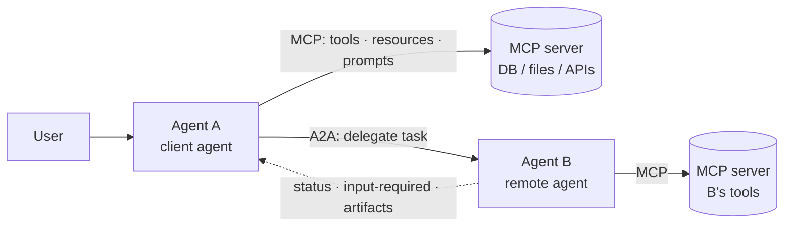

# Agent Protocols



Agent systems usually need two kinds of interoperability. **Tool interoperability**: how an AI app connects to tools, data, prompts, and resources (the **Model Context Protocol**, MCP). **Agent interoperability**: how one agent delegates work to another and tracks that work over time (the **Agent2Agent Protocol**, A2A). They're often mentioned together because both connect agents to the outside world, but they solve different problems.

**The boundary matters.** Treat every remote system as a simple tool and you lose the idea of a **task with progress, clarifying questions, and a lifecycle**. Wrap every small function as an agent and you add **latency and operational complexity** for little benefit.

## 1. MCP in Agentic Contexts
MCP (covered in [What is MCP](../09-mcp/01-what-is-mcp.md)) gives an agent a uniform way to discover and call capabilities:

| Primitive | Controlled by | Agent use |
|---|---|---|
| Tools | Model | Actions (query DB, create ticket) |
| Resources | Application | Context (files, records) |
| Prompts | User | Reusable workflows |
| Sampling / elicitation | Server asks client | Server requests an LLM call or user input |

MCP calls are **synchronous, stateless-ish function calls**: input → result (long ops can report progress, and newer spec versions add task-style async support). The agent keeps the reasoning; the server only executes.

## 2. A2A: Agent-to-Agent Protocol
Introduced by Google (Apr 2025), donated to the **Linux Foundation**; JSON-RPC 2.0 over HTTP(S), with SSE streaming and push notifications (webhooks); gRPC binding in later versions.

| Concept | What |
|---|---|
| **Agent Card** | JSON at `/.well-known/agent-card.json`: name, description, endpoint, **skills**, supported modalities, auth schemes |
| **Task** | Unit of work with id + lifecycle state |
| **Message** | Turn between client and remote agent (role, parts) |
| **Part** | TextPart, FilePart, DataPart (structured JSON) |
| **Artifact** | Output produced by the task (doc, file, data) |
| **Context id** | Groups related tasks/messages into one conversation |

Task states: `submitted → working → (input-required ↔ working) → completed | failed | canceled | rejected` (+ `auth-required`).

```json
{
  "name": "travel-booking-agent",
  "description": "Searches and books flights and hotels within corporate policy.",
  "url": "https://agents.example.com/travel/a2a",
  "version": "1.2.0",
  "capabilities": {"streaming": true, "pushNotifications": true},
  "defaultInputModes": ["text/plain", "application/json"],
  "defaultOutputModes": ["text/plain", "application/json"],
  "securitySchemes": {"oauth": {"type": "oauth2", "flows": {"clientCredentials": {"tokenUrl": "https://auth.example.com/token"}}}},
  "skills": [{"id": "book-trip", "name": "Book trip", "description": "Book flights + hotel for given dates and city",
              "tags": ["travel"], "examples": ["Book NYC→SFO Mar 3–5, hotel near Moscone"]}]
}
```

```python
# client side: send a message, follow the task until it needs input or finishes
resp = await rpc(agent_url, "message/send", {"message": {
    "role": "user", "messageId": uuid4().hex,
    "parts": [{"kind": "text", "text": "Book NYC→SFO Mar 3–5, hotel under $300/night"}]}})
task = resp["result"]
while task["status"]["state"] in ("submitted", "working"):
    task = (await rpc(agent_url, "tasks/get", {"id": task["id"]}))["result"]   # or SSE: message/stream
if task["status"]["state"] == "input-required":
    ask_user(task["status"]["message"])            # e.g., "Two hotels match; which one?"
```

## 3. MCP vs. A2A
| Aspect | MCP | A2A |
|---|---|---|
| Connects | Agent ↔ tools/data | Agent ↔ agent |
| Counterparty | Deterministic capability | Autonomous, possibly LLM-driven, opaque |
| Interaction | Call → result | Multi-turn task with lifecycle |
| Duration | Seconds | Seconds to days |
| State | Minimal | Task + context ids, history |
| Clarification | Elicitation (limited) | First-class `input-required` |
| Discovery | `tools/list` on a connected server | Agent Cards (well-known URL, registries) |
| Opacity | Server exposes schemas | Remote agent hides internals (tools, prompts, model) |

They compose: a remote A2A agent typically uses MCP internally for its own tools.

## 4. Tool or Agent? Drawing the Boundary
| Expose as a **tool** (MCP) when | Expose as an **agent** (A2A) when |
|---|---|
| Deterministic, single action | Needs judgment, planning, multiple steps |
| Returns in seconds | May take minutes–days |
| No clarifying questions needed | May need to ask for input |
| Same owner/team | Different team, vendor, or org owns it |
| Caller should control the logic | Callee owns the domain logic and policy |

Anti-patterns: "agent" wrappers around `get_weather` (pure overhead); a "tool" that secretly runs a 10-minute multi-step agent with no progress or clarification channel.

## 5. Security and Trust (additions)
- Authenticate both directions (OAuth 2 / OIDC, mTLS); scope tokens per skill.
- Signed Agent Cards and registries to prevent impersonation.
- Treat remote agent outputs as **untrusted input** (they can carry prompt injection).
- Don't forward user credentials; use delegated, scoped tokens; log the delegation chain.
- Budget and timeout per delegated task; cancel on parent abort.

## 6. Other Protocols and the Landscape (additions)
| Protocol | Focus |
|---|---|
| **MCP** (Anthropic → Linux Foundation's Agentic AI Foundation) | Tools/context; de facto standard |
| **A2A** (Google → Linux Foundation) | Agent-to-agent tasks |
| ACP (IBM BeeAI) | Agent communication over REST; merged into A2A effort |
| AG-UI | Agent ↔ frontend event streaming |
| Agent Payments (AP2), commerce protocols | Agent-initiated payments with mandates |
| OpenAPI / function calling | Plain tool APIs, still the baseline |

Pick standards that your frameworks support natively (most agent frameworks support MCP; A2A support is common in Google ADK, LangGraph, CrewAI, BeeAI, Semantic Kernel).

## Takeaways
- MCP connects agents to tools and data; A2A connects agents to agents with long-lived, stateful tasks.
- A2A's core: Agent Cards for discovery, Tasks with lifecycle states, Messages/Parts, Artifacts.
- Choose tool vs. agent by determinism, duration, need for clarification, and ownership.
- Authenticate, scope, budget, and treat remote outputs as untrusted.

## References
- A2A specification (a2a-protocol.org) · Google, *Announcing the Agent2Agent Protocol* (2025)
- Model Context Protocol specification (modelcontextprotocol.io) · AG-UI protocol docs

## Related
- [What is MCP](../09-mcp/01-what-is-mcp.md) · [Remote MCP servers](../09-mcp/03-remote-mcp-servers.md) · [Production MCP server patterns](../09-mcp/04-production-mcp-server-patterns.md)
- [Multi-agent systems](../10-agents/03-multi-agent-systems.md) · [Long-running agents](05-long-running-agents.md) · [Agent sandboxing and security](06-agent-sandboxing-and-security.md)
