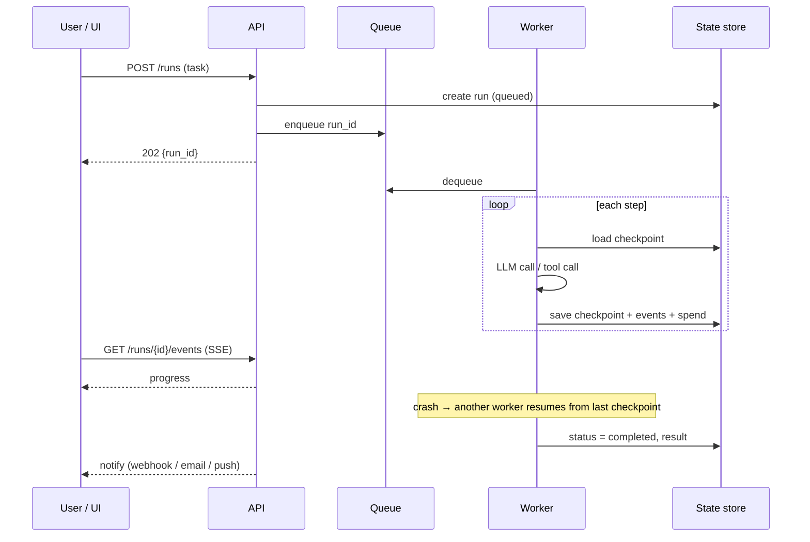

# Long-Running and Async Agents



Once an agent runs longer than a single request-response, the engineering problems change. Processes **crash mid-task**, the **context window fills up** after many tool calls, the **user closes the browser** and expects progress when they come back, workers get **evicted**, model calls **time out**, and a **faulty loop keeps spending money** with nobody watching. For background agents these aren't edge cases; they're **normal operating conditions**.

Long-running agents need to **checkpoint state, resume safely, manage context across long runs, report progress, enforce budgets, and handle work that outlives an HTTP connection**.

## 1. Why Long-Running Agents Are Different
| Short request | Long-running run |
|---|---|
| Seconds; in an HTTP handler | Minutes–days; background worker |
| State in memory | State must be **durable** |
| Failure → retry the request | Failure → **resume from checkpoint** |
| Fits in context | Needs **compaction / external memory** |
| User waits | User leaves; needs **progress + notification** |
| Cost bounded by one call | Cost grows per step; needs **budgets** |

## 2. Decouple from the Request
- `POST /runs` → enqueue, return **202 + run_id** immediately.
- Workers pull from a queue (SQS, Redis Streams, Pub/Sub, Kafka) or a workflow engine.
- Clients follow progress via **SSE/WebSocket**, polling `GET /runs/{id}`, or **webhooks/notifications** on completion.
- Reconnects resume from an event cursor (`Last-Event-ID`).

## 3. Checkpointing and Durable Execution
Persist after every step: messages/summary, plan, tool results, step counter, spend, pending approvals.

```python
async def run_agent(run_id):
    st = await store.load(run_id) or State.new(run_id)
    while not st.done:
        if st.spend_usd > st.budget_usd or st.steps >= st.max_steps:
            return await store.finish(run_id, "budget_exceeded", st)
        if await store.cancel_requested(run_id):
            return await store.finish(run_id, "canceled", st)
        resp = await llm(st.context())
        for call in resp.tool_calls:
            key = f"{run_id}:{st.steps}:{call.id}"                 # idempotency key per side effect
            if (cached := await store.tool_result(key)) is None:
                cached = await execute(call, idempotency_key=key)
                await store.save_tool_result(key, cached)
            st.add_tool_result(call, cached)
        st.add_assistant(resp); st.steps += 1; st.spend_usd += resp.cost
        await store.checkpoint(st)                                   # atomic; resume point
        await events.publish(run_id, {"step": st.steps, "summary": resp.short_summary()})
```

| Option | Notes |
|---|---|
| Hand-rolled (DB + queue) | Simple; you own retries, leases, visibility timeouts |
| **Temporal** / Restate / DBOS / Inngest | Durable workflows: steps replay deterministically, activities retried, timers for days |
| LangGraph checkpointers | Postgres/Redis checkpointer, threads, interrupt/resume |
| Cloud: Step Functions, Durable Functions, Workflows | Managed state machines |
| Agent platforms (OpenAI Agents SDK + Temporal, Claude Agent SDK sessions, managed agent services) | Session persistence built in |

**Idempotency** is the key correctness property: when a step replays after a crash, side effects (emails, payments, tickets) must not repeat. Use idempotency keys, check-before-act, or record-then-act.

## 4. Context Management Across Long Runs
| Technique | How |
|---|---|
| **Compaction** | Summarize older turns into a structured digest (goal, decisions, files/records touched, open issues) |
| Tool-result clearing | Replace old large tool outputs with a short stub + pointer |
| External memory / scratchpad | Agent writes notes/TODO to a file or store and re-reads them |
| Subagents | Delegate sub-tasks to fresh contexts that return summaries |
| Plan anchoring | Keep the current plan pinned at the end of context |
| Artifacts by reference | Store big outputs in object storage; pass ids |

Trigger compaction at a threshold (e.g., 70–80% of the window), and test that the agent still finishes tasks correctly after compaction. See [Agent memory systems](../10-agents/02-agent-memory-systems.md).

## 5. Progress Reporting
- Emit structured events: `step_started`, `tool_called`, `milestone`, `needs_input`, `completed`, `failed`.
- A human-readable **status line** ("Analyzed 34/120 files") + percentage when estimable.
- Persist events so a returning user sees history; send notifications (email, Slack, push) on completion or when **input is required**.
- Long waits for human approval are normal states (`waiting_for_approval`), not timeouts. See [Human-in-the-loop patterns](../10-agents/07-human-in-the-loop-patterns.md).

## 6. Budgets and Runaway Protection
| Limit | Example |
|---|---|
| Spend per run | $5 hard, alert at $4 |
| Steps / tool calls per run | 200 steps |
| Wall-clock | 2 h, then pause for review |
| Per-tool rate | ≤10 emails/run |
| Loop detection | Same tool + same args 3× → stop or re-plan |
| Per-user / per-tenant concurrent runs | 3 active runs |
| Global kill switch | Feature flag halts all workers |

## 7. Failure Handling
| Failure | Handling |
|---|---|
| Model timeout / 5xx / 429 | Retry with backoff + jitter; failover model |
| Worker crash / eviction | Lease expires → another worker resumes from checkpoint |
| Tool permanently failing | Mark step failed; let the agent re-plan or escalate |
| Poison run (keeps crashing) | Max attempts → dead-letter + alert |
| Deploy mid-run | Versioned state schema; drain or replay-compatible code |
| Model/prompt version change mid-run | Pin versions per run |

## 8. Scheduling and Triggers (additions)
- Cron/scheduled agents (daily reports, monitoring); event-triggered agents (new ticket, PR opened, file uploaded).
- Deduplicate triggers; one run per event id.
- Ambient agents watch streams and act or notify; keep humans in the loop for consequential actions.

## 9. Observability (additions)
Trace per run with spans per step; dashboards for runs by state, duration, spend distribution, steps/run, failure reasons, % needing human input, resumes per run. Alert on spend outliers and stuck runs (no progress for N minutes).

## Takeaways
- Treat crashes, timeouts, evictions, full contexts, and absent users as normal conditions.
- Decouple from HTTP: queue + workers + durable state; stream or notify progress.
- Checkpoint every step and make side effects idempotent so resumption is safe.
- Manage context with compaction, external memory, and subagents; enforce spend/step/time budgets and loop detection.

## References
- Temporal docs (durable execution) · LangGraph persistence and interrupts docs
- Anthropic, *Effective context engineering for AI agents* (2025) · Anthropic, *Effective harnesses for long-running agents* (2025)

## Related
- [Coding agents](02-coding-agents.md) · [Deep research agents](03-deep-research-agents.md) · [Agent protocols](04-agent-protocols.md) · [Agent sandboxing and security](06-agent-sandboxing-and-security.md)
- [Building AI workflows](../10-agents/08-building-ai-workflows.md) · [Designing for reliability](../11-ai-system-architecture/02-designing-for-reliability.md) · [Understanding AI application costs](../13-llm-optimization/01-understanding-ai-application-costs.md)
