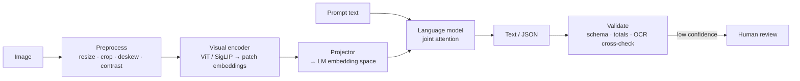

# Vision Models and Image Understanding



Vision models let AI systems reason over **photos, screenshots, diagrams, scanned documents, charts, and video frames**. They describe scenes, read visible text, reason about layout, compare images, and answer targeted questions. Production uses: document processing, product search, insurance claims, UI automation, accessibility, medical imaging support, industrial inspection, multimodal assistants.

The model call is the easy part. The engineering is in deciding **what visual evidence to send, at what resolution, with what prompt, and how to validate the answer**.

## 1. How Vision-Language Models Work
| Stage | What happens |
|---|---|
| 1. Image encoding | Resize, normalize, split into **patches**; a visual encoder (ViT, **SigLIP**, etc.) produces patch embeddings |
| 2. Projection | Embeddings mapped into the LM's representation space; image regions become "visual tokens" |
| 3. Joint reasoning | LM attends across visual + text tokens ("invoice total" ↔ that region of the scan) |
| 4. Text generation | Ordinary text: description, answer, JSON, extracted fields, refusal |

**More resolution and more images mean more tokens, so higher latency, cost, and rate-limit pressure.** Preprocessing is a system-design decision.

Architecture families (additions): adapter-style (LLaVA: frozen encoder + MLP projector), cross-attention (Flamingo, Llama 3.2 Vision), and natively multimodal models trained on interleaved data (GPT-4o/5.x, Gemini, Claude). Dynamic-resolution tiling (Qwen-VL, InternVL) handles large or odd aspect ratios.

## 2. Sending Images to Vision APIs
Inputs: **URL, uploaded file id, or base64**. The pattern is the same everywhere: text instructions + one or more image blocks.

```python
import base64
from openai import OpenAI
client = OpenAI()

def b64(path): return base64.b64encode(open(path, "rb").read()).decode()

r = client.responses.create(model="gpt-4.1-mini", input=[{
    "role": "user",
    "content": [
        {"type": "input_text", "text": "What error is shown in this dialog? Answer in one sentence."},
        {"type": "input_image", "image_url": f"data:image/png;base64,{b64('err.png')}", "detail": "high"},
    ]}])
print(r.output_text)
```

```python
# Anthropic equivalent
import anthropic
msg = anthropic.Anthropic().messages.create(model="claude-sonnet-5-5", max_tokens=500, messages=[{
    "role": "user", "content": [
        {"type": "image", "source": {"type": "base64", "media_type": "image/png", "data": b64("err.png")}},
        {"type": "text", "text": "What error is shown in this dialog?"}]}])
```

- Large payloads: prefer **file ids or signed object-storage URLs** (smaller JSON, less memory, cleaner retries).
- Put images **before** the question (often helps) and label multiple images ("Image 1: before, Image 2: after").
- New multimodal features usually land in the newest API surfaces first; check current docs.

## 3. Resolution, Tokens, and Cost
OpenAI `detail` parameter:

| Detail | Use |
|---|---|
| `low` | Fast, cheap; coarse classification/description |
| `high` | Receipts, charts, dense screenshots, small labels, document extraction |
| `original` | Max detail for large, dense, spatially sensitive images (where supported) |
| `auto` | API decides |

Accounting differs by model family: newer models use **patch-based** accounting, older GPT-4o/4.1 used **tile-based** (512px tiles + base tokens). Anthropic's rough guide is `tokens ≈ width × height / 750`, with images downscaled past a long-edge cap. **Don't hard-code one formula**; build estimators from current docs.

| Image size | Cost | Fit |
|---|---|---|
| 512×512 | Low | Simple classification, description |
| 1024×1024 | Medium | Layout, medium-size text |
| 2048×1024 | Higher | Wide images: **crop** if only one region matters |
| 2048×4096 | Model-dependent (resized/capped) | Use `original` only when the detail matters |

```python
from PIL import Image
import math

def est_patch_tokens(w, h, patch=32, max_long=2048):        # planning estimate only, not billing
    s = min(1.0, max_long / max(w, h)); w, h = int(w*s), int(h*s)
    return math.ceil(w/patch) * math.ceil(h/patch)

def prep(path, max_long=1568, crop=None):
    im = Image.open(path).convert("RGB")
    if crop: im = im.crop(crop)                              # send only the relevant region
    im.thumbnail((max_long, max_long))                       # avoid paying for pixels the API discards
    return im
```

"Cat or dog?" works at low detail. "Extract every line item and total" needs high detail, **ideally on a cropped image**.

## 4. Practical Use Cases
| Use | Notes |
|---|---|
| Description / captioning | Accessibility alt text, catalog enrichment, moderation triage, asset indexing |
| OCR / text extraction | Better than classic OCR **when layout and meaning matter**; not reliably better for raw character accuracy (dense text, tiny print, serial numbers). For high stakes, **cross-check with a dedicated OCR engine** |
| Structured extraction | Ask for specific fields; make uncertainty explicit (null + reason) |
| Diagram / UI interpretation | Flowcharts, wireframes, dashboards, error dialogs; treat output as interpretation |
| Comparison | Before/after, defect vs. reference, document versions |
| Visual QA over charts | Read values, but compute aggregates in code |

## 5. What Vision Models Get Wrong
| Failure | Mitigation |
|---|---|
| **Counting** (overlapping, partially hidden, similar objects) | Detection/segmentation models (YOLO, SAM, Grounding DINO) when counts matter |
| **Spatial reasoning** (precise position, nearest-to-corner) | Crop, overlay grids/coordinates, classic CV |
| **Small text** (fine print, low contrast, angled, compressed) | Crop, deskew, enhance contrast, upscale |
| **Hallucination** (invented text/objects, "completed" serial numbers, plausible wrong totals) | Ask for uncertainty, validate, OCR cross-check, human review |
| **Math from images** | Extract values → validate → compute in code |

**Make uncertainty observable**: confidence fields aren't calibrated probabilities but are useful **routing signals**. Combine with schema validation, consistency checks, OCR cross-checks, and human review queues.

## 6. Worked Example: Receipt Processor
```python
from pydantic import BaseModel, Field, model_validator

class LineItem(BaseModel):
    description: str
    quantity: float | None = None
    amount: float

class Receipt(BaseModel):
    merchant: str | None
    date: str | None = Field(description="ISO date if legible, else null")
    currency: str | None
    items: list[LineItem]
    subtotal: float | None
    tax: float | None
    total: float | None
    confidence: float = Field(ge=0, le=1)
    image_quality_notes: str | None = None          # model reports blur/cropping → triggers review
    total_mismatch: bool = False

    @model_validator(mode="after")
    def check_total(self):
        if self.total is not None and self.items:
            s = sum(i.amount for i in self.items) + (self.tax or 0)
            self.total_mismatch = abs(s - self.total) > 0.02   # flag, don't reject: one misread line shouldn't drop everything
        return self

PROMPT = ("Extract the receipt. Only report text you can read; use null for illegible fields. "
          "Do not guess digits. Describe any image-quality problems in image_quality_notes.")

def extract(path) -> Receipt:
    im = prep(path, max_long=1568)
    if min(im.size) < 300: raise ValueError("image too small to read reliably")
    r = client.responses.parse(model="gpt-4.1-mini", text_format=Receipt, input=[{
        "role": "user", "content": [{"type": "input_text", "text": PROMPT},
                                    {"type": "input_image", "image_url": to_data_url(im), "detail": "high"}]}])
    return r.output_parsed

def process(path):
    try: rec = extract(path)
    except Exception as e: return {"status": "error", "reason": str(e)}
    needs_review = rec.total_mismatch or rec.confidence < 0.7 or rec.image_quality_notes
    return {"status": "review" if needs_review else "ok", "receipt": rec.model_dump()}
```

The happy path isn't enough: **fail gracefully and communicate uncertainty**.

## 7. Choosing a Vision Model (additions)
| Need | Option |
|---|---|
| General VQA, docs, screenshots | Frontier API models (GPT-5.x/4.1, Claude, Gemini) |
| Long PDFs / many pages | Gemini (long context, native PDF), Claude PDF support |
| Cheap high-volume captioning | Small tiers (mini/haiku/flash) at low detail |
| Self-hosted | Qwen2.5/3-VL, InternVL, Llama 3.2 Vision, Gemma 3, Pixtral, served with vLLM |
| Document OCR at scale | Dedicated OCR (Textract, Document AI, Azure DI, PaddleOCR, docTR) ± VLM for layout reasoning |
| Detection / counting / masks | YOLO, Grounding DINO, SAM 2 |

Evaluate on **your** images with field-level accuracy, not generic benchmarks (MMMU, DocVQA, ChartQA, OCRBench).

## 8. Production Concerns (additions)
- **PII** in images (IDs, faces, screens): redact or restrict retention; check provider data policies.
- **Injection via images**: text inside an image can carry instructions; treat it as untrusted data.
- Cache by image hash + prompt version; dedupe repeated uploads.
- Validate file types/sizes; strip EXIF (location); normalize orientation.
- Log image hash, detail level, tokens, latency, and validation outcome per request.

## Takeaways
- Image detail becomes tokens, so resolution and image count drive cost and latency.
- Match detail level and cropping to the task.
- Vision output is probabilistic: validate counts, totals, and extracted fields in code.
- Expose uncertainty and route low-confidence results to humans.

## References
- OpenAI *Images and vision* docs · OpenAI pricing · OpenAI *Structured Outputs*
- Anthropic *Vision* docs · Google Gemini *Image understanding* docs · Hugging Face, *Vision Language Models Explained*

## Related
- [Text-to-image generation](02-text-to-image-generation.md) · [Video understanding and generation](04-video-understanding-and-generation.md) · [Building multimodal applications](05-building-multimodal-applications.md)
- [Multimodal RAG](../07-rag/08-multimodal-rag.md) · [Computer use agents](../14-agentic-ai/01-computer-use-agents.md) · [Understanding AI application costs](../13-llm-optimization/01-understanding-ai-application-costs.md)
