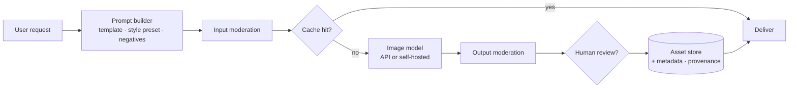

# Text-to-Image Generation



Text-to-image models create visual assets from natural-language descriptions and, increasingly, from **reference images**. They fit **fast visual exploration, many variants, and user-directed creative output**. They fit poorly when the output must be **precise, rights-sensitive, or repeatable** across many runs.

Uses: thumbnails, ad variants, product mockups, storyboards, educational illustrations, game assets, design exploration. The model is one component; a production system also needs **prompt construction, style control, moderation, caching, human review, asset storage, and rights management**.

## 1. How Diffusion Models Work
| Concept | Meaning |
|---|---|
| Forward process | Gradually add Gaussian noise to an image until it's pure noise |
| Reverse process | Network learns to **predict the noise** (or velocity) at each step and remove it |
| **Latent diffusion** | Run diffusion in a compressed VAE latent space (e.g., 64×64×4 for 512² image): far cheaper (Stable Diffusion) |
| Text conditioning | Text encoder (CLIP, T5) embeddings injected via cross-attention or joint attention |
| **Classifier-free guidance (CFG)** | Mix conditional and unconditional predictions; higher scale = more prompt adherence, less diversity, more artifacts |
| Samplers / steps | DDIM, DPM++, Euler; 20–50 steps typical; distilled models (Turbo/LCM/Schnell) use 1–8 |
| Backbones | U-Net (SD 1.5/SDXL) → **Diffusion Transformers (DiT)** + **flow matching** (SD3, FLUX) |
| Seed | Fixes initial noise → reproducibility for a given model/version/params |

Other families: **autoregressive/native multimodal** image generation inside LLMs (GPT-image, Gemini image models), which follow complex instructions and render text better, and are strong at **editing via conversation**.

```python
# Self-hosted with diffusers (shape)
import torch
from diffusers import AutoPipelineForText2Image
pipe = AutoPipelineForText2Image.from_pretrained("black-forest-labs/FLUX.1-schnell", torch_dtype=torch.bfloat16).to("cuda")
img = pipe("isometric illustration of a data center, soft pastel palette, clean vector style",
           num_inference_steps=4, guidance_scale=0.0, generator=torch.Generator("cuda").manual_seed(42)).images[0]
```

## 2. Choosing a Provider
| Option | Strengths | Watch |
|---|---|---|
| OpenAI `gpt-image-*` | Instruction following, text rendering, editing with references | Cost per high-quality image, latency (10–60 s) |
| Google Imagen / Gemini image | Photorealism, editing, SynthID watermark | Region/policy limits |
| Midjourney | Aesthetic quality | Limited official API |
| FLUX (BFL), Stable Diffusion 3.x (Stability), Ideogram, Recraft | API + open weights; Ideogram/Recraft for text, vectors, logos | Licenses differ (non-commercial variants) |
| Self-hosted SDXL/FLUX | Control (LoRA, ControlNet), privacy, cost at volume | GPU ops, safety is on you |

Decide on: quality for your domain, **text rendering**, editing/inpainting, reference-image support, latency, $/image, **commercial license and indemnity**, safety filters, data retention.

## 3. Prompting: Specific Without Being Brittle
Structure: **subject → action/composition → setting → style/medium → lighting → camera/lens → color palette → constraints**.

```python
STYLE_PRESETS = {
    "brand_flat": "flat vector illustration, brand palette #1A73E8 #FBBC04 #FFFFFF, generous whitespace, no text",
    "photo_product": "studio product photo, softbox lighting, white seamless background, 85mm, shallow depth of field",
}

def build_prompt(subject: str, preset: str, aspect: str = "16:9", extra: str = "") -> str:
    return f"{subject}. {STYLE_PRESETS[preset]}. Aspect ratio {aspect}. {extra}".strip()
```

- Put fixed style in **presets** (versioned like prompts); users supply only the subject.
- Spell out quoted text exactly (`a sign reading "OPEN 24/7"`); keep it short.
- Negative prompts (diffusion) or explicit exclusions ("no people, no logos").
- Use an LLM to **expand** a short user idea into a full prompt, but keep the user's intent.
- Fix seed + params for reproducible variants; vary one thing at a time.

## 4. Control Beyond the Prompt (additions)
| Technique | Use |
|---|---|
| Image-to-image (strength) | Restyle while keeping composition |
| **Inpainting / outpainting** | Edit a masked region; extend canvas |
| **ControlNet / T2I-Adapter** | Condition on edges, depth, pose, layout |
| IP-Adapter / reference images | Style or subject from a reference |
| **LoRA / DreamBooth fine-tunes** | Consistent brand style, characters, products |
| Upscalers (Real-ESRGAN, SD upscale) | Generate small, upscale the keeper |

Product images must be **exact**: generate the scene, then **composite the real product photo** rather than letting the model redraw it.

## 5. Shipping Safely
| Concern | Control |
|---|---|
| Harmful/NSFW content | Input prompt moderation + output image classifier; provider filters |
| Real people / likeness | Block or restrict named-person prompts; no sexualized/deceptive depictions |
| Copyrighted characters, trademarks | Prompt filters, review for commercial use |
| Deepfakes / misinformation | Watermark + **C2PA content credentials**; disclose AI generation |
| Bias in default depictions | Test prompt suites across demographics; diversify defaults |
| Abuse at scale | Per-user rate limits, quotas, account trust levels |
| Legal | Vendor terms, indemnity, licensing of training data; check regional AI-content disclosure rules |

## 6. Production Architecture
- **Async**: generation takes seconds to a minute; queue jobs and stream/poll status; show placeholders.
- **Caching**: key = hash(model, version, prompt, seed, params); generated images are expensive.
- **Variants**: generate N (2–4) cheaply at low quality, let users pick, then upscale or re-render the chosen one at high quality.
- **Asset storage**: object storage + CDN; metadata (prompt, model, seed, user, moderation result, license) for audit and rights management.
- **Human review** for brand/marketing assets before publication.
- **Cost control**: quality/size tiers, quotas, draft mode with fast models.

## 7. Evaluation (additions)
- Automated: CLIPScore / VQAScore (prompt alignment), aesthetic predictors, OCR check for requested text, safety classifier rates.
- Human: side-by-side preference, brand-fit rubric, defect tagging (hands, text, artifacts).
- Business: selection rate of generated variants, edits per asset, time saved.

## Takeaways
- Diffusion models denoise latent noise into images guided by text; DiT + flow matching and native multimodal LLM generators are the current frontier.
- Choose providers on domain quality, text rendering, editing, cost, latency, and license.
- Keep prompts structured with versioned style presets; use reference images, ControlNet, or LoRA for consistency.
- Wrap generation with moderation, caching, async jobs, provenance, human review, and asset/rights tracking.

## References
- Ho et al., *DDPM* (2020) · Rombach et al., *Latent Diffusion Models* (2022) · Peebles & Xie, *DiT* (2023) · Esser et al., *SD3 / Rectified Flow Transformers* (2024)
- Hugging Face `diffusers` docs · OpenAI *Image generation* docs · C2PA specification

## Related
- [Vision models and image understanding](01-vision-models-and-image-understanding.md) · [Video understanding and generation](04-video-understanding-and-generation.md) · [Building multimodal applications](05-building-multimodal-applications.md)
- [Building AI-powered UX](../11-ai-system-architecture/06-building-ai-powered-ux.md) · [Caching strategies](../11-ai-system-architecture/07-caching-strategies-for-llm-applications.md)
