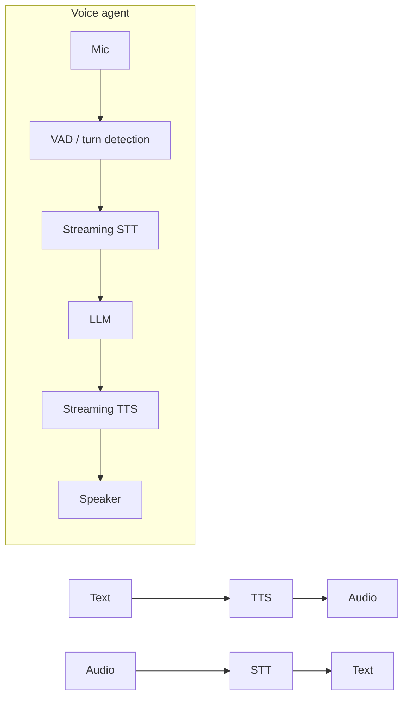

# Audio and Speech



Audio systems let AI applications work with **spoken language**: speech-to-text, text-to-speech, identifying **who spoke when**, live voice agents, sound effects, dubbing, and music. Calling the first API is easy. The hard part is making the experience **fast, clear, consent-respecting, and reliable enough to measure**.

Uses: voice assistants, contact centers, meeting tools, accessibility, media workflows, language learning, podcasts, interactive tutors. Building blocks: **STT, TTS, batch vs. streaming transcription, speaker diarization, and latency trade-offs in real-time voice**.

## 1. Speech-to-Text: Turning Audio into Words
| Model / service | Notes |
|---|---|
| OpenAI Whisper / `gpt-4o(-mini)-transcribe` | Multilingual, robust; Whisper open weights (large-v3, turbo) |
| Deepgram Nova, AssemblyAI Universal, Speechmatics | Low-latency streaming, diarization, keyterms, enterprise features |
| Google Chirp, AWS Transcribe, Azure Speech | Cloud-native, compliance, many languages |
| Gemini / GPT audio-native models | Transcribe + understand (summarize, answer) in one call |
| Self-hosted: faster-whisper, whisper.cpp, NVIDIA Parakeet/Canary | Privacy, cost at volume, on-device |

```python
from openai import OpenAI
client = OpenAI()
with open("call.mp3", "rb") as f:
    tr = client.audio.transcriptions.create(model="gpt-4o-mini-transcribe", file=f,
                                            prompt="Product names: AlgoMaster, Kubernetes, vLLM")  # biasing vocabulary
print(tr.text)
```

Metrics: **WER** (word error rate = (S+D+I)/N), CER for character languages, **entity/keyword accuracy** (names, numbers, product terms usually matter more than overall WER), real-time factor, latency.

Quality levers: 16 kHz mono input, noise suppression, **custom vocabulary / keyterm prompting**, language hint, channel separation (agent vs. customer on separate channels), post-processing (numbers, punctuation, PII redaction).

## 2. Batch vs. Streaming Transcription
| | Batch | Streaming |
|---|---|---|
| Input | Complete file | Audio chunks over WebSocket/WebRTC |
| Output | Final transcript | **Partial** (unstable) + **final** segments |
| Accuracy | Higher (full context) | Slightly lower |
| Latency | Minutes OK | ~100–500 ms partials |
| Use | Meetings, podcasts, call analytics, subtitles | Voice agents, live captions, dictation |
| Cost | Often cheaper | Per-second, connection overhead |

Long files: chunk on silence (VAD) with overlap, or use provider async jobs; preserve timestamps.

## 3. Speaker Diarization
"Who spoke when": segment audio → speaker embeddings (x-vectors/ECAPA) → cluster → label segments.

- Tools: **pyannote.audio**, NeMo, provider diarization flags (Deepgram, AssemblyAI, AWS).
- Hard cases: overlapping speech, short turns, similar voices, unknown speaker count.
- Prefer **separate channels** when you control recording (call centers) instead of diarizing a mixed track.
- Map "Speaker 1/2" to real identities only with consent (enrollment) or from context.
- Metric: **DER** (diarization error rate).

## 4. Text-to-Speech
| Provider | Notes |
|---|---|
| OpenAI `gpt-4o-mini-tts` / tts-1 | Steerable via instructions ("calm, friendly") |
| ElevenLabs | High naturalness, voice cloning, many languages |
| Cartesia, Deepgram Aura, PlayHT, Rime | Very low time-to-first-audio for agents |
| Google, Azure, AWS Polly | SSML, neural voices, compliance |
| Open: Kokoro, XTTS, F5-TTS, Piper | Self-hosted / on-device |

```python
with client.audio.speech.with_streaming_response.create(
        model="gpt-4o-mini-tts", voice="alloy", input="Your order has shipped and arrives Thursday.",
        instructions="Warm, concise, customer-support tone.", response_format="pcm") as r:
    for chunk in r.iter_bytes(4096): player.write(chunk)        # start playback before synthesis finishes
```

- Measure **time-to-first-byte (TTFB)**, naturalness (MOS / preference tests), pronunciation of names and numbers.
- Text normalization: "$1,250.50" → "one thousand two hundred fifty dollars and fifty cents"; dates, abbreviations, phone numbers; SSML or pronunciation lexicons.
- Write for the ear: short sentences, no markdown/bullets/URLs in spoken output.

## 5. Real-Time Voice Agents
Two architectures:

| | Cascaded (STT → LLM → TTS) | Speech-to-speech (realtime models) |
|---|---|---|
| Examples | Deepgram + GPT + ElevenLabs; Pipecat/LiveKit pipelines | OpenAI Realtime API, Gemini Live, Nova Sonic |
| Latency | Sum of stages (~500–1200 ms) | Lower (~300–800 ms) |
| Control | Best-of-breed per stage; inspect text | Fewer knobs, less visibility |
| Prosody / emotion | Lost at text boundary | Preserved |
| Tool calling, guardrails | Easy on text | Supported, less mature |
| Cost | Mix-and-match | Audio tokens can be costly |

### Latency budget (cascaded, target < ~800 ms voice-to-voice)
| Stage | Typical |
|---|---|
| End-of-turn detection (VAD/endpointing) | 200–500 ms (biggest lever) |
| STT final | 100–300 ms |
| LLM TTFT | 200–500 ms |
| TTS time-to-first-audio | 100–250 ms |
| Network/transport | 50–150 ms |

Techniques: **stream everything**, start TTS on the first sentence of LLM output, semantic turn detection (not just silence), fast small model for the conversational turn, filler/backchannel audio for slow tool calls, WebRTC transport, co-locate services.

**Barge-in / interruption**: when the user starts speaking, stop TTS immediately, truncate the assistant message to what was actually spoken, and resume listening.

```python
async def on_user_speech_start():
    tts.stop(); llm_task.cancel()
    history.truncate_last_assistant(spoken_chars=tts.played_chars)   # model must know what user heard
```

Frameworks: **Pipecat**, **LiveKit Agents**, Vapi, Retell, Twilio Media Streams for telephony (8 kHz μ-law audio).

## 6. Other Audio Generation (additions)
- **Voice cloning**: requires explicit, verified consent from the voice owner; watermark outputs.
- **Dubbing / speech translation**: STT → translate → TTS with voice matching, or end-to-end models; timing alignment for video.
- Sound effects and music generation (ElevenLabs SFX, Stable Audio, Suno/Udio, MusicGen): licensing varies.

## 7. Consent, Privacy, Safety
- Disclose recording and AI voice ("You're speaking with an AI assistant"); follow call-recording consent laws (one/two-party).
- Redact PII (card numbers, SSNs) from transcripts and audio; PCI pause-and-resume for payments.
- Retention limits for raw audio; voiceprints may be biometric data (BIPA, GDPR special category).
- Anti-spoofing: don't use voice alone for authentication.
- Deepfake risk: restrict cloning to consented voices; watermark.

## 8. Evaluation and Monitoring (additions)
| Layer | Metric |
|---|---|
| STT | WER on your domain set, entity accuracy, latency |
| TTS | TTFB, MOS/preference, mispronunciation rate |
| Conversation | Voice-to-voice latency p50/p95, interruptions handled, false barge-ins, task success, containment rate (no human handoff), CSAT |
| Ops | Dropped calls, concurrent sessions, $/minute |

Test with real-world audio: accents, background noise, phone codecs, crosstalk. Simulated callers (LLM + TTS) can stress-test voice agents.

## Takeaways
- STT and TTS are the round trip; pick batch for accuracy and streaming for interactivity.
- Measure domain WER and entity accuracy, not just generic benchmarks; bias vocabulary for names and terms.
- Diarization labels who spoke when; separate channels beat diarizing mixed audio.
- Voice agent UX is a latency game: stream every stage, detect turns well, handle barge-in.
- Consent, disclosure, PII redaction, and voice-cloning controls are mandatory.

## References
- Radford et al., *Whisper* (2022) · pyannote.audio docs · OpenAI *Speech to text*, *Text to speech*, *Realtime API* docs
- Pipecat and LiveKit Agents docs · Deepgram / AssemblyAI streaming docs

## Related
- [Vision models and image understanding](01-vision-models-and-image-understanding.md) · [Video understanding and generation](04-video-understanding-and-generation.md) · [Building multimodal applications](05-building-multimodal-applications.md)
- [Latency optimization](../13-llm-optimization/04-latency-optimization.md) · [Building AI-powered UX](../11-ai-system-architecture/06-building-ai-powered-ux.md) · [Tool use: from text generation to action](../08-tool-use/01-from-text-generation-to-action.md)
