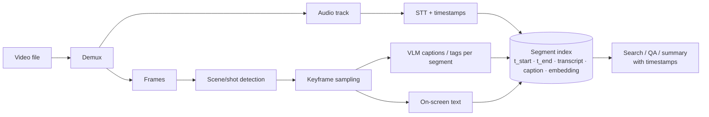

# Video Understanding and Generation



Video adds **time** to multimodal AI. A system must understand what appears in each frame and **how things change across frames**: actions, scene cuts, camera movement, speech, captions, and the **order of events**.

Generation models can create **short clips** from text, still images, or reference video. They're good for creative exploration, ads, social clips, and motion concepts, and poor when output must be **precise, long, factual, or faithful to product details**. Core skills: practical understanding pipelines, **frame sampling to control cost**, and production decisions about generation.

## 1. Breaking Video into Understandable Pieces
| Piece | How | Why |
|---|---|---|
| Audio | Demux with ffmpeg → STT with word timestamps | Speech carries most info in talks, meetings, tutorials |
| Shots / scenes | PySceneDetect (content/threshold), TransNetV2 | Natural segment boundaries |
| Keyframes | 1 per shot + uniform fps within long shots | Cost control |
| On-screen text | OCR on keyframes | Slides, UI, captions, signs |
| Objects/actions | VLM captions per segment; detectors/trackers when precision matters | Searchable descriptions |
| Segments | Window of 10–60 s merging all of the above | Unit for indexing and citing |

```bash
ffmpeg -i in.mp4 -vn -ac 1 -ar 16000 audio.wav                        # audio for STT
ffmpeg -i in.mp4 -vf "select='gt(scene,0.3)',scale=768:-1" -vsync vfr kf_%04d.jpg   # scene-change keyframes
```

## 2. Frame Sampling and Cost
Video is a stack of images; cost scales with **frames × tokens per frame**.

| Strategy | Frames for a 10-min video | Fit |
|---|---|---|
| Native 1 fps (e.g., Gemini default) | 600 | Short clips, fine-grained QA |
| Uniform 0.2 fps | 120 | Overview, summaries |
| Scene-change keyframes | ~50–150 | Edited content |
| Transcript-first, frames on demand | 0 → few | Talking heads, lectures |
| Adaptive (motion/novelty threshold) | Varies | Surveillance, sports |

Gemini processes video natively (~258 tokens/frame at default resolution plus audio; ~300 tokens/s overall, lower at "low" media resolution), so 1 hour ≈ ~1M tokens. Other APIs take frames as images. Downscale frames, lower fps, and **ask targeted questions** of the relevant segment rather than the whole video.

```python
def sample_frames(path, fps=0.5, max_frames=64, long_edge=768):
    import cv2
    cap = cv2.VideoCapture(path); native = cap.get(cv2.CAP_PROP_FPS); step = max(1, int(native / fps))
    frames, i = [], 0
    while len(frames) < max_frames:
        ok = cap.grab()
        if not ok: break
        if i % step == 0:
            _, f = cap.retrieve(); h, w = f.shape[:2]; s = long_edge / max(h, w)
            frames.append((i / native, cv2.resize(f, (int(w*s), int(h*s)))))   # keep timestamp
        i += 1
    return frames
```

## 3. Understanding Tasks
| Task | Approach |
|---|---|
| Summarization | Transcript + keyframe captions → hierarchical summary (segment → chapter → video) |
| Q&A with timestamps | Retrieve segments → VLM on those frames + transcript → cite `mm:ss` |
| Video search | Index segment text + multimodal embeddings; return time-coded hits |
| Chaptering | Topic shifts in transcript + scene cuts |
| Moderation | Sampled frames + audio classifiers; escalate borderline |
| Event / action detection | Specialized models (temporal detection, tracking) when precise timing matters |
| Meeting/lecture notes | Transcript + slide OCR deduplicated |

**Temporal reasoning is weak**: counting repetitions, exact ordering of quick events, speed, and causality across long spans are error-prone. Give timestamps explicitly in the prompt (`[t=02:15] frame…`), keep windows short, verify in code when precision matters.

## 4. Video RAG (additions)
- Segment records: `{video_id, t_start, t_end, transcript, captions, ocr_text, embedding}`.
- Hybrid search over transcript text + caption embeddings; optional multimodal video embeddings (Twelve Labs, Gemini/Vertex multimodal embeddings).
- Answer with **deep links to timestamps** so users can verify. See [Multimodal RAG](../07-rag/08-multimodal-rag.md).

## 5. Video Generation
| Model | Notes |
|---|---|
| OpenAI Sora 2 | Text/image-to-video with audio |
| Google Veo 3.x | High fidelity, native audio, Gemini/Vertex API |
| Runway Gen-4, Luma Ray, Kling, Pika, Hailuo | Creative tools, image-to-video, camera controls |
| Open: Wan 2.x, HunyuanVideo, LTX-Video, CogVideoX | Self-hostable; heavy GPU |

Typical limits: **5–20 s clips**, 720p–1080p, generation times of tens of seconds to minutes, **$ per second of output** (can be high).

Engineering patterns:
- **Image-to-video** from an approved keyframe for consistency (generate the still first, then animate).
- Storyboard → shot list → generate per shot → edit/stitch (ffmpeg, NLE).
- Async jobs with webhooks/polling; show progress; store with provenance metadata.
- Never use for **precise product depictions, factual events, or legal/medical content** without real footage.
- Safety: likeness and deepfake controls, C2PA/watermarks (SynthID), moderation on prompts and outputs, disclosure.

## 6. Production Pipeline Concerns (additions)
- Heavy preprocessing (decode, scene detection, STT) runs as **batch jobs** on workers, not in request paths.
- Cache derived artifacts (transcripts, keyframes, captions) by video hash; re-run only changed stages.
- Storage: originals in object storage; transcode to proxies for analysis.
- Cost model per video-minute: STT + frames × tokens + embeddings + storage.
- Privacy: faces, license plates, screens; blur/redact; retention policies.

## 7. Evaluation (additions)
- QA accuracy with timestamp correctness (answer + within ±N s).
- Summary coverage vs. human chapter lists; search recall@k on labeled queries.
- Benchmarks: Video-MME, MVBench, EgoSchema, LongVideoBench.
- For generation: prompt adherence, temporal consistency, artifact rate, human preference.

## Takeaways
- Video = frames + audio + time; decompose into timestamped segments (transcript, keyframes, OCR, captions).
- Frame sampling is the main cost lever; use scene-aware, adaptive, or transcript-first sampling.
- Models are weak at fine temporal reasoning; keep windows short, pass timestamps, verify precisely in code.
- Video generation suits short creative clips; use image-to-video and shot-based workflows, async jobs, and provenance controls.

## References
- Gemini *Video understanding* docs · PySceneDetect docs · ffmpeg docs
- OpenAI Sora, Google Veo docs · Fu et al., *Video-MME* (2024)

## Related
- [Vision models and image understanding](01-vision-models-and-image-understanding.md) · [Audio and speech](03-audio-and-speech.md) · [Text-to-image generation](02-text-to-image-generation.md) · [Building multimodal applications](05-building-multimodal-applications.md)
- [Multimodal RAG](../07-rag/08-multimodal-rag.md) · [Data architecture for AI](../11-ai-system-architecture/03-data-architecture-for-ai.md)
