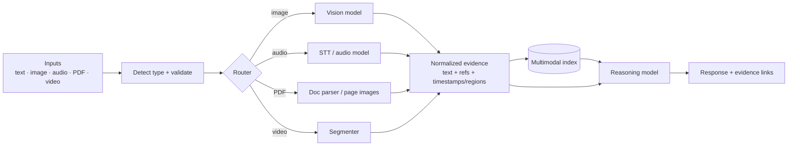

# Building Multimodal Applications



Most AI products are no longer text-only. Users upload **screenshots, photos, PDFs, recordings, tables, and videos**. A multimodal system must understand each input type, **track the evidence behind its answers**, and pick the right model or tool for each job.

Example workflows: screenshot troubleshooting, product search by photo, document analysis across text and diagrams, meeting summarization, video search, voice agents with visual context. Core topics: **multimodal embeddings, cross-modal search, multimodal RAG, routing, and architecture choices**.

## 1. Multimodal Embeddings: A Shared Retrieval Space
Models trained with **contrastive learning** on (image, caption) pairs place images and text in the **same vector space**, so a text query can retrieve images and vice versa.

| Model | Modalities | Notes |
|---|---|---|
| **CLIP / OpenCLIP** | Image ↔ text | Classic baseline; weak on text-in-image and fine detail |
| **SigLIP / SigLIP 2** | Image ↔ text | Sigmoid loss, better quality per size |
| Cohere Embed v4, Voyage multimodal, Jina CLIP/v4 | Text + images (interleaved, screenshots) | API; strong for documents/screenshots |
| Vertex / Gemini multimodal embeddings | Text, image, video | Shared space incl. video segments |
| ImageBind | Image, text, audio, depth, thermal, IMU | Research, binds via images |
| CLAP | Audio ↔ text | Sound search |
| **ColPali / ColQwen** | Page images ↔ text (late interaction) | Retrieve PDF pages **without OCR**; multi-vector |

```python
import torch, open_clip
from PIL import Image
model, _, preprocess = open_clip.create_model_and_transforms("ViT-B-32", pretrained="laion2b_s34b_b79k")
tok = open_clip.get_tokenizer("ViT-B-32")

@torch.no_grad()
def embed_images(paths):
    x = torch.stack([preprocess(Image.open(p).convert("RGB")) for p in paths])
    return torch.nn.functional.normalize(model.encode_image(x), dim=-1)

@torch.no_grad()
def embed_text(qs):
    return torch.nn.functional.normalize(model.encode_text(tok(qs)), dim=-1)

sims = embed_text(["red running shoes"]) @ embed_images(catalog_paths).T     # cosine similarity
```

Caveats: modality gap (text-text scores aren't comparable to text-image scores, so don't mix in one ranked list without calibration); domain shift (fine-tune on your catalog for best results); text inside images often needs OCR or document-specific embedders.

## 2. Cross-Modal Search
| Query → Target | Approach |
|---|---|
| Text → image | Shared embedding (CLIP/SigLIP) + metadata filters |
| Image → image (visual similarity, product by photo) | Image embeddings; crop to the object first (detector) |
| Image → text/docs | Caption/OCR the query image, or shared embedding |
| Text → audio/video moment | Index transcripts + segment captions with timestamps |
| Mixed (photo + "in blue") | Composed retrieval: image embedding + text filter/re-rank |

Production: **hybrid** = multimodal vectors + keyword/BM25 over captions/OCR + structured filters (price, size, availability), then a **re-ranker** (VLM or cross-encoder) for the top-k. See [Scaling vector search](../06-embeddings-vector-search/05-scaling-vector-search.md).

## 3. Multimodal RAG
Three patterns for indexing non-text content:

| Pattern | How | Pros | Cons |
|---|---|---|---|
| **Convert to text** | OCR, captions, table-to-markdown, transcripts; embed text | Works with any text RAG stack; cheap retrieval | Loses visual detail; caption quality limits recall |
| **Native multimodal embeddings** | Embed images/pages directly (ColPali, Cohere v4) | Keeps layout/charts; no OCR pipeline | Heavier index; newer tooling |
| **Hybrid** | Retrieve via text surrogates, pass **original images** to the VLM at answer time | Best of both | More moving parts, more tokens |

```python
def answer(question):
    hits = index.search(question, k=6)                         # text surrogate or page embeddings
    content = [{"type": "input_text", "text": f"Question: {question}\nCite sources as [doc p.N]."}]
    for h in hits:
        content.append({"type": "input_text", "text": f"[{h.doc} p.{h.page}] {h.text[:1500]}"})
        if h.kind in ("chart", "diagram", "page_image"):
            content.append({"type": "input_image", "image_url": h.image_url, "detail": "high"})
    return client.responses.create(model="gpt-4.1-mini", input=[{"role": "user", "content": content}]).output_text
```

Keep **evidence references** (doc, page, bounding box, timestamp) through the whole pipeline so answers link back to the exact region or moment. Deep dive: [Multimodal RAG](../07-rag/08-multimodal-rag.md).

## 4. Routing
| Input | Default route | Escalate when |
|---|---|---|
| Simple photo question | Small VLM, low detail | Low confidence, small text |
| Receipt/form/ID | OCR + VLM structured extraction | Validation fails → human |
| Long PDF | Parser (Docling, Unstructured, LlamaParse, Document AI) → text RAG; page images for charts | Complex tables/figures |
| Audio | STT → text model | Tone/emotion matters → audio-native model |
| Video | Transcript-first; frames on demand | Visual-only content |
| Screenshot of UI error | VLM high detail on cropped region | Needs actions → computer use agent |

Routing signals: MIME type, file size/pages/duration, user intent classification, cost budget, latency SLO, required precision. Prefer **specialist tools** (OCR, detectors, STT) for precise sub-tasks and the **LLM/VLM for reasoning and synthesis**. See [Model selection and routing](../13-llm-optimization/03-model-selection-and-routing.md).

## 5. Architecture Choices
| Decision | Options |
|---|---|
| One native multimodal model vs. pipeline of specialists | Native: simpler, keeps cross-modal context, costlier per token. Pipeline: cheaper, debuggable, best-of-breed, more glue |
| Sync vs. async processing | Images: sync. Long audio/video/PDF: **async ingest** jobs + status |
| Preprocess at ingest vs. at query | Ingest: fast queries, upfront cost. Query: fresh, slower |
| Storage | Originals in object storage; derived artifacts (OCR, captions, transcripts, embeddings) versioned by model |
| Context assembly | Text surrogates first, raw media only where needed (token cost) |

Upload pipeline: validate type/size → virus scan → strip metadata (EXIF) → normalize (orientation, format, sample rate) → hash for dedupe/cache → store → enqueue processing → emit status events.

## 6. UX Patterns (additions)
- Show what the model "saw": highlight regions, show page thumbnails, timestamp links.
- Progressive results for long media (transcript appears first, summary later).
- Let users crop/select a region before asking.
- Clear limits (file size, duration, formats) and graceful errors for unreadable inputs.

## 7. Security, Privacy, Cost (additions)
- **Prompt injection through media**: text in images, PDFs, or audio is untrusted content.
- PII in screenshots, IDs, faces, voices: redact, restrict retention, regional processing.
- Cost per modality: track image tokens, audio minutes, video frames separately in cost dashboards; cap upload sizes and durations; cache derived artifacts by content hash.
- Evaluate per modality and end to end: extraction accuracy, retrieval recall, answer faithfulness with evidence, latency per input type.

## Takeaways
- Multimodal apps normalize every input into evidence with references (page, region, timestamp).
- Shared embedding spaces (CLIP/SigLIP, ColPali, multimodal APIs) enable cross-modal search; combine with keyword, filters, and re-ranking.
- Multimodal RAG: convert-to-text, native embeddings, or hybrid (retrieve via text, reason over original images).
- Route by modality, size, intent, and precision; specialists for precise sub-tasks, VLM/LLM for reasoning.

## References
- Radford et al., *CLIP* (2021) · Zhai et al., *SigLIP* (2023) · Faysse et al., *ColPali* (2024) · Girdhar et al., *ImageBind* (2023)
- OpenCLIP docs · Cohere Embed v4 docs · Docling docs

## Related
- [Vision models and image understanding](01-vision-models-and-image-understanding.md) · [Audio and speech](03-audio-and-speech.md) · [Video understanding and generation](04-video-understanding-and-generation.md)
- [Multimodal RAG](../07-rag/08-multimodal-rag.md) · [What are embeddings](../06-embeddings-vector-search/01-what-are-embeddings.md) · [Architecture patterns for AI applications](../11-ai-system-architecture/01-architecture-patterns-for-ai-applications.md)
