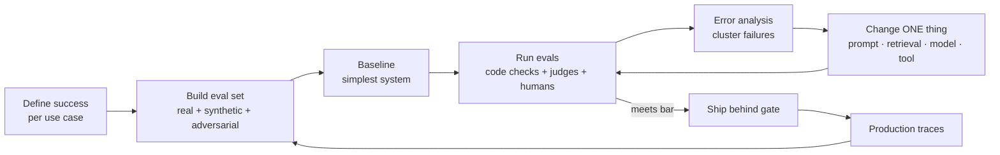

# Eval-Driven Development



LLM output is non-deterministic, open-ended, and fails silently: a wrong answer looks as fluent as a right one. **Evals replace unit tests as the main feedback signal.** Without them, every prompt tweak is a guess, model upgrades are scary, and regressions reach users first.

Eval-driven development (EDD) means writing the eval before the feature, the same way test-driven development writes the test first. It's the single habit that separates prototypes from production AI systems.

## 1. Why AI Evals Are Different
| Traditional software | LLM applications |
|---|---|
| Deterministic output | Sampled output; same input → different answers |
| Exact assertions | Many acceptable answers; quality is graded |
| Bugs crash or error | Failures look plausible (hallucination, omission) |
| Coverage by code paths | Coverage by **input distribution** (intents, edge cases, languages) |
| Tests rarely change | Eval set grows continuously from production failures |

## 2. The Evaluation Stack
Use the cheapest evaluator that can decide the question.

| Layer | What it checks | Cost | Example |
|---|---|---|---|
| **Code assertions** | Format, schema, length, forbidden strings, tool called, JSON valid | ~free | `Order.model_validate_json(out)` |
| **Reference-based metrics** | Exact match, F1, BLEU/ROUGE, embedding similarity | Cheap | Extraction field accuracy |
| **LLM-as-judge** | Faithfulness, helpfulness, tone, policy compliance | Medium | Rubric-graded 1–5 or pass/fail |
| **Human review** | Ground truth, judge calibration, subtle quality | Expensive | Weekly 100-sample review |
| **Online signals** | Thumbs, edits, retries, escalations, conversion | Free at scale, noisy | A/B test outcome |

Rule: **assertions first, judges second, humans to calibrate both.** See [LLM-as-a-judge](03-llm-as-a-judge.md).

## 3. Define Success Before Building
Write down, per use case:
- **Task success criterion**: what does a correct output contain or do?
- **Hard constraints**: must-never violations (PII leak, wrong price, unsafe advice). These are zero-tolerance assertions.
- **Quality dimensions**: correctness, completeness, groundedness, tone, conciseness. Pick 2–4, not 10.
- **Operational targets**: p95 latency, cost per request, refusal rate.
- **Ship bar**: e.g., "≥ 92% task success, 0 critical violations, p95 < 3 s, ≤ $0.01/request."

## 4. Metric Choice by Task Type
| Task | Primary metrics |
|---|---|
| Classification / routing | Accuracy, per-class precision/recall, confusion matrix |
| Extraction | Field-level exact match / F1, schema validity, null-handling |
| RAG Q&A | Retrieval recall@k, faithfulness, answer correctness, citation precision ([RAG evals](../07-rag/05-evaluating-rag-systems.md)) |
| Summarization | Coverage of key points, factual consistency, length compliance |
| Generation (copy, email) | Pairwise preference vs. baseline, rubric adherence, brand/tone |
| Agents | Task success, pass^k, steps/cost per success, safety violations ([agent evals](../10-agents/06-agent-evaluation-and-testing.md)) |
| Code | Unit tests pass, compile rate, SWE-bench-style resolution |

## 5. A Minimal Eval Harness
```python
import json, statistics, asyncio
from dataclasses import dataclass
from typing import Callable

@dataclass
class Case:
    id: str
    input: dict
    expected: dict | None = None
    tags: tuple[str, ...] = ()

@dataclass
class Result:
    case_id: str
    scores: dict[str, float]
    output: str

async def run_eval(cases: list[Case], system: Callable, scorers: dict[str, Callable], concurrency=8):
    sem = asyncio.Semaphore(concurrency)
    async def one(c: Case):
        async with sem:
            out = await system(**c.input)
            return Result(c.id, {n: await s(c, out) for n, s in scorers.items()}, out)
    results = await asyncio.gather(*(one(c) for c in cases))
    summary = {n: statistics.mean(r.scores[n] for r in results) for n in scorers}
    return results, summary

# scorers: code assertion + judge
async def valid_json(case, out):
    try: json.loads(out); return 1.0
    except ValueError: return 0.0
```

Log every run with: system version (prompt hash, model ID, retrieval config), eval set version, per-case scores, and cost. Compare runs **per tag slice**, not just in aggregate: an average can rise while one intent collapses.

## 6. Statistical Hygiene
- **Sample size**: with 100 cases, a 90% pass rate has a 95% CI of roughly ±6 points. Differences smaller than that are noise. Use ≥ 300–500 cases for decisions on small deltas.
- **Paired comparison**: run old and new systems on the **same** cases; use a paired test (McNemar for pass/fail, bootstrap for scores).
- **Non-determinism**: run k samples per case (or temperature 0 with a seed where supported) and report mean and variance.
- **Judge noise**: judges have their own error rate; measure their agreement with humans before trusting a 2-point improvement.
- **Overfitting the eval set**: keep a held-out set you don't look at while iterating.

```python
import random
def bootstrap_diff(a: list[float], b: list[float], n=10_000):
    """Paired bootstrap CI for mean(b) - mean(a) on the same cases."""
    idx = range(len(a)); diffs = []
    for _ in range(n):
        s = [random.choice(idx) for _ in idx]
        diffs.append(sum(b[i] - a[i] for i in s) / len(s))
    diffs.sort(); return diffs[int(.025*n)], diffs[int(.975*n)]
```

## 7. Where Evals Run
| Stage | Eval | Gate? |
|---|---|---|
| Local iteration | Small dev set (30–100), fast | No |
| Pull request | Golden regression set + critical assertions | **Yes** ([CI/CD](../12-production-deployment/02-ci-cd-for-ai-applications.md)) |
| Pre-release | Full set + held-out + red-team suite | Yes |
| Production | Sampled online judging, user signals, drift checks | Alerts ([monitoring](../12-production-deployment/03-monitoring-and-observability.md)) |
| Scheduled | Nightly vs. provider model updates | Alerts |

## 8. Tooling
| Tool | Strength |
|---|---|
| Promptfoo | YAML-driven prompt/model matrix tests, red-teaming, CI-friendly |
| DeepEval | Pytest-style metrics (G-Eval, faithfulness, hallucination) |
| RAGAS | RAG-specific metrics |
| Inspect AI (UK AISI) | Rigorous evals, agent tasks, sandboxes |
| OpenAI Evals / provider eval APIs | Hosted graders |
| Langfuse, LangSmith, Braintrust, Arize Phoenix, W&B Weave | Datasets + experiments + tracing + online scoring |

Spreadsheets and a Python script are a fine start. Tooling matters less than **looking at the data**.

## 9. Anti-Patterns
- Shipping on "vibes" from 5 hand-picked prompts.
- Off-the-shelf generic metrics (BLEU, "helpfulness 1–10") that don't match the product's definition of good.
- One aggregate score with no slices.
- Eval sets built only from synthetic data or only from the happy path.
- Judges never compared with humans.
- Evals that take hours, so nobody runs them.

## Takeaways
- Evals are the unit tests of AI systems; write them before the feature and grow them from production failures.
- Layer evaluators: code assertions → reference metrics → LLM judges → human calibration → online signals.
- Define success, hard constraints, and a ship bar per use case before building.
- Compare systems paired on the same cases, report confidence intervals and per-slice results, and keep a held-out set.

## References
- Hamel Husain, *Your AI Product Needs Evals* (2024) · Shreya Shankar et al., *Who Validates the Validators?* (2024)
- Anthropic *Define success criteria and build evaluations* docs · OpenAI *Evaluation best practices*
- Promptfoo, DeepEval, RAGAS, Inspect AI docs

## Related
- [Building eval datasets and error analysis](02-building-eval-datasets-and-error-analysis.md) · [LLM-as-a-judge](03-llm-as-a-judge.md) · [Online evaluation and experiments](04-online-evaluation-and-experiments.md)
- [Evaluating RAG systems](../07-rag/05-evaluating-rag-systems.md) · [Agent evaluation and testing](../10-agents/06-agent-evaluation-and-testing.md) · [CI/CD for AI applications](../12-production-deployment/02-ci-cd-for-ai-applications.md)
- Repo: [LLM eval and observability](../../11-llm-applications/11-eval-and-observability.md) · [Evaluation benchmarks](../../10-llms/04-evaluation-benchmarks.md)
