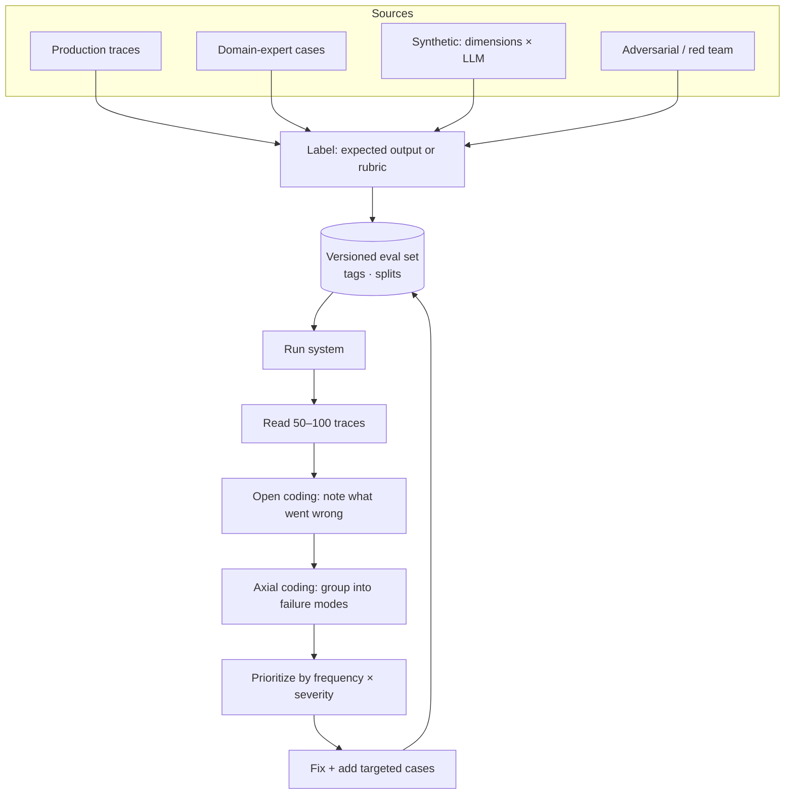

# Building Eval Datasets and Error Analysis



An eval is only as good as its dataset. The best eval sets come from **real user inputs**, labeled by someone who knows what "good" means, and organized so you can see **which kinds of inputs fail**. Error analysis, which means systematically reading outputs and naming failure modes, tells you what to measure and what to fix first.

## 1. Anatomy of an Eval Case
```json
{
  "id": "refund-0142",
  "input": {"message": "I was charged twice for order #A-9912", "user_tier": "pro"},
  "expected": {"intent": "billing_dispute", "must_include": ["refund timeline"], "must_not": ["promise exact date"]},
  "rubric": "Acknowledges double charge, checks order, explains 5–7 day refund window.",
  "tags": ["billing", "pro", "single-turn"],
  "source": "prod-trace-2026-09-14",
  "split": "dev"
}
```
Not every case needs an exact expected output. Use **reference answers** where one is right, **assertions** (`must_include`, `must_not`, schema) where several are acceptable, and **rubrics** for judged quality.

## 2. Where Cases Come From
| Source | Strength | Weakness |
|---|---|---|
| Production logs / traces | Real distribution, real phrasing | Needs PII scrubbing; few rare cases |
| Domain experts | Correct labels, knows edge cases | Slow, expensive |
| Support tickets, search logs, FAQs | Pre-launch proxy for real queries | May not match chat phrasing |
| Synthetic generation | Coverage of rare slices, fast | Bland, repetitive, misses real weirdness |
| Adversarial / red team | Safety and robustness | Not representative of normal use |
| Past incidents | Regression protection | Narrow |

Target mix for a mature set: mostly real, synthetic to fill coverage holes, a dedicated adversarial suite.

## 3. Generating Synthetic Cases That Aren't Bland
Don't ask "generate 100 user questions." Define **dimensions**, sample combinations, then generate.

```python
import itertools, random
DIMS = {
    "intent": ["refund", "shipping_delay", "cancel", "wrong_item", "account_access"],
    "persona": ["new customer", "angry repeat buyer", "non-native English speaker", "terse mobile user"],
    "complexity": ["single issue", "two issues in one message", "missing order number"],
}
combos = random.sample(list(itertools.product(*DIMS.values())), 60)

PROMPT = """Write one realistic customer support message.
Intent: {intent}. Persona: {persona}. Complexity: {complexity}.
Use natural phrasing, typos if the persona would make them. Output only the message."""
```
Then: dedupe by embedding similarity, have a human review a sample, and label expected behavior. Synthetic inputs are cheap; **labels are where quality comes from**. See repo [Synthetic data](../../11-llm-applications/04-synthetic-data.md).

## 4. Size and Splits
| Stage | Size | Purpose |
|---|---|---|
| Smoke set | 20–50 | Runs in seconds; every local change |
| Dev set | 100–300 | Iterate against; you'll overfit it |
| Golden regression set | 200–1000 | CI gate; stable, versioned |
| Held-out test set | 100–500 | Touch only for release decisions |
| Adversarial suite | 50–500 | Safety, injection, jailbreaks |

Balance by **tag slices** so rare-but-critical intents have enough cases (≥ 20–30 per slice for a rough signal).

## 5. Error Analysis: The Highest-ROI Activity
Most teams under-invest here. The process (adapted from qualitative research):

1. **Sample** 50–100 traces, mixing failures, random, and low-confidence ones.
2. **Open coding**: for each, write a short free-text note on the *first* thing that went wrong. Don't use a predefined taxonomy yet.
3. **Axial coding**: group notes into failure modes ("retrieved wrong product version", "ignored refund policy", "asked for info already given").
4. **Count** each mode; weight by severity.
5. **Fix the top mode**, add targeted cases for it, re-run.
6. Repeat until the error rate stops falling, about 100 traces per round.

| Failure mode | Count | Severity | Likely layer |
|---|---|---|---|
| Wrong doc version retrieved | 14 | High | Retrieval: metadata filter |
| Missing escalation on legal threat | 3 | Critical | Prompt + classifier |
| Over-long answers | 21 | Low | Prompt / max tokens |
| Hallucinated order status | 6 | Critical | Tool not called → force tool |

**Locate the failing layer** before fixing: input understanding → retrieval → context assembly → generation → tool execution → post-processing. Trace views make this fast.

## 6. Labeling Practice
- Write a **labeling guide** with examples of pass/fail per criterion; update it when labelers disagree.
- Prefer **binary pass/fail per criterion** over 1–10 scales: higher agreement, clearer action.
- Measure inter-annotator agreement (Cohen's κ) on an overlap sample; κ < 0.6 means the criterion is ambiguous.
- One "benevolent dictator" domain expert often beats a committee for early-stage labels.
- Labels drift: criteria change as you see more data ("criteria drift"). Re-label old cases when the definition changes.

## 7. Dataset Operations
- **Version** eval sets (git, DVC, or the eval platform's dataset versions); record which version each score used.
- Store provenance (`source`, date) and **scrub PII** before cases leave production.
- **Freshness**: add new production failures weekly; retire cases that no longer reflect the product.
- Keep **multi-turn** cases as full conversation prefixes and **agent** cases with a fixed environment state.
- Contamination: don't put eval cases into few-shot examples or fine-tuning data.

## Takeaways
- Real user inputs labeled by domain experts are the backbone; synthetic data fills coverage gaps along explicit dimensions.
- Organize cases with tags and splits (smoke, dev, golden, held-out, adversarial) and version them.
- Error analysis means reading traces, open-coding failures, grouping them into modes, and fixing the most frequent or severe first.
- Binary per-criterion labels with a written guide beat vague numeric scales.

## References
- Hamel Husain & Shreya Shankar, *AI Evals for Engineers* course notes (2025) · Shankar et al., *Who Validates the Validators?* (2024)
- Braun & Clarke, thematic analysis (open/axial coding origins)

## Related
- [Eval-driven development](01-eval-driven-development.md) · [LLM-as-a-judge](03-llm-as-a-judge.md)
- [Evaluating RAG systems](../07-rag/05-evaluating-rag-systems.md) · [Iterating in production](../12-production-deployment/05-iterating-in-production.md) · [Preparing fine-tuning data](../17-fine-tuning/02-preparing-fine-tuning-data.md)
