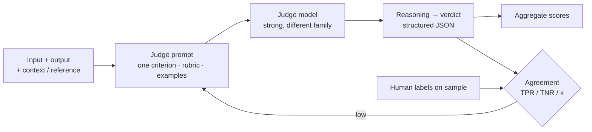

# LLM-as-a-Judge



An LLM judge grades outputs that code can't check: faithfulness to sources, helpfulness, tone, policy compliance. Judges scale human judgment cheaply, but they are **models with their own biases and errors**. A judge is only trustworthy after you've measured its agreement with human labels.

## 1. Judge Formats
| Format | Question | Use when | Notes |
|---|---|---|---|
| **Pointwise binary** | "Does the answer satisfy X? PASS/FAIL" | Most production criteria | Highest agreement; easiest to act on |
| Pointwise scale | "Rate 1–5 on X" | Graded quality | Anchor every level with a description |
| **Pairwise** | "Which of A or B is better on X?" | Comparing prompts or models | More sensitive than absolute scores; needs position swap |
| Reference-based | "Is the answer equivalent to the reference?" | Q&A with known answers | Most reliable judged setting |
| Reference-free with context | "Is every claim supported by the context?" | RAG faithfulness | Claim-level decomposition helps |

## 2. Writing a Judge Prompt
- **One criterion per judge.** A combined "rate quality" prompt blends dimensions and hides what failed.
- Define pass and fail precisely, with **few-shot examples of borderline cases**.
- Ask for **reasoning before the verdict** (chain of thought improves accuracy), and return structured output.
- Give the judge everything a human grader would need: input, output, retrieved context, reference, policy.

```python
from pydantic import BaseModel
from typing import Literal

class Verdict(BaseModel):
    reasoning: str
    verdict: Literal["PASS", "FAIL"]

JUDGE = """You are grading a customer-support reply for ONE criterion: policy-correct refund guidance.

PASS if: the reply states the 5–7 business day refund window, does not promise an exact date,
and does not offer compensation beyond policy.
FAIL if any of these is violated. Ignore tone and length.

Examples:
<example> Reply: "Refunded! You'll see it tomorrow." → FAIL (promises exact date) </example>
<example> Reply: "I've started the refund; it usually takes 5–7 business days." → PASS </example>

Policy: {policy}
Customer message: {input}
Reply to grade: {output}

Think step by step, then give the verdict."""

def judge(client, **kw) -> Verdict:
    r = client.responses.parse(model="gpt-4.1", input=JUDGE.format(**kw), text_format=Verdict, temperature=0)
    return r.output_parsed
```

## 3. Known Biases and Mitigations
| Bias | Effect | Mitigation |
|---|---|---|
| **Position bias** | Pairwise judges prefer the first (or second) answer | Run both orders; count only consistent wins, else tie |
| **Verbosity bias** | Longer answers rated higher | Rubric penalizes padding; length-controlled comparison |
| **Self-preference** | Judges favor outputs from their own model family | Use a different family or a panel of judges |
| **Sycophancy to claims** | Accepts confident but wrong statements | Provide reference or context; claim-level checking |
| **Scale compression** | Everything gets 4/5 | Binary criteria; anchored scale descriptions |
| **Format/style bias** | Markdown and lists look better | Normalize formatting before judging |

```python
def pairwise(judge_fn, q, a, b):
    first = judge_fn(q, a, b)    # returns "A" | "B" | "tie"
    second = judge_fn(q, b, a)
    flipped = {"A": "B", "B": "A", "tie": "tie"}[second]
    return first if first == flipped else "tie"
```

## 4. Calibrating the Judge Against Humans
1. Label 100–200 outputs by hand (a domain expert, binary per criterion).
2. Split: tune the judge prompt on one half, measure on the other.
3. Report **true positive rate** (judge says PASS when human says PASS) and **true negative rate** (judge says FAIL when human says FAIL) separately. Accuracy hides a judge that never fails anything.
4. Target TPR and TNR > ~0.85–0.9 for gating decisions; κ > 0.6 at minimum.
5. **Correct aggregate estimates** for judge error: with known TPR/TNR, true pass rate ≈ (observed − (1 − TNR)) / (TPR + TNR − 1).
6. Re-calibrate when you change the judge model, the prompt, or the product's definition of good.

## 5. Choosing a Judge Model
- Use a model **at least as capable** as the system under test for subtle criteria; reasoning models help on multi-step checks.
- Cheap small judges work for narrow binary checks (e.g., "contains a refusal?"). Fine-tuned judges (Prometheus, Patronus Lynx, Galileo Luna) suit high volume.
- **Panels** (3 different models, majority vote) reduce single-model bias at extra cost.
- Pin judge model versions; a provider update can shift scores overnight.

## 6. Common Judge Metrics
| Metric | Definition | Typical implementation |
|---|---|---|
| Faithfulness / groundedness | Every claim in the answer is supported by the context | Extract claims → verify each against context |
| Answer relevance | Answer addresses the question | Judge or reverse-question similarity |
| Correctness | Matches reference facts | Reference-based judge |
| Instruction following | Meets every stated constraint | Checklist judge (one item per constraint) |
| G-Eval | Rubric scoring with auto-generated steps, probability-weighted | DeepEval `GEval` |
| Safety / policy | No policy violation | Classifier (Llama Guard) or judge |

## 7. Cost and Practice
- Judging is often **more tokens than the original call** (input + output + context + reasoning). Sample in production (1–10%), judge fully in CI.
- Cache judgments by `(case_id, output_hash, judge_version)`.
- Look at judge **disagreements** with humans: they reveal ambiguous criteria more often than bad judges.
- Never let the system under test see the judge prompt (no "teaching to the test" via few-shot leakage).

## Takeaways
- Use one binary criterion per judge with explicit pass/fail definitions and borderline examples; reasoning before verdict.
- Mitigate position, verbosity, and self-preference bias: swap order, penalize padding, use a different model family.
- Calibrate against human labels and report TPR and TNR, not just accuracy; recalibrate on any judge change.
- Judges are expensive; sample online, cache, and reserve full judging for CI and release.

## References
- Zheng et al., *Judging LLM-as-a-Judge with MT-Bench and Chatbot Arena* (2023) · Liu et al., *G-Eval* (2023)
- Kim et al., *Prometheus 2* (2024) · Shankar et al., *Who Validates the Validators?* (2024)
- Eugene Yan, *Evaluating the Effectiveness of LLM-Evaluators* (2024)

## Related
- [Eval-driven development](01-eval-driven-development.md) · [Building eval datasets and error analysis](02-building-eval-datasets-and-error-analysis.md)
- [Evaluating RAG systems](../07-rag/05-evaluating-rag-systems.md) · [Hallucination detection and mitigation](../18-safety-and-governance/02-hallucination-detection-and-mitigation.md)
