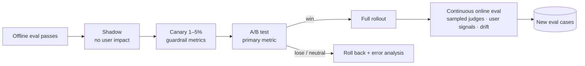
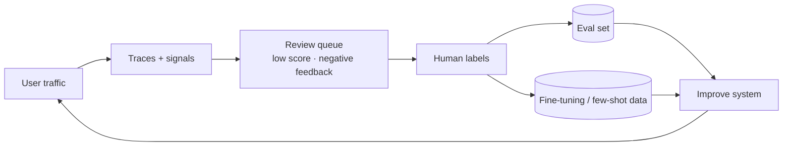

# Online Evaluation and Experiments



Offline evals predict quality on the inputs you thought of. Production shows quality on the inputs users actually send, and whether better outputs change **user behavior**. Online evaluation closes that loop: it measures real outcomes, catches drift, and feeds new cases back into the offline set.

## 1. Online Signals
| Signal | Type | Strength | Caveat |
|---|---|---|---|
| Thumbs up/down | Explicit | Direct | < 1–5% of users vote; skewed to extremes |
| Edits to AI output | Implicit | Strong quality signal (edit distance) | Needs edit-capable UX |
| Copy / accept / insert | Implicit | Usefulness (e.g., code acceptance rate) | Accept ≠ correct |
| Regenerate / retry | Implicit | Dissatisfaction | Some users explore |
| Follow-up rephrasing | Implicit | Misunderstanding | Needs detection |
| Escalation to human / abandonment | Outcome | Business-relevant | Confounded by issue difficulty |
| Task completion, conversion, resolution | Outcome | What the business cares about | Slow, noisy |
| Sampled LLM-judge scores | Model-based | Quality on real traffic | Judge calibration ([judge](03-llm-as-a-judge.md)) |

Instrument these from day one: they are cheap to log and impossible to backfill.

## 2. Release Ladder
| Stage | Traffic | What you learn | Decision |
|---|---|---|---|
| **Shadow** | 0% user-visible; new system runs on copies | Errors, latency, cost, judge-scored diffs | Safe to expose? |
| **Canary** | 1–5% | Guardrail metrics on real users | Any regressions? |
| **A/B test** | 10–50% split | Causal effect on primary metric | Ship? |
| **Holdout** | Small % kept on old system long term | Long-run effects, novelty decay | Keep investing? |

See [Iterating in production](../12-production-deployment/05-iterating-in-production.md).

## 3. Designing an LLM A/B Test
- **Primary metric**: one business or task metric (resolution rate, acceptance rate, conversion).
- **Guardrail metrics**: latency p95, cost/request, safety violation rate, escalation rate, error rate. Any breach stops the test.
- **Randomization unit**: user or conversation, not request; otherwise one user sees both variants mid-conversation.
- **Sample size**: small effects on noisy metrics need many users. Compute power before starting; repo [A/B testing](../../04-evaluation/06-ab-testing-experimentation.md).
- **Novelty effects**: new AI features get curiosity clicks; run long enough (1–2 weeks) to see the plateau.
- **Interleaving** (for search/ranking): mix results from A and B in one list; far more sensitive than split tests.

```python
import hashlib
def variant(user_id: str, experiment: str, split=0.5) -> str:
    h = int(hashlib.sha256(f"{experiment}:{user_id}".encode()).hexdigest(), 16) % 10_000
    return "treatment" if h < split * 10_000 else "control"
```

## 4. Continuous Online Evaluation
- **Sample** 1–10% of traces (higher for new features or low-volume critical flows) and run judges asynchronously.
- **Always score** cheap code checks on 100%: schema validity, refusal detection, PII patterns, citation presence.
- **Dashboards by slice**: intent, customer tier, language, model version, prompt version.
- **Alerts** on drops in judge pass rate, rises in retries or escalations, and cost or latency anomalies.
- **Route to humans**: low judge scores, negative feedback, and high-stakes flows go into a review queue whose labels become eval cases.

## 5. Drift
| Drift | Example | Detection |
|---|---|---|
| Input drift | New product launch → new question types | Embedding cluster shift, new-topic detection, intent classifier distribution |
| Model drift | Provider silently updates a model alias | Pin versions; nightly fixed-set eval |
| Knowledge drift | Docs change, index stale | Freshness metrics, retrieval recall on recent questions |
| Behavior drift | Users learn to phrase differently | Feedback and retry trends |

## 6. Closing the Loop (the data flywheel)

Keep eval and training data separate (no contamination), and record consent and retention for any user data reused.

## Takeaways
- Offline evals predict; online evaluation measures real outcomes and catches drift.
- Log explicit and implicit signals from day one: edits, accepts, retries, escalations, and sampled judge scores.
- Release through shadow → canary → A/B with one primary metric and hard guardrail metrics; randomize by user.
- Feed low-scoring and negatively rated traces through human review into the eval set.

## References
- Kohavi, Tang, Xu, *Trustworthy Online Controlled Experiments* (2020)
- GitHub, *Measuring the impact of GitHub Copilot* (acceptance-rate methodology) · Chapelle et al., *Large-scale validation of interleaving* (2012)

## Related
- [Eval-driven development](01-eval-driven-development.md) · [Monitoring and observability](../12-production-deployment/03-monitoring-and-observability.md) · [Iterating in production](../12-production-deployment/05-iterating-in-production.md)
- Repo: [A/B testing and experimentation](../../04-evaluation/06-ab-testing-experimentation.md)
