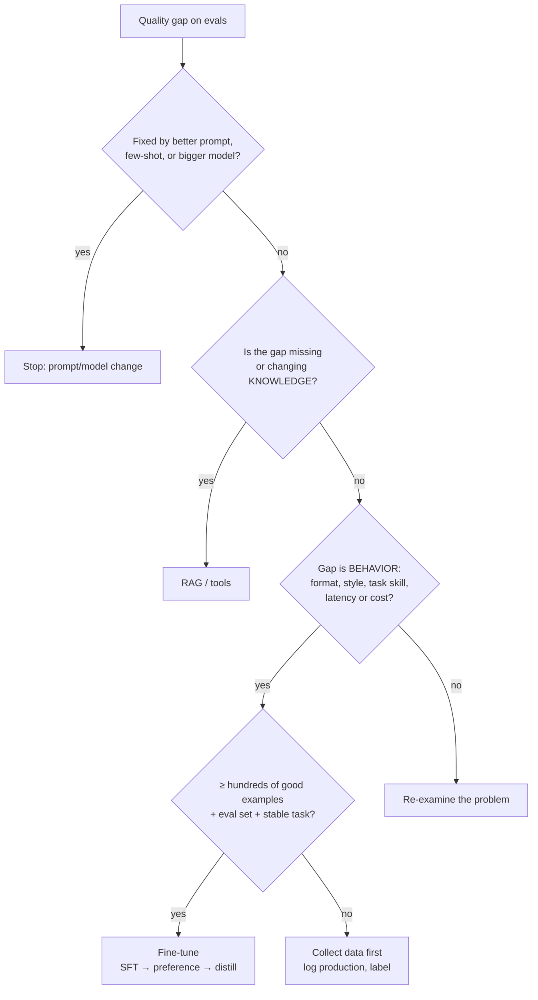

# When to Fine-Tune

Fine-tuning changes the model's weights so it does a specific task better, more consistently, or more cheaply. It's powerful and often unnecessary. Most quality problems are solved faster by prompting, retrieval, or picking a stronger model. Fine-tune when you have a **stable task**, **good data**, and an **eval that proves the gain**.

## 1. What Fine-Tuning Is Good and Bad At
| Good at | Bad at |
|---|---|
| Consistent output format / schema | Adding fresh or frequently changing facts |
| Style, tone, brand voice | Citing sources (no provenance) |
| Narrow task skill (classification, extraction, domain-specific reasoning) | Fixing a bad eval or unclear task definition |
| Shortening prompts (bake instructions in) → lower latency and cost | Teaching a small model broad general capability |
| Distilling a big model's behavior into a small one | Overriding safety on frontier APIs |
| Tool-calling reliability for a fixed tool set | Tasks with < ~100 examples of clear quality |

**Knowledge vs. behavior** is the core heuristic: RAG gives the model facts at inference time; fine-tuning shapes *how* it responds. They combine well: fine-tune a model to use retrieved context faithfully (RAFT-style).

## 2. Decision Matrix
| Situation | Best first move |
|---|---|
| Answers need company docs that change weekly | RAG |
| Output format drifts 5% of the time | Structured outputs / constrained decoding, then fine-tune if still needed |
| 2,000-token system prompt on 10M requests/month | Fine-tune a smaller model to drop the prompt |
| Frontier model is good but too slow/expensive | Distill into a small model |
| Domain jargon misunderstood (legal, medical codes) | RAG + few-shot first; fine-tune if evals plateau |
| Need a new language or modality | Continued pretraining (big investment) or choose a different base |
| Strict data residency / on-prem | Open-weight model, possibly fine-tuned |

## 3. Types of Fine-Tuning
| Type | Data | Changes | Typical use |
|---|---|---|---|
| **Continued pretraining** | Raw domain text (100M+ tokens) | Knowledge, vocabulary | Domain models (code, biomed) |
| **Supervised fine-tuning (SFT)** | (prompt, ideal response) pairs | Behavior, format, task skill | Most app fine-tunes |
| **Preference tuning (DPO, ORPO, KTO)** | (prompt, chosen, rejected) | Quality, style, refusal balance | Polishing after SFT |
| **RL fine-tuning (RFT, GRPO)** | Prompts + a grader / verifiable reward | Reasoning on checkable tasks | Math, code, structured decisions |
| **Distillation** | Teacher outputs on your inputs | Small model mimics big model | Cost/latency reduction |

Details: [Preparing data](02-preparing-fine-tuning-data.md) · [LoRA and PEFT](03-lora-qlora-and-peft.md) · [Preference tuning](04-preference-tuning-dpo-and-rl.md) · [Distillation and serving](05-distillation-and-serving-fine-tuned-models.md).

## 4. Hosted vs. Self-Managed
| | Provider fine-tuning API | Self-managed open weights |
|---|---|---|
| Examples | OpenAI SFT/DPO/RFT, Gemini/Vertex tuning, Bedrock custom models, Together, Fireworks | Llama, Qwen, Mistral, Gemma with HF TRL, Unsloth, Axolotl, torchtune |
| Effort | Upload JSONL, click | GPUs, training code, serving stack |
| Control | Limited hyperparameters | Full: method, rank, data mix, quantization |
| Data | Leaves your environment | Stays in your VPC |
| Serving | Provider hosts (often premium price per token) | You host (vLLM, TGI, multi-LoRA) |
| Lock-in | Tied to that provider's base model | Portable weights |

## 5. Cost-Benefit Check
Before training, estimate:
- **Training cost**: tokens × epochs × price (hosted) or GPU-hours (self). LoRA on a 7–8B model with 10k examples is typically a few GPU-hours.
- **Data cost**: labeling or generating and reviewing examples. Usually the dominant cost.
- **Serving delta**: fine-tuned hosted models often cost more per token than the base; self-hosting adds ops cost.
- **Maintenance**: every base-model upgrade means re-training and re-evaluating. Prompts port across models; fine-tunes don't.
- **Payback**: (per-request savings × volume) − (training + maintenance). A fine-tune that removes a 2k-token prompt from 10M calls/month pays back quickly; one for 1k calls/month rarely does.

## 6. Failure Modes
- **Catastrophic forgetting**: the model loses general abilities; mix in general instruction data, use LoRA, and evaluate on general benchmarks too.
- **Overfitting to format**: perfect on training-like inputs, brittle on real ones; hold out real production samples.
- **Teaching hallucination**: training on answers containing facts the model doesn't know teaches it to make things up confidently.
- **Safety regression**: even benign fine-tuning can weaken refusals; re-run the safety suite ([red teaming](../18-safety-and-governance/03-red-teaming-llm-applications.md)).
- **No baseline**: without the same eval on the prompted base model, you can't claim the fine-tune helped.

## Takeaways
- Prompt, retrieve, or pick a stronger model first; fine-tune for stable behavior gaps, not missing knowledge.
- SFT for format and task skill, preference tuning for quality polish, RL for verifiable reasoning, distillation for cost and latency.
- Data and maintenance usually cost more than training; prompts port across model upgrades and fine-tunes don't.
- Always compare against a prompted baseline on the same eval, and re-check general and safety behavior.

## References
- OpenAI *Model optimization* and fine-tuning guides · Anyscale, *Fine-tuning is for form, not facts* (2023)
- Zhang et al., *RAFT: Adapting Language Model to Domain Specific RAG* (2024) · Qi et al., *Fine-tuning Aligned Language Models Compromises Safety* (2023)

## Related
- [LLM training pipeline](../04-how-llms-work/05-llm-training-pipeline.md) · [What is RAG](../07-rag/01-what-is-rag.md) · [Model selection and routing](../13-llm-optimization/03-model-selection-and-routing.md)
- Repo: [Fine-tuning at scale](../../10-llms/06-fine-tuning-at-scale.md) · [Tuning optimization](../../11-llm-applications/10-tuning-optimization.md) · [Project: LLM fine-tuning](../../17-projects/03-llm-finetuning/)
