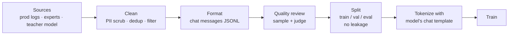

# Preparing Fine-Tuning Data



Fine-tuning quality is almost entirely data quality. A thousand carefully curated examples routinely beat a hundred thousand noisy ones (LIMA showed strong instruction following from about 1,000 examples). The model learns **exactly** what the data shows, including its mistakes, verbosity, and inconsistencies.

## 1. Data Format
Most tools take chat-formatted JSONL, one conversation per line:
```json
{"messages": [
  {"role": "system", "content": "You extract invoice fields as JSON."},
  {"role": "user", "content": "Invoice #4471 from Acme Corp, due 2026-11-30, total $1,240.00"},
  {"role": "assistant", "content": "{\"invoice_id\":\"4471\",\"vendor\":\"Acme Corp\",\"due\":\"2026-11-30\",\"total\":1240.0}"}
]}
```
Tool-calling fine-tunes include `tools` and assistant `tool_calls` messages; preference data adds `chosen`/`rejected` ([DPO](04-preference-tuning-dpo-and-rl.md)).

**Train on completions only**: mask the loss on system and user tokens so the model learns to produce answers, not to predict prompts.

## 2. How Much Data
| Goal | Rough size |
|---|---|
| Format / style consistency | 50–500 examples |
| Narrow task (classification, extraction) | 500–5,000 |
| Distilling a complex task | 5,000–50,000 teacher outputs |
| Broad domain behavior | 10,000+ diverse examples |

Plot a **learning curve**: train on 25%, 50%, 100% of the data. If quality still climbs, more data helps; if flat, improve quality or diversity instead.

## 3. Sources
| Source | Notes |
|---|---|
| Production logs + human corrections | Best match to real inputs; edits are high-value labels |
| Domain experts writing ideal answers | Highest quality, slowest |
| Teacher model outputs (distillation) | Check provider terms of use; filter by judge or verifier |
| Rejection sampling | Generate N candidates, keep those passing tests or judges |
| Public datasets | Good for general mix-in; check licenses |

## 4. Cleaning and Quality Filters
```python
import hashlib, json, re
from datasketch import MinHash, MinHashLSH

PII = [re.compile(p) for p in [r"\b\d{3}-\d{2}-\d{4}\b", r"[\w.+-]+@[\w-]+\.[\w.]+", r"\b(?:\d[ -]?){13,16}\b"]]

def scrub(text: str) -> str:
    for p in PII: text = p.sub("[REDACTED]", text)
    return text

def near_dedup(rows, threshold=0.85):
    lsh, keep = MinHashLSH(threshold=threshold, num_perm=128), []
    for i, r in enumerate(rows):
        m = MinHash(num_perm=128)
        for w in json.dumps(r["messages"]).split(): m.update(w.encode())
        if not lsh.query(m):
            lsh.insert(str(i), m); keep.append(r)
    return keep
```
Checklist:
- Exact and near-duplicate removal (MinHash or embedding similarity).
- PII and secret scrubbing; consent and license for every source.
- Drop examples where the assistant answer is wrong, truncated, or off-policy (LLM judge + human sample).
- **Consistency**: the same kind of input should get the same kind of answer. Inconsistent labels teach randomness.
- Length distribution: if training answers are long, the model gets verbose.
- Balance classes and intents; upsample rare-but-important slices.
- Include **refusals and "I don't know"** examples where appropriate, or the model learns to always answer.

## 5. Splits and Leakage
- Train / validation (for loss and early stopping) / **eval** (your real task eval, ideally production-sourced).
- Split by **entity or time**, not by row, when examples share sources (same customer, same document), or near-duplicates leak.
- Never train on eval cases or few-shot examples used in evals.

## 6. Chat Templates
Each open model has its own template (special tokens for roles). Using the wrong one quietly degrades quality.
```python
from transformers import AutoTokenizer
tok = AutoTokenizer.from_pretrained("Qwen/Qwen2.5-7B-Instruct")
text = tok.apply_chat_template(example["messages"], tokenize=False)
```
Train and serve with the **same** template; inference servers (vLLM) apply it automatically from the tokenizer config.

## 7. Synthetic Data for Fine-Tuning
- **Self-Instruct / Evol-Instruct**: generate instructions from seeds, then evolve complexity.
- **Persona-driven** generation for diversity (see [eval datasets](../16-evaluation/02-building-eval-datasets-and-error-analysis.md) for dimension sampling).
- **Verifier filtering**: for code and math, keep only outputs that pass tests.
- Watch for **model collapse**: training repeatedly on model outputs narrows diversity; keep real data in the mix.

## Takeaways
- Quality and consistency beat volume; the model copies everything in the data, including errors and verbosity.
- Use chat-format JSONL, train on completions only, and apply the model's exact chat template.
- Deduplicate, scrub PII, filter wrong answers, balance slices, and include refusals.
- Split by entity or time to avoid leakage, and keep the task eval separate from training data.

## References
- Zhou et al., *LIMA: Less Is More for Alignment* (2023) · Wang et al., *Self-Instruct* (2023) · Xu et al., *WizardLM / Evol-Instruct* (2023)
- Hugging Face TRL and chat templating docs · Shumailov et al., *AI models collapse when trained on recursively generated data* (2024)

## Related
- [When to fine-tune](01-when-to-fine-tune.md) · [LoRA, QLoRA, and PEFT](03-lora-qlora-and-peft.md)
- Repo: [Synthetic data](../../11-llm-applications/04-synthetic-data.md) · [Privacy and fairness](../../14-responsible-ai/01-privacy-and-fairness.md)
