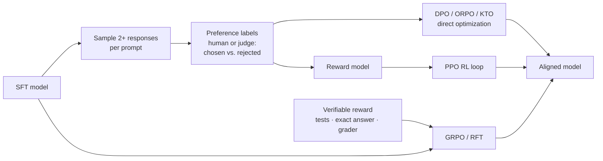

# Preference Tuning: DPO and RL



SFT teaches the model to imitate good answers. **Preference tuning** teaches it to prefer better answers over worse ones, which works even when you can't write the perfect answer but can tell which of two is better. RL with verifiable rewards goes further: the model explores and is rewarded for correct results, which is how modern reasoning models are trained.

## 1. Methods at a Glance
| Method | Data | Needs reward model? | Notes |
|---|---|---|---|
| **RLHF (PPO)** | Preference pairs → reward model → RL | Yes | Classic InstructGPT recipe; complex and unstable |
| **DPO** | (prompt, chosen, rejected) | No | Closed-form loss on pairs; the practical default |
| IPO | Pairs | No | Regularized DPO; less overfitting |
| **KTO** | Single responses labeled good/bad | No | Works with thumbs up/down data |
| ORPO | Pairs, no SFT stage | No | Combines SFT and preference in one step |
| SimPO | Pairs | No | Reference-free, length-normalized |
| **GRPO** | Prompts + reward function | Rule/verifier | Group-relative advantages, no value model (DeepSeek-R1) |
| **RFT** (OpenAI) | Prompts + grader | Grader | Hosted RL on your task |

## 2. DPO Intuition
DPO raises the log-probability of the chosen response relative to the rejected one, measured against a frozen reference model so the policy doesn't drift too far:

L = −log σ( β · [ (log π(y_w|x) − log π_ref(y_w|x)) − (log π(y_l|x) − log π_ref(y_l|x)) ] )

- β (0.05–0.5) controls how far from the reference the model may move; lower = more conservative.
- The reference is usually the SFT model. Run SFT first, then DPO.
- Watch **reward margins** and **chosen log-probs**: if chosen log-prob falls too, the model is just pushing rejected down (a known DPO failure).

```python
from trl import DPOConfig, DPOTrainer
from datasets import load_dataset

ds = load_dataset("json", data_files="prefs.jsonl")["train"]  # {"prompt","chosen","rejected"}
trainer = DPOTrainer(
    model=sft_model, ref_model=None,         # None → frozen copy (or implicit with PEFT)
    args=DPOConfig(output_dir="dpo", beta=0.1, learning_rate=5e-7, num_train_epochs=1,
                   per_device_train_batch_size=2, gradient_accumulation_steps=16, bf16=True),
    train_dataset=ds, processing_class=tokenizer, peft_config=peft_cfg,
)
trainer.train()
```
Note the much lower LR than SFT (5e-7 to 5e-6 for full; ~5e-6 to 5e-5 with LoRA).

## 3. Building Preference Data
- **On-policy pairs**: sample responses from *your* SFT model, then label. Off-policy pairs (from other models) work less well.
- **Labelers**: humans for subjective quality; a calibrated LLM judge ([judge](../16-evaluation/03-llm-as-a-judge.md)) for scale; product signals (edited vs. accepted, thumbs) as weak labels.
- **Contrast**: pairs with a clear but not trivial difference teach most. Identical-quality pairs are noise.
- **Length bias**: if chosen responses are systematically longer, the model learns verbosity. Balance lengths or use length-normalized methods.

## 4. RL with Verifiable Rewards
For tasks with checkable outcomes (math answers, unit tests, JSON validity, exact extraction), skip preference labels and reward the result directly.
```python
def reward_fn(completions, answer, **_):
    """1.0 if the final boxed answer matches, plus a small format bonus."""
    out = []
    for c, a in zip(completions, answer):
        final = c.split("\\boxed{")[-1].split("}")[0] if "\\boxed{" in c else None
        out.append((1.0 if final == a else 0.0) + (0.1 if "<think>" in c else 0.0))
    return out
# trl.GRPOTrainer(model=..., reward_funcs=[reward_fn], args=GRPOConfig(num_generations=8, ...))
```
- **GRPO** samples a group of N completions per prompt and uses each one's reward relative to the group mean as the advantage, so there's no critic network.
- **Reward hacking** is the main risk: the model finds loopholes (passes tests by special-casing, games format bonuses). Inspect samples, harden the grader.
- Needs a base or SFT model that already succeeds sometimes; RL amplifies existing ability more than creating it.

## 5. Which to Use
| You have | Use |
|---|---|
| Good demonstrations only | SFT |
| Pairs of better/worse responses | SFT → DPO |
| Thumbs up/down on single responses | KTO |
| A programmatic grader or tests | GRPO / RFT |
| Limited compute, one stage | ORPO |
| Frontier-lab scale with human raters | RLHF with a reward model |

## Takeaways
- Preference tuning learns from comparisons; it works when "better" is easier to judge than to write.
- DPO is the practical default: SFT first, then DPO on on-policy pairs with low LR and β ≈ 0.1.
- KTO handles binary feedback; GRPO/RFT optimize directly against verifiable rewards.
- Watch for length bias and reward hacking; evaluate on held-out tasks, not on reward.

## References
- Ouyang et al., *InstructGPT* (2022) · Rafailov et al., *Direct Preference Optimization* (2023) · Ethayarajh et al., *KTO* (2024)
- Hong et al., *ORPO* (2024) · Shao et al., *DeepSeekMath (GRPO)* (2024) · DeepSeek-AI, *DeepSeek-R1* (2025)
- Hugging Face TRL DPO/GRPO docs · OpenAI reinforcement fine-tuning guide

## Related
- [LLM training pipeline](../04-how-llms-work/05-llm-training-pipeline.md) · [LoRA, QLoRA, and PEFT](03-lora-qlora-and-peft.md) · [Distillation and serving](05-distillation-and-serving-fine-tuned-models.md)
- Repo: [Training process](../../10-llms/01-training-process.md)
