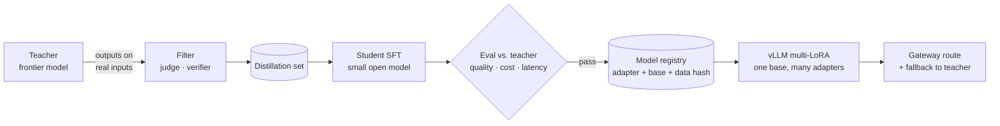

# Distillation and Serving Fine-Tuned Models



The most common production reason to fine-tune is **cost and latency**: a frontier model proves the task is solvable, then a small model is trained to do that one task almost as well for a fraction of the price. Shipping it means treating adapters like any other deployable artifact: versioned, evaluated, canaried, and with a fallback.

## 1. Distillation Recipe
1. **Prove the task** with a strong prompted model; build the eval ([EDD](../16-evaluation/01-eval-driven-development.md)).
2. **Collect real inputs** (production logs, 5k–50k).
3. **Generate teacher outputs**, optionally with chain-of-thought or multiple samples.
4. **Filter**: keep only outputs passing the judge, the verifier, or human review. Distilling errors bakes them in.
5. **SFT the student** (LoRA on 1–8B is typical) ([LoRA](03-lora-qlora-and-peft.md)).
6. **Evaluate** student vs. teacher on held-out data: quality ratio, cost per request, p95 latency.
7. **Route**: student handles traffic; low-confidence or out-of-distribution inputs fall back to the teacher (a [cascade](../13-llm-optimization/03-model-selection-and-routing.md)).

| Variant | What's transferred |
|---|---|
| Response distillation | Final answers (simplest; works with any API teacher) |
| Reasoning distillation | Chain-of-thought traces → small reasoning models (e.g., R1-distill) |
| Logit distillation | Full token distributions (needs open teacher, same tokenizer) |
| Provider-native | OpenAI stored completions → distill; Bedrock model distillation |

Check the teacher provider's **terms of use**; some forbid training competing models on outputs.

## 2. Serving Options
| Option | Pros | Cons |
|---|---|---|
| Provider-hosted fine-tune | No infra | Higher per-token price; locked to provider |
| **Merged weights** on vLLM/TGI/SGLang | Fastest inference, simple | One GPU deployment per model |
| **Multi-LoRA serving** | One base serves many adapters; per-request adapter | Small overhead; adapters must share base |
| Serverless LoRA (Together, Fireworks, Predibase/LoRAX) | Pay per token, many adapters | Vendor dependency |
| On-device / edge (GGUF, llama.cpp, MLX) | Privacy, offline | Small models only |

```bash
vllm serve Qwen/Qwen2.5-7B-Instruct \
  --enable-lora --max-loras 8 --max-lora-rank 32 \
  --lora-modules invoice-extractor=/adapters/invoice-v3 support-tone=/adapters/tone-v1
```
```python
# Pick the adapter per request by model name (OpenAI-compatible API)
client.chat.completions.create(model="invoice-extractor", messages=msgs)
```
Multi-LoRA is ideal for **per-tenant or per-task adapters**: hundreds of adapters, one copy of base weights in GPU memory. Quantize the base (AWQ, GPTQ, FP8) to cut memory further; re-evaluate after quantizing ([self-hosting](../13-llm-optimization/05-self-hosting-models.md)).

## 3. Model Lifecycle
- **Registry entry** per adapter: base model + revision, adapter weights, training data hash, hyperparameters, eval scores, owner. (MLflow, W&B, HF Hub private repos.)
- **Release** like code: eval gate → shadow → canary → full ([online eval](../16-evaluation/04-online-evaluation-and-experiments.md)).
- **Rollback**: keep the previous adapter loaded; switching is a routing change.
- **Retraining triggers**: base-model upgrade, eval drift, accumulated new labeled data (e.g., monthly), new product requirements.
- **Monitor** the same quality and drift signals as for prompted systems, plus fallback rate to the teacher.

## 4. Merging and Composition
- **Merge** an adapter into the base for single-task serving (`model.merge_and_unload()`).
- **Combine adapters** (TIES, DARE, linear merges) to blend skills without retraining; evaluate carefully. Repo: [Model merging](../../11-llm-applications/08-model-merging.md).

## 5. Economics Example
| | Frontier API | Distilled 8B on 1× L40S (self-hosted) |
|---|---|---|
| Cost per 1M requests (1k in / 200 out) | ~$4,000–6,000 | GPU ~$1–2/h × hours needed; often 5–20× cheaper at steady high volume |
| p50 latency | 1–3 s | 0.2–0.6 s |
| Quality on task eval | 100% (reference) | Target ≥ 95% of teacher |
| Ops burden | None | GPUs, autoscaling, upgrades |

Self-hosting wins at **high, steady volume**; at low or spiky volume, serverless LoRA or the API usually wins.

## Takeaways
- Distill when a frontier model proves the task and volume makes cost or latency matter; filter teacher outputs before training.
- Serve merged weights for one hot model, multi-LoRA for many adapters on one base, serverless LoRA for spiky volume.
- Treat adapters as versioned artifacts with eval gates, canaries, instant rollback, and a teacher fallback.
- Retrain on base upgrades, drift, or enough new labels, and re-evaluate after quantization.

## References
- Hinton et al., *Distilling the Knowledge in a Neural Network* (2015) · DeepSeek-AI, *DeepSeek-R1* distilled models (2025)
- vLLM LoRA adapters docs · Predibase LoRAX · Sheng et al., *S-LoRA* (2023) · OpenAI model distillation guide

## Related
- [When to fine-tune](01-when-to-fine-tune.md) · [LoRA, QLoRA, and PEFT](03-lora-qlora-and-peft.md)
- [Self-hosting models](../13-llm-optimization/05-self-hosting-models.md) · [Understanding AI application costs](../13-llm-optimization/01-understanding-ai-application-costs.md)
- Repo: [AI infrastructure](../../20-ai-infrastructure/) · [Inference optimization](../../11-llm-applications/06-inference-optimization.md)
