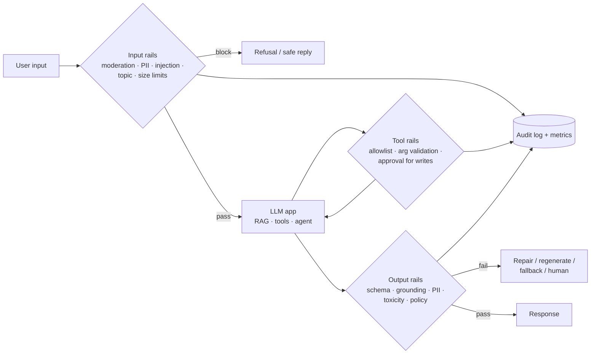

# Guardrails Architecture



Guardrails are deterministic and model-based checks wrapped around an LLM so the system's behavior stays inside policy even when the model doesn't. The model is probabilistic and can be manipulated; guardrails make specific failures **impossible or detectable**. No single rail is sufficient. Use layers, as in [prompt-injection defense](../05-prompt-engineering/06-defending-against-prompt-injection.md).

## 1. Where Rails Sit
| Layer | Checks | Typical tools |
|---|---|---|
| **Input** | Harmful content, jailbreak / injection patterns, PII, off-topic, length and rate limits | Moderation APIs, Llama Guard, Prompt Guard, regex, classifiers |
| **Retrieval** | Document ACLs, source allowlists, injected instructions inside documents | Metadata filters, content scanning |
| **Tool / action** | Allowlisted tools, argument validation, spend and rate caps, human approval for irreversible actions | Pydantic, policy engine (OPA), [HITL](../10-agents/07-human-in-the-loop-patterns.md) |
| **Output** | Schema validity, groundedness, PII leakage, toxicity, brand/legal policy, competitor mentions | Pydantic, NLI or judge, Presidio, classifiers |
| **System** | Audit logs, kill switch, per-tenant policy, monitoring and alerts | Gateway, observability |

## 2. Rail Types and Trade-offs
| Type | Latency | Strength | Weakness |
|---|---|---|---|
| Rules / regex / allowlists | < 1 ms | Exact, explainable | Brittle; easy to evade |
| Small classifiers (Llama Guard 3 1B/8B, Prompt Guard, ShieldGemma) | 10–100 ms | Good coverage, cheap | Fixed taxonomy; false positives |
| Provider moderation API | 50–200 ms | Free or cheap, maintained | Generic categories |
| LLM-as-judge rail | 300 ms–2 s | Flexible custom policy | Cost, latency, itself attackable |
| Structural (schemas, tool permissions, sandboxing) | ~0 | Can't be talked around | Only covers what you can specify |

**Prefer structural controls** for anything high-stakes: an agent that has no permission to issue refunds can't be prompted into issuing one.

## 3. Implementation Sketch
```python
import asyncio
from dataclasses import dataclass

@dataclass
class RailResult:
    ok: bool
    rail: str
    reason: str = ""

async def moderation(text):  # provider moderation or Llama Guard
    flagged = await moderation_client.check(text)
    return RailResult(not flagged, "moderation", "harmful content" if flagged else "")

async def injection(text):
    score = await prompt_guard.score(text)
    return RailResult(score < 0.9, "injection", f"score={score:.2f}")

async def pii_in(text):
    found = presidio.analyze(text, language="en")
    return RailResult(not any(f.entity_type in {"CREDIT_CARD", "US_SSN"} for f in found), "pii")

INPUT_RAILS = [moderation, injection, pii_in]

async def guarded_call(user_text: str) -> str:
    results = await asyncio.gather(*(r(user_text) for r in INPUT_RAILS))  # run rails in parallel
    if failed := [r for r in results if not r.ok]:
        log_block(failed)
        return "I can't help with that request."
    draft = await app(user_text)
    out = await output_rails(draft)            # schema, grounding, PII, policy
    return out.text if out.ok else await fallback(user_text, out)
```
Libraries: **NeMo Guardrails** (Colang flows), **Guardrails AI** (validators hub), **LLM Guard**, **Llama Guard / Prompt Guard**, provider safety settings (Bedrock Guardrails, Azure AI Content Safety).

## 4. Latency Budget
- Run input rails **in parallel** with each other, and optionally in parallel with the main call (cancel the call if a rail fails).
- For streaming, check output in **chunks** (every sentence or N tokens) and stop the stream on violation; full-output rails can't run before the first token.
- Cache rail verdicts for repeated inputs; use small models for rails, larger judges only on flagged or high-risk traffic.

## 5. Measuring Rails
Each rail is a classifier with precision and recall:
- **False positives** block legitimate users (over-refusal hurts product metrics).
- **False negatives** let violations through.
- Build a labeled set of benign and adversarial inputs per rail; track block rate in production, sample blocked requests for review, and tune thresholds per surface.

## 6. Policy as Configuration
Keep policy separate from code: per-tenant topic allowlists, PII handling (block, redact, allow), refusal templates, and thresholds in versioned config, reviewed like code. A **kill switch** that can disable a feature or tool without a deploy is essential during incidents ([incidents](../12-production-deployment/04-handling-production-incidents.md)).

## Takeaways
- Layer rails at input, retrieval, tool, and output; no single check is enough.
- Structural controls (permissions, schemas, sandboxes) beat persuasion-based ones for high-stakes actions.
- Run rails in parallel, use small classifiers by default, and escalate to judges only when needed.
- Treat every rail as a classifier: measure false positives and negatives, and keep policy in versioned config with a kill switch.

## References
- NVIDIA NeMo Guardrails docs · Guardrails AI docs · Meta Llama Guard 3 and Prompt Guard model cards
- OWASP Top 10 for LLM Applications (2025) · Microsoft Presidio · AWS Bedrock Guardrails docs

## Related
- [Defending against prompt injection](../05-prompt-engineering/06-defending-against-prompt-injection.md) · [Agent sandboxing and security](../14-agentic-ai/06-agent-sandboxing-and-security.md) · [AI gateway pattern](../11-ai-system-architecture/05-the-ai-gateway-pattern.md)
- [Hallucination detection](02-hallucination-detection-and-mitigation.md) · [Red teaming](03-red-teaming-llm-applications.md)
- Repo: [LLM safety and governance](../../14-responsible-ai/03-llm-safety-and-governance.md)
