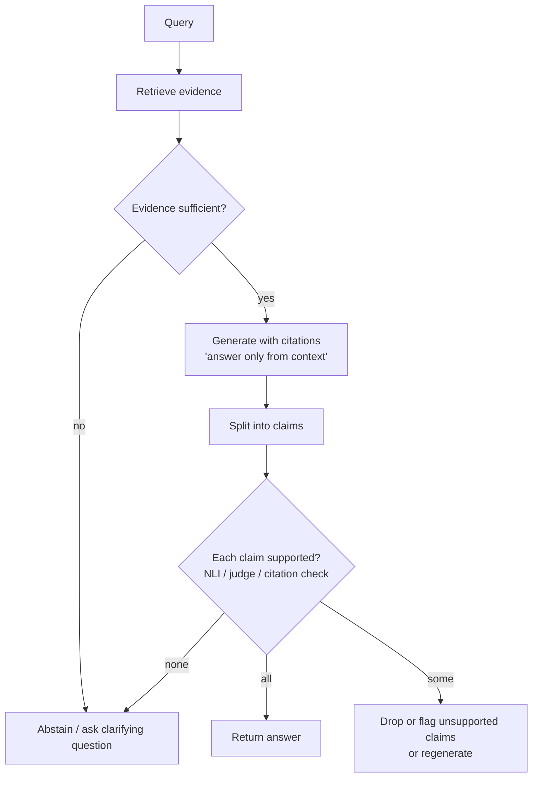

# Hallucination Detection and Mitigation



A hallucination is output that is fluent but not supported, either by the provided context (**unfaithful**) or by the world (**factually wrong**). LLMs generate likely text, not verified text, so hallucination can be reduced but never eliminated. Engineering focuses on **reducing the rate**, **detecting what slips through**, and **designing the UX so remaining errors are cheap**.

## 1. Taxonomy
| Type | Example | Main fix |
|---|---|---|
| Intrinsic (contradicts context) | Context says 30 days, answer says 60 | Faithfulness checks, better prompts |
| Extrinsic (unsupported addition) | Adds a policy clause not in any doc | Answer-only-from-context, claim verification |
| Factual (wrong about the world, no context) | Invented paper citation | RAG, tools, abstention |
| Fabricated references | Fake URLs, case law, APIs | Citation validation against sources |
| Reasoning error | Wrong arithmetic in a correct setup | Tools (calculator, code), self-check |
| Tool / agent hallucination | Claims an action ran when it didn't | Verify tool results, state from tool output only |

## 2. Causes
- Knowledge gaps or cutoff; model answers anyway because training rewarded confident answers.
- Retrieval misses or retrieves near-miss documents ([evaluating RAG](../07-rag/05-evaluating-rag-systems.md)).
- Long context: the evidence is present but lost in the middle.
- Prompt pressure: "always answer", forced formats with required fields.
- High temperature, weak model, or fine-tuning on facts the model didn't know.

## 3. Mitigation (prevent)
| Technique | Effect |
|---|---|
| Ground with RAG and tools | Facts come from sources, not weights |
| "Use only the context; say 'I don't know' if absent" + explicit abstention option | Gives the model a legal way out |
| Citations per claim ([citations](../07-rag/04-rag-with-citations-and-grounding.md)) | Makes unsupported claims visible and checkable |
| Nullable schema fields | Model can return `null` instead of inventing a value |
| Lower temperature for factual tasks | Less sampling of unlikely tokens |
| Retrieval quality (hybrid + rerank) | Fewer near-miss contexts |
| Stronger / reasoning model for hard cases | Lower base rate |
| Tools for math, dates, lookups | Removes whole error classes |

## 4. Detection (catch)
| Method | How | Cost |
|---|---|---|
| **Citation validation** | Check cited IDs exist and quoted spans appear in the source | ~0 |
| **NLI entailment** | Each claim vs. its evidence → entail / neutral / contradict (e.g., DeBERTa-NLI, HHEM, MiniCheck) | Low |
| **LLM judge faithfulness** | Claim-level "supported by context?" ([judge](../16-evaluation/03-llm-as-a-judge.md)) | Medium |
| **Self-consistency** | Sample N answers; disagreement signals low confidence (SelfCheckGPT) | N× generation |
| **Token log-probs / semantic entropy** | Low confidence or high semantic entropy → flag | Low (needs logprobs) |
| **Chain-of-verification** | Model drafts, plans verification questions, answers them independently, revises | 3–4× calls |

```python
from pydantic import BaseModel

class ClaimCheck(BaseModel):
    claim: str
    supported: bool
    evidence_id: str | None

async def verify_answer(answer: str, contexts: dict[str, str]) -> list[ClaimCheck]:
    claims = await llm_json(f"Split into atomic factual claims:\n{answer}", list[str])
    checks = []
    for c in claims:
        verdict = await llm_json(
            "Is the claim fully supported by one of these passages? "
            f"Return supported and the passage id.\nClaim: {c}\nPassages: {contexts}",
            ClaimCheck,
        )
        checks.append(verdict)
    return checks

def faithfulness(checks): return sum(c.supported for c in checks) / max(len(checks), 1)
```

## 5. Response Policy
- **Faithfulness ≥ threshold**: return.
- **Some unsupported claims**: remove them, regenerate with feedback, or show with a warning.
- **Low overall**: abstain, escalate to a human, or ask a clarifying question.
- Pick thresholds by risk tier: a medical or legal answer needs near-zero unsupported claims; a brainstorming tool tolerates more.

## 6. UX That Limits Damage
- Show sources inline and make them clickable; users verify what they can see.
- Communicate uncertainty ("based on the 2024 policy document…").
- Keep humans in the loop for consequential outputs; make editing easy ([AI UX](../11-ai-system-architecture/06-building-ai-powered-ux.md)).

## 7. Measure It
Track **hallucination rate** (unsupported-claim rate) on the offline eval set and on sampled production traffic; segment by intent and retrieval score. Pair it with **abstention rate**: driving hallucinations to zero by refusing everything is also a failure.

## Takeaways
- Hallucination is unsupported output; you reduce, detect, and contain it, never eliminate it.
- Prevent with grounding, abstention options, nullable fields, citations, tools, and good retrieval.
- Detect with citation checks, NLI or judge claim verification, self-consistency, and confidence signals.
- Set response policy by risk tier, and track hallucination rate together with abstention rate.

## References
- Ji et al., *Survey of Hallucination in NLG* (2023) · Manakul et al., *SelfCheckGPT* (2023) · Dhuliawala et al., *Chain-of-Verification* (2023)
- Farquhar et al., *Detecting hallucinations using semantic entropy* (Nature, 2024) · Tang et al., *MiniCheck* (2024) · Vectara HHEM leaderboard
- Kalai et al., *Why Language Models Hallucinate* (OpenAI, 2025)

## Related
- [RAG with citations and grounding](../07-rag/04-rag-with-citations-and-grounding.md) · [Evaluating RAG systems](../07-rag/05-evaluating-rag-systems.md) · [Guardrails architecture](01-guardrails-architecture.md)
- Repo: [Hallucination mitigation](../../11-llm-applications/05-hallucination-mitigation.md)
