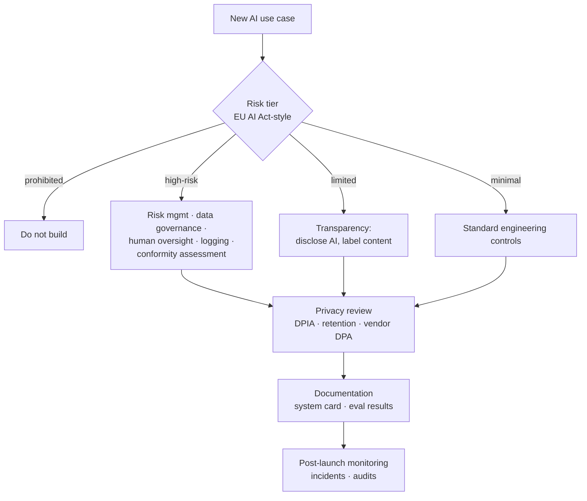

# Responsible AI and Compliance



AI engineers increasingly own compliance-relevant decisions: what data goes to which provider, what gets logged and for how long, when a human must be in the loop, and how the system is documented. This lesson covers the practical engineering side, not legal advice. Involve legal, privacy, and security teams early.

## 1. The Regulatory Landscape (as of late 2026)
| Framework | Scope | What engineers need to know |
|---|---|---|
| **EU AI Act** | Risk-based law for AI systems in the EU | Prohibited practices (since Feb 2025); GPAI model obligations (since Aug 2025); high-risk system obligations phased in from 2026–2027; transparency duties for chatbots and generated content |
| **GDPR** (and UK GDPR) | Personal data of EU/UK residents | Lawful basis, data minimization, purpose limitation, rights to access and erasure, DPIAs, limits on solely automated decisions with significant effects (Art. 22), transfers outside the EU |
| **NIST AI RMF + GenAI Profile (AI 600-1)** | Voluntary US framework | Govern, Map, Measure, Manage; common vocabulary for risk programs |
| **ISO/IEC 42001** | AI management system standard | Certifiable process; increasingly asked for in enterprise procurement |
| Sector rules | HIPAA (health), GLBA/FCRA/ECOA (finance), FERPA (education), employment laws | Often stricter than AI-specific rules |
| US state laws | e.g., Colorado AI Act, NYC Local Law 144 (hiring tools), California transparency laws | Bias audits, notices for consequential decisions |

Regulation changes quickly. Check current guidance and dates before relying on this table.

## 2. EU AI Act Risk Tiers
| Tier | Examples | Obligations |
|---|---|---|
| Unacceptable (prohibited) | Social scoring, manipulative techniques, untargeted face scraping, emotion recognition at work/school | Banned |
| High-risk | Hiring and HR decisions, credit scoring, education access, critical infrastructure, medical devices | Risk management, data governance, technical documentation, logging, human oversight, accuracy and robustness, conformity assessment, registration |
| Limited risk | Chatbots, deepfakes, AI-generated content | Tell users they're interacting with AI; label synthetic content |
| Minimal | Spam filters, most internal productivity tools | Voluntary codes |

Most LLM apps (support bots, copilots) are **limited risk**, but the same model used to screen job applicants becomes **high-risk**. The use case sets the tier, not the model.

## 3. Privacy Engineering for LLM Apps
| Concern | Control |
|---|---|
| Data sent to model providers | Enterprise agreements with zero data retention / no training on inputs; DPA in place; regional endpoints for residency |
| PII in prompts and logs | Redact before logging; tokenize or pseudonymize identifiers; restrict trace access |
| Retention | Set TTLs on traces, conversation history, and memory; support deletion requests across all stores, including vector indexes and caches |
| Right to erasure in RAG | Track document → chunk → embedding lineage so a source can be deleted everywhere |
| Fine-tuning data | Consent and lawful basis; erasure is hard once trained, so prefer RAG for personal data |
| Memory features | User-visible and deletable; no sensitive categories by default |
| Cross-tenant isolation | Tenant ID filters enforced server-side in retrieval and caches |

```python
def log_trace(trace: dict) -> None:
    trace["input"] = redact(trace["input"])          # Presidio / regex
    trace["output"] = redact(trace["output"])
    trace["user_id"] = hmac_sha256(SECRET, trace["user_id"])  # pseudonymize
    trace["expires_at"] = now() + timedelta(days=30)          # retention TTL
    trace_store.write(trace)
```

## 4. Fairness and Harm Assessment
- Identify affected groups and potential harms (allocation, quality of service, stereotyping, erasure).
- Slice evals by language, dialect, region, and other relevant groups; compare quality and refusal rates ([eval datasets](../16-evaluation/02-building-eval-datasets-and-error-analysis.md)).
- For consequential decisions, keep a human decision-maker, log rationale, and provide an appeal path.
- Repo depth: [Privacy and fairness](../../14-responsible-ai/01-privacy-and-fairness.md).

## 5. Documentation and Transparency
| Artifact | Contents |
|---|---|
| **System card** | Purpose, intended users, out-of-scope uses, models and providers, data flows, known limitations |
| **Eval report** | Quality, safety, fairness, and red-team results per release |
| **Data sheet** | Sources, consent, licenses, PII handling for RAG corpora and fine-tuning data |
| **Model registry entry** | Versions, prompts, adapters, approvals ([fine-tuned models](../17-fine-tuning/05-distillation-and-serving-fine-tuned-models.md)) |
| **User-facing disclosure** | "You're chatting with an AI", content labels, how data is used |
| **Incident log** | Harms, root causes, fixes |

Content provenance: C2PA metadata and watermarking (e.g., SynthID) for generated images, audio, and video.

## 6. Governance Process
- **Intake review** for new AI use cases with a risk tier, owner, and required controls.
- **Release gates**: eval and safety thresholds, privacy sign-off, documentation complete.
- **Ongoing**: monitoring, periodic audits, incident response with user notification where required.
- Keep it proportional: heavy review for high-risk, lightweight checklists for minimal-risk internal tools.

## Takeaways
- The use case sets the risk tier; the same model can be limited-risk in one product and high-risk in another.
- Privacy controls live in engineering: provider agreements, redaction, retention TTLs, deletion lineage across vector stores and caches.
- Document with system cards and eval reports, and disclose AI to users.
- Proportional governance: intake review, release gates, monitoring, and incident response.

## References
- EU AI Act (Regulation (EU) 2024/1689) and Commission guidelines · GDPR (Regulation (EU) 2016/679)
- NIST AI RMF 1.0 and AI 600-1 · ISO/IEC 42001:2023 · Mitchell et al., *Model Cards* (2019) · Gebru et al., *Datasheets for Datasets* (2021)
- C2PA specification · Google DeepMind SynthID

## Related
- [Guardrails architecture](01-guardrails-architecture.md) · [Red teaming](03-red-teaming-llm-applications.md) · [Data architecture for AI](../11-ai-system-architecture/03-data-architecture-for-ai.md)
- Repo: [Privacy and fairness](../../14-responsible-ai/01-privacy-and-fairness.md) · [LLM safety and governance](../../14-responsible-ai/03-llm-safety-and-governance.md)
