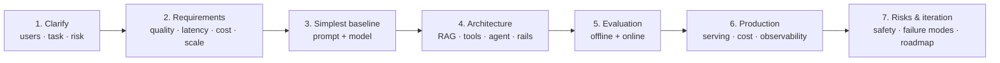

# AI System Design Interview Framework



LLM system design interviews (and real design reviews) test whether you can turn a fuzzy product ask into a **reliable, measurable, affordable** system. The classic ML design framework ([repo framework](../../15-system-design/01-design-interview-framework.md)) still applies, but the emphasis moves from training models to **composing** them: context, tools, guardrails, evaluation, and cost control.

## 1. The Seven Steps (45-minute budget)
| Step | Time | What to produce |
|---|---|---|
| 1. Clarify | 5 min | Users, core task, inputs/outputs, risk of a wrong answer, languages, channels |
| 2. Requirements | 5 min | Quality bar, p95 latency, cost per request, QPS and growth, data sources, compliance |
| 3. Baseline | 3 min | "Single prompt + frontier model" and why it isn't enough |
| 4. Architecture | 15 min | Diagram: ingestion, retrieval, orchestration, tools, rails, model routing, storage |
| 5. Evaluation | 7 min | Golden set, metrics, judges, launch criteria, online metrics |
| 6. Production | 5 min | Serving, caching, routing, observability, cost math |
| 7. Risks | 5 min | Failure modes, safety, security, roadmap |

## 2. Clarifying Questions That Change the Design
| Question | Why it matters |
|---|---|
| What happens if the answer is wrong? | Sets risk tier, HITL needs, abstention policy |
| Read-only or does it take actions? | Tools, permissions, approval gates |
| Where does the knowledge live, and how often does it change? | RAG vs. fine-tune, ingestion freshness |
| Who can see what? | Per-user ACLs in retrieval |
| Latency expectation: chat, voice, batch? | Streaming, model size, voice pipeline |
| Volume and budget? | Routing, caching, self-hosting |
| Languages, modalities? | Embedding/model choice, OCR, ASR |

## 3. Back-of-Envelope Math
```
Requests/day         = DAU × requests per user          e.g. 100k × 5 = 500k
Tokens/request       = system + history + context + output
                     ≈ 1,000 + 1,000 + 3,000 + 400 = 5,400
Cost/request         = in_tok × $in + out_tok × $out
                     ≈ 5,000 × $3/1M + 400 × $15/1M ≈ $0.021
Daily cost           ≈ 500k × $0.021 ≈ $10.5k/day → drives caching + routing
Peak QPS             ≈ 500k / 86,400 × peak factor 3 ≈ 17 QPS
```
Then name the levers: prompt caching (cached input ~90% cheaper), routing 60–80% of traffic to a small model, shorter context via better retrieval, semantic caching for repeated FAQs ([costs](../13-llm-optimization/01-understanding-ai-application-costs.md)).

## 4. Architecture Building Blocks
| Block | Choices to justify |
|---|---|
| Orchestration | Single call → workflow → agent ([agent vs. workflow](../10-agents/08-building-ai-workflows.md)) |
| Knowledge | RAG (hybrid + rerank), GraphRAG, long context, fine-tune |
| Actions | Tool schemas, MCP, permission model, HITL |
| Models | Frontier vs. small; router/cascade; self-host vs. API |
| Safety | Input/output rails, injection defense, PII ([guardrails](../18-safety-and-governance/01-guardrails-architecture.md)) |
| Platform | AI gateway, caching, rate limits, fallback providers |
| Data | Vector DB, document store, conversation/memory store, trace store |
| Ops | Tracing, eval pipelines, prompt registry, feature flags |

## 5. Evaluation Story (where most candidates are weak)
1. **Golden dataset** of 200–500 real or realistic cases, stratified by intent and difficulty ([eval datasets](../16-evaluation/02-building-eval-datasets-and-error-analysis.md)).
2. **Component metrics**: retrieval recall@k, tool-call accuracy, schema validity.
3. **End-to-end metrics**: task success, faithfulness, judge scores calibrated to humans ([judge](../16-evaluation/03-llm-as-a-judge.md)).
4. **Launch gate**: e.g., ≥ 90% task success, ≤ 2% unsupported claims, 0 critical safety failures, p95 < 3 s.
5. **Online**: thumbs, resolution rate, escalation rate, A/B on business KPI ([online eval](../16-evaluation/04-online-evaluation-and-experiments.md)).

## 6. Trade-offs Interviewers Probe
| Trade-off | Talking point |
|---|---|
| Quality vs. latency | Streaming, smaller model for first token, reasoning only on hard queries |
| Agent autonomy vs. reliability | Workflow for known paths, agent for open-ended; step limits |
| RAG vs. fine-tune | Knowledge → RAG; behavior/format → fine-tune ([when to fine-tune](../17-fine-tuning/01-when-to-fine-tune.md)) |
| API vs. self-host | Volume, data residency, team capacity |
| Safety vs. helpfulness | Measure over-refusal with block rate |
| Freshness vs. cost | Incremental indexing, TTL caches |

## 7. Common Failure Modes to Volunteer
Retrieval misses, hallucinated citations, prompt injection via documents, tool-loop runaway, provider outage, cost spikes from long contexts, silent quality drift after a model upgrade. For each, name the **detection** and the **mitigation**.

## 8. Case Index
| Case | Core challenge |
|---|---|
| [Customer-support agent](02-customer-support-agent.md) | Actions with permissions, escalation, resolution rate |
| [Enterprise knowledge assistant](03-enterprise-rag-knowledge-assistant.md) | ACL-aware RAG at scale, freshness, citations |
| [Coding assistant](04-coding-assistant.md) | Latency (autocomplete), repo context, sandboxed agents |
| [Document extraction pipeline](05-document-extraction-pipeline.md) | Accuracy at volume, structured output, human review |
| [Voice agent](06-voice-agent.md) | Sub-second turn latency, interruptions, telephony |
| Repo: [LLM product assistant](../../15-system-design/cases/13-llm-product-assistant.md) · [Content moderation](../../15-system-design/cases/07-content-moderation.md) | |

## Takeaways
- Clarify the cost of a wrong answer and whether the system takes actions; both reshape the design.
- Start with the simplest baseline, then add RAG, tools, agents, and rails only with a stated reason.
- Do the token and cost math out loud and name the levers: caching, routing, shorter context.
- Spend real time on evaluation and failure modes; that's what separates senior answers.

## References
- Chip Huyen, *AI Engineering* (O'Reilly, 2025), ch. 10 · Anthropic, *Building Effective Agents* (2024)
- Eugene Yan et al., *What We Learned from a Year of Building with LLMs* (2024)

## Related
- [Architecture patterns](../11-ai-system-architecture/01-architecture-patterns-for-ai-applications.md) · [AI engineering lifecycle](../12-production-deployment/06-the-ai-engineering-lifecycle.md)
- Repo: [ML system design](../../15-system-design/02-ml-system-design.md) · [System design README](../../15-system-design/README.md)
