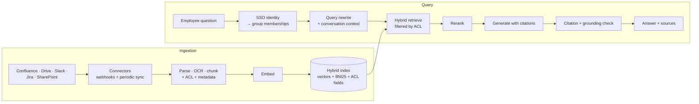

# Case: Enterprise RAG Knowledge Assistant

**Prompt:** Design an internal assistant that answers employee questions across 20M documents from Confluence, Google Drive, Slack, and Jira for a 30k-employee company. Answers must respect document permissions and cite sources.

## 1. Requirements
| Dimension | Target |
|---|---|
| Corpus | 20M docs (~200M chunks), 100k doc changes/day |
| Freshness | Edits searchable within 15 minutes; permission changes within 5 minutes |
| Security | Never show content a user can't open in the source system |
| Quality | Answer correctness ≥ 85% on golden set; citation precision ≥ 95% |
| Latency | p95 < 4 s full answer, first token < 1.5 s |
| Load | 30k users, ~200k queries/day, peak ~20 QPS |

## 2. Ingestion
| Concern | Design |
|---|---|
| Connectors | Event-driven (webhooks) plus nightly reconciliation; per-source rate limits and backoff |
| Parsing | Layout-aware parsing for PDFs/slides, OCR for scans, tables to markdown ([data architecture](../11-ai-system-architecture/03-data-architecture-for-ai.md)) |
| Chunking | Structure-aware (headings), 300–800 tokens, with doc title and breadcrumb prepended (contextual chunk headers) |
| Metadata | `source`, `doc_id`, `updated_at`, `author`, `space`, **`acl_groups`**, `language`, `doc_type` |
| Dedup | Content hash per chunk; skip re-embedding unchanged chunks |
| Deletion | Doc deleted at source → tombstone → remove chunks from index and caches |
| Scale | 200M chunks × 1024-d float32 ≈ 800 GB raw; use int8 or binary quantization + rescoring, sharded index |

## 3. Permissions (the hardest part)
| Approach | Pros | Cons |
|---|---|---|
| **Early-binding**: store `acl_groups` on chunks, filter at query time | Fast, scalable | Must sync ACL changes quickly; group explosion |
| Late-binding: retrieve, then check each hit against source API | Always accurate | Slow, API rate limits, recall loss |
| **Hybrid** (recommended) | Filter by indexed ACLs, re-verify top results for sensitive sources | More moving parts |

Rules: resolve user → groups from the IdP at query time (cached a few minutes); **apply the filter inside the vector query**, not after; semantic cache keys must include the permission set (or be per-user) so cached answers never leak across users ([caching](../11-ai-system-architecture/07-caching-strategies-for-llm-applications.md)).

## 4. Query Pipeline
1. **Rewrite** the question using chat history into a standalone query; optionally expand to sub-queries ([conversational RAG](../07-rag/06-conversational-rag.md)).
2. **Hybrid retrieve** top-50 (dense + BM25, RRF) with ACL and optional source/date filters.
3. **Rerank** to top-8 with a cross-encoder ([advanced retrieval](../07-rag/03-advanced-retrieval-techniques.md)).
4. **Generate** with numbered sources, "answer only from sources; say what's missing".
5. **Verify** citations exist and support claims; drop unsupported ones ([hallucination](../18-safety-and-governance/02-hallucination-detection-and-mitigation.md)).
6. **Agentic escalation** for complex research questions: iterative retrieval with a step budget ([agentic RAG](../07-rag/09-agentic-rag.md)).

Recency matters: boost by `updated_at` and prefer canonical sources (e.g., the policy space over Slack threads).

## 5. Evaluation
- Golden set: 500 questions from real search logs and SMEs, with expected source docs and reference answers, across sources and departments.
- Retrieval: recall@50 before rerank, nDCG@8 after. Generation: correctness (judge vs. reference), faithfulness, citation precision.
- **Permission tests**: synthetic users with restricted groups; assert zero leaked doc IDs in retrieved sets. Run in CI.
- Online: thumbs, citation click-through, "no answer" rate, query reformulation rate ([evaluating RAG](../07-rag/05-evaluating-rag-systems.md)).

## 6. Cost and Scale
- Embedding: initial 200M chunks × ~400 tokens = 80B tokens; at $0.02/1M ≈ $1.6k once; daily deltas are small.
- Generation: 200k queries × ~6k input tokens ≈ 1.2B tokens/day; route simple lookups to a small model, cache stable system prompt.
- Index: managed vector DB or OpenSearch/Vespa with sharding; replicas for QPS.

## 7. Failure Modes
| Failure | Mitigation |
|---|---|
| Permission leak | Filter-in-query, permission CI tests, sensitive-source re-check, per-ACL cache keys |
| Stale or contradictory docs | Recency boost, canonical-source boost, show dates in citations |
| Slack noise dominates | Source weighting, thread summarization at ingest |
| Long tables/figures lost | Layout-aware parsing, multimodal RAG for diagrams ([multimodal RAG](../07-rag/08-multimodal-rag.md)) |
| Prompt injection inside documents | Treat retrieved text as data; no write tools in this assistant |

## Takeaways
- Permissions are the hardest requirement: filter inside the retrieval query and keep ACLs fresh.
- Ingestion is half the system: connectors, layout-aware parsing, contextual chunks, deletions, and dedup.
- Hybrid retrieval + rerank + citation verification gives quality you can measure.
- Test for permission leaks in CI, and scope caches to permission sets.

## References
- Anthropic, *Contextual Retrieval* (2024) · Glean and Microsoft 365 Copilot architecture talks · Cormack et al., *Reciprocal Rank Fusion* (2009)

## Related
- [Interview framework](01-ai-system-design-interview-framework.md) · [Production RAG pipeline](../07-rag/02-building-a-production-rag-pipeline.md) · [GraphRAG](../07-rag/07-graphrag-and-knowledge-graphs.md)
- Repo: [Search ranking case](../../15-system-design/cases/09-search-ranking.md) · [RAG](../../11-llm-applications/02-rag.md)
