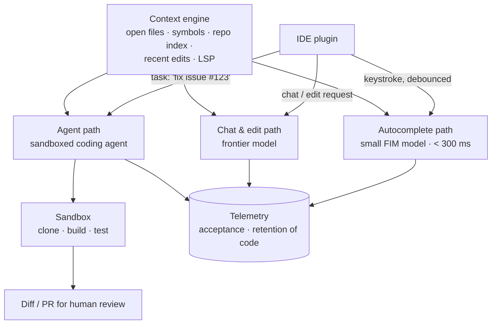

# Case: Coding Assistant

**Prompt:** Design an AI coding assistant for a company of 5,000 engineers: inline autocomplete, chat about the codebase, and an agent that can complete small tickets and open pull requests.

## 1. Three Products, Three Budgets
| Mode | Latency target | Model | Context |
|---|---|---|---|
| **Autocomplete** | p50 < 200 ms, p95 < 400 ms | Small code model (1–15B) with fill-in-the-middle, self-hosted near users | Prefix/suffix around cursor + a few snippets from related files (~2–8k tokens) |
| **Chat / inline edit** | First token < 1 s | Frontier model | Selected code, retrieved repo chunks, symbols, docs (~20–100k tokens) |
| **Agent** | Minutes; async | Frontier reasoning/coding model | Tools: search, read, edit, run tests; iterative ([coding agents](../14-agentic-ai/02-coding-agents.md)) |

Treat them as separate pipelines that share a **context engine**.

## 2. Context Engine
| Source | Use |
|---|---|
| Cursor neighborhood | Prefix and suffix (FIM) |
| Open tabs and recent edits | Strong relevance signal |
| Symbol graph (LSP, tree-sitter, ctags) | Definitions of called functions, types |
| Repo index | Hybrid code search: embeddings on function-level chunks + BM25/trigram for identifiers |
| Docs and internal libraries | RAG over internal API docs |
| Repo rules file | Conventions, build commands (`AGENTS.md`-style) | <!-- noqa: filename -->

Code chunking follows syntax (functions/classes via tree-sitter), not fixed token windows. Rank candidates by similarity, recency, and graph distance, then pack to budget.

## 3. Autocomplete Path
- **Debounce** keystrokes (~50–100 ms), cancel in-flight requests on new input.
- **Speculative/streaming** decoding, short max tokens, stop at end of block.
- Serve on GPUs in each region with continuous batching; KV/prefix caching for the stable file prefix ([latency](../13-llm-optimization/04-latency-optimization.md)).
- Post-filter: syntax check, dedupe against existing code, filter secrets.
- Fine-tune the FIM model on internal code (with permission) to learn internal APIs ([when to fine-tune](../17-fine-tuning/01-when-to-fine-tune.md)).

## 4. Agent Path
1. Ticket → plan → explore repo (search/read tools).
2. Edit files → run build and tests **in an isolated sandbox** (container/microVM, no prod credentials, egress allowlist) ([sandboxing](../14-agentic-ai/06-agent-sandboxing-and-security.md)).
3. Iterate on failures with a step and token budget.
4. Open a PR with summary and test evidence; **a human reviews and merges**. CI runs as for any PR.

## 5. Evaluation
| Mode | Offline | Online |
|---|---|---|
| Autocomplete | Exact match / pass@1 on held-out internal FIM tasks; latency | **Acceptance rate**, characters accepted, retention (accepted code still present after 30 min) |
| Chat | Judge on internal Q&A set; retrieval recall of the right files | Thumbs, copy/apply rate |
| Agent | SWE-bench-style internal tasks (real past tickets with tests) | PR merge rate, review iterations, reverts, time-to-merge |

Beware vanity metrics: acceptance rate can rise while quality falls. Track reverts and bug rates on AI-authored code.

## 6. Cost
- Autocomplete dominates **request count** (hundreds per engineer per day): 5,000 × 300 ≈ 1.5M requests/day → self-hosting the small model is far cheaper than API calls.
- Chat and agents dominate **token spend**: agent runs can use 1–5M tokens each; set per-user and per-task budgets, and cache the repo-context prefix.

## 7. Security and Governance
- Code may not leave approved boundaries: enterprise zero-retention agreements or self-hosted models; respect repo permissions in the index.
- Secret scanning on prompts and suggestions; block suggestions matching public code if license policy requires.
- Agents never get production credentials; all writes go through PRs.
- Prompt injection via repo content (malicious comments, issue text) → sandbox and least privilege.

## Takeaways
- Autocomplete, chat, and agents are separate pipelines with very different latency and cost budgets.
- The context engine (symbols, recent edits, hybrid code search) decides quality more than the model.
- Agents run in sandboxes with budgets and only ever produce PRs for human review.
- Measure acceptance and retention, merge rate, and reverts, not acceptance alone.

## References
- Bavarian et al., *Efficient Training of Language Models to Fill in the Middle* (2022) · Jimenez et al., *SWE-bench* (2024)
- GitHub Copilot and Sourcegraph Cody engineering blogs · Ziegler et al., *Productivity Assessment of Neural Code Completion* (2022)

## Related
- [Interview framework](01-ai-system-design-interview-framework.md) · [Coding agents](../14-agentic-ai/02-coding-agents.md) · [Long-running agents](../14-agentic-ai/05-long-running-agents.md)
- Repo: [Speculative decoding](../../11-llm-applications/07-speculative-decoding.md) · [AI infrastructure](../../20-ai-infrastructure/)
