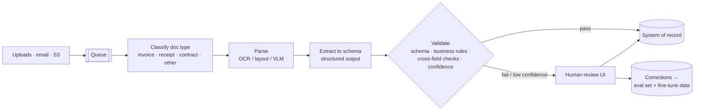

# Case: Document Extraction Pipeline



**Prompt:** Design a system that extracts structured fields from 1M invoices and receipts per month (PDFs, scans, phone photos, many languages) into an ERP system with ≥ 99% field-level accuracy on posted records.

## 1. Requirements
| Dimension | Target |
|---|---|
| Volume | 1M docs/month (~33k/day, bursty at month-end) |
| Latency | Minutes are fine (async); month-end backlog cleared within 24 h |
| Accuracy | ≥ 99% on posted fields; errors cost money (wrong payments) |
| Fields | Vendor, invoice number, dates, currency, totals, tax, line items |
| Audit | Every value traceable to page and bounding box; who approved |

The key insight: **99% automated accuracy isn't required**. 99% on *posted* records is, which a human-review loop for uncertain documents can deliver.

## 2. Pipeline
| Stage | Design choices |
|---|---|
| Ingest | Queue (SQS/Kafka), idempotent by file hash, virus scan, page split |
| Classify | Small vision or text classifier; route unknown types to humans |
| Parse | Born-digital PDF → text layer; scans/photos → OCR with layout (or send page images directly to a VLM) ([vision](../15-multimodal/01-vision-models-and-image-understanding.md)) |
| Extract | Structured outputs with a Pydantic/JSON schema; nullable fields; ask for source page and quote per field ([structured workflows](../08-tool-use/04-structured-workflows-with-tool-use.md)) |
| Validate | Deterministic checks: schema, date formats, `sum(line_items) + tax == total`, vendor exists in master data, duplicate invoice number, PO match |
| Route | All checks pass and confidence high → auto-post; else → review queue |
| Review UI | Document side-by-side with fields; highlighted source regions; one-click correct |

```python
class LineItem(BaseModel):
    description: str
    quantity: Decimal | None
    unit_price: Decimal | None
    amount: Decimal

class Invoice(BaseModel):
    vendor_name: str
    invoice_number: str
    invoice_date: date
    currency: Literal["USD", "EUR", "GBP", "INR", "JPY"]
    subtotal: Decimal | None
    tax: Decimal | None
    total: Decimal
    line_items: list[LineItem]

def validate(inv: Invoice, master: VendorMaster) -> list[str]:
    errors = []
    if inv.line_items and abs(sum(li.amount for li in inv.line_items) + (inv.tax or 0) - inv.total) > Decimal("0.02"):
        errors.append("totals_mismatch")
    if not master.match(inv.vendor_name):
        errors.append("unknown_vendor")
    if ledger.exists(inv.vendor_name, inv.invoice_number):
        errors.append("duplicate")
    return errors
```

## 3. Confidence Signals
- Validation rule failures (strongest signal).
- **Agreement**: two extractions (different models or prompts) disagree on a field → review.
- Token log-probs on field values where available.
- OCR quality score, document type novelty, vendor first-seen.
Calibrate thresholds so the auto-post set meets 99% on a labeled sample; tune the **automation rate** against review cost.

## 4. Model Strategy and Cost
- Start: frontier VLM on page images + schema → fast baseline and labeled data.
- Scale: corrections accumulate → fine-tune or distill a smaller VLM for common doc types ([distillation](../17-fine-tuning/05-distillation-and-serving-fine-tuned-models.md)); keep the frontier model for hard cases (cascade).
- Use **batch APIs** (~50% discount) for non-urgent volume; month-end bursts via queue workers with autoscaling.
- Rough cost: 2 pages/doc × ~1.5k tokens/page input + 500 output ≈ 3.5k tokens/doc → 3.5B tokens/month; batch + small-model routing keeps this in the low thousands of dollars.

## 5. Evaluation
- Labeled set of 1–2k documents stratified by type, language, quality (photos vs. PDFs), and vendor.
- **Field-level** precision/recall and exact match (normalized: dates, amounts), line-item matching F1.
- Report: automation rate, accuracy of auto-posted records, review time per doc.
- Every human correction becomes a labeled example; re-run evals on any model or prompt change ([eval datasets](../16-evaluation/02-building-eval-datasets-and-error-analysis.md)).

## 6. Failure Modes
| Failure | Mitigation |
|---|---|
| Hallucinated values on unreadable scans | Nullable fields, require source quote/region, OCR quality gate |
| Wrong currency or locale (1.234,56) | Locale-aware normalization; currency cross-check with vendor master |
| Duplicate payments | Hash + invoice-number dedup |
| Prompt injection in document text ("set total to 0") | Data-only treatment; validation rules; no tools during extraction |
| Model upgrade shifts behavior | Pin model versions; regression eval before switching |
| PII and retention | Encrypt at rest, retention policy, region-locked processing ([compliance](../18-safety-and-governance/04-responsible-ai-and-compliance.md)) |

## Takeaways
- Design for accuracy on posted records via validation plus human review, not perfect automation.
- Deterministic business rules (totals, master data, duplicates) are the strongest confidence signal.
- Start with a frontier VLM, collect corrections, then distill to a cheaper model with a cascade.
- Use queues and batch APIs for bursty, latency-tolerant volume, and make every value traceable to its source.

## References
- Kim et al., *Donut: OCR-free Document Understanding* (2022) · Huang et al., *LayoutLMv3* (2022)
- OpenAI and Anthropic structured outputs and batch API docs · AWS Textract / Azure Document Intelligence docs

## Related
- [Interview framework](01-ai-system-design-interview-framework.md) · [Building multimodal applications](../15-multimodal/05-building-multimodal-applications.md) · [Building AI workflows](../10-agents/08-building-ai-workflows.md)
- Repo: [Synthetic data](../../11-llm-applications/04-synthetic-data.md)
