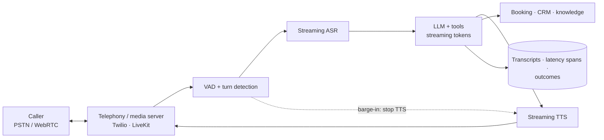

# Case: Voice Agent

**Prompt:** Design a phone agent for a clinic network that books, reschedules, and cancels appointments and answers basic questions, handling 2,000 concurrent calls at peak.

## 1. Requirements
| Dimension | Target |
|---|---|
| Turn latency | Voice-to-voice **< 800 ms** p50, < 1.5 s p95 (humans expect ~300–500 ms gaps) |
| Concurrency | 2,000 calls at peak |
| Actions | Look up patient (verified), search slots, book/reschedule/cancel |
| Safety | No medical advice; urgent symptoms → immediate human transfer or emergency instructions |
| Compliance | Health data: HIPAA-style controls, call recording consent, retention limits |

## 2. Two Architectures
| | **Cascaded** (ASR → LLM → TTS) | **Speech-to-speech** (realtime model) |
|---|---|---|
| Latency | Sum of stages; needs heavy streaming | Lowest; native |
| Control | Text in the middle: easy guardrails, logging, tool calls, model choice | Less transparent; fewer model options |
| Quality | Best-of-breed per stage | Better prosody, handles interruptions naturally |
| Cost | Usually cheaper, tunable | Higher per minute |

Choose **cascaded** for regulated, tool-heavy flows (as here); consider realtime models for conversational, low-stakes use ([audio and speech](../15-multimodal/03-audio-and-speech.md)).

## 3. Latency Budget (cascaded)
| Stage | Budget | Techniques |
|---|---|---|
| End-of-turn detection | 150–250 ms | VAD + semantic turn-detection model, not a fixed 1 s silence |
| ASR final | 100–200 ms | Streaming ASR with partials; start LLM on stable partials |
| LLM first token | 200–350 ms | Small/fast model, prompt caching, short system prompt, colocated region |
| TTS first audio | 100–150 ms | Streaming TTS, sentence-chunked input |
| Network/telephony | 50–100 ms | Media servers near carriers |
| **Total** | **~600–1,000 ms** | Stream every stage; never wait for full outputs |

Tool calls break the budget: say a short filler ("Let me check that for you") via TTS while the tool runs, and keep tools fast (< 500 ms) with prefetching (e.g., load the patient's upcoming appointments at call start).

## 4. Conversation Design
- **Barge-in**: when the caller speaks, stop TTS immediately, truncate the assistant's message in history to what was actually spoken.
- **Confirmation** of critical values by read-back ("Tuesday the 14th at 3:30 pm, with Dr. Rao — correct?").
- Spell-out handling for names and IDs; DTMF fallback for numbers.
- Short responses (1–2 sentences); no markdown or lists in voice output.
- **Identity verification** (DOB + phone match) before revealing or changing anything.
- Escalation: "agent please", repeated failures, distress, or urgent-symptom keywords → warm transfer with a summary.

## 5. Scale and Infra
- 2,000 concurrent calls = 2,000 streaming ASR + TTS sessions and up to ~2,000 LLM turns in flight at speaking moments (~200–400 turns/s at peak).
- Stateful media sessions pinned to workers (LiveKit/Pipecat agents); horizontal scaling by session count; graceful drain on deploy.
- Self-hosted ASR/TTS on GPUs at this volume can beat per-minute API pricing; keep API fallback.
- Per-minute cost ≈ telephony + ASR + LLM + TTS; often **$0.05–0.15/min** cascaded.

## 6. Evaluation
- Offline: ASR word error rate on accented, noisy, domain-term audio (drug and doctor names); task success on **simulated calls** (TTS-driven caller personas with scripted goals and noise).
- Latency: per-stage spans and voice-to-voice p50/p95 on every call ([monitoring](../12-production-deployment/03-monitoring-and-observability.md)).
- Online: booking completion rate, transfer rate, call duration, hang-ups mid-turn (often a latency symptom), post-call survey.

## 7. Failure Modes
| Failure | Mitigation |
|---|---|
| Talks over the caller | Better turn detection, barge-in |
| Mishears names/dates | Read-back confirmation, domain vocab boosting, DTMF |
| Long silence during tools | Filler phrases, prefetch, tool timeouts |
| Medical advice requests | Output rail + scripted safe responses + transfer |
| Social engineering to access another patient's record | Verification in code before tool access; tools scoped to verified patient |
| Provider latency spike | Gateway with fast fallback model; latency-based routing |

## Takeaways
- Voice is a latency problem first: stream every stage and budget each one to hit ~800 ms voice-to-voice.
- Cascaded pipelines give control and guardrails; speech-to-speech gives naturalness at higher cost.
- Handle barge-in, read-back confirmation, and identity verification in code.
- Evaluate with simulated noisy calls and per-stage latency spans; track hang-ups and transfers online.

## References
- OpenAI Realtime API and Gemini Live docs · Pipecat and LiveKit Agents docs · Deepgram, ElevenLabs, Cartesia streaming docs
- Skantze, *Turn-taking in Conversational Systems and Human-Robot Interaction: A Review* (2021)

## Related
- [Interview framework](01-ai-system-design-interview-framework.md) · [Audio and speech](../15-multimodal/03-audio-and-speech.md) · [Latency optimization](../13-llm-optimization/04-latency-optimization.md)
- Repo: [Clinical ML system](../../15-system-design/cases/06-clinical-ml-system.md)
