# AI Engineering — Flowcharts

Decision and debugging flows. Each links to the lesson with the detail. Numbers and defaults are in the [cheatsheet](CHEATSHEET.md).

## 1. Choosing a Technique (prompt → RAG → tools → fine-tune)
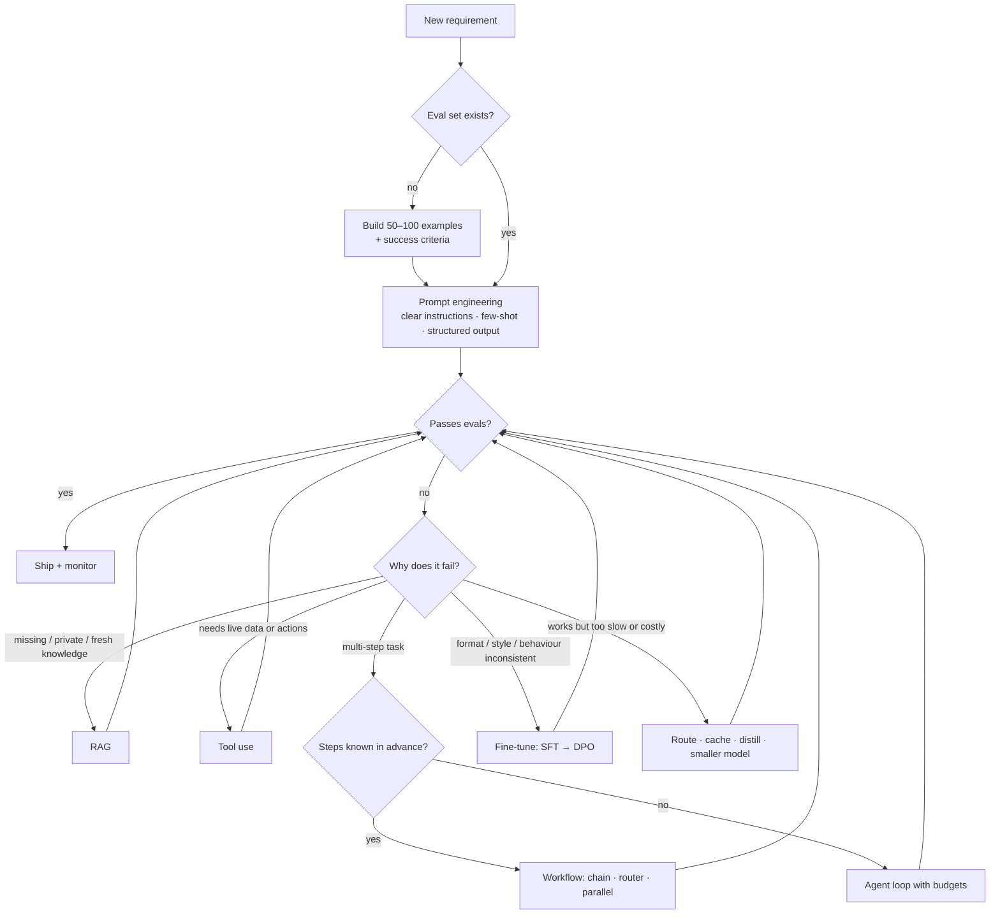
See [what is AI engineering](01-introduction/01-what-is-ai-engineering.md), [when to fine-tune](17-fine-tuning/01-when-to-fine-tune.md).

## 2. Workflow or Agent?
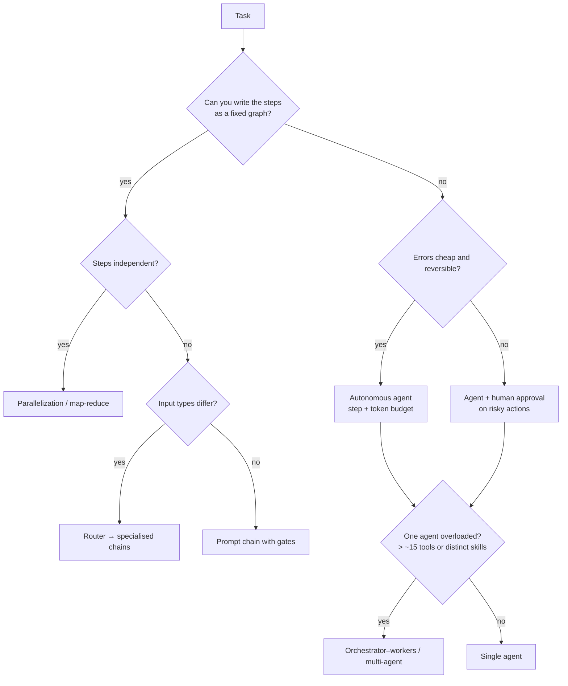
See [building AI workflows](10-agents/08-building-ai-workflows.md), [multi-agent systems](10-agents/03-multi-agent-systems.md).

## 3. Debugging a RAG System
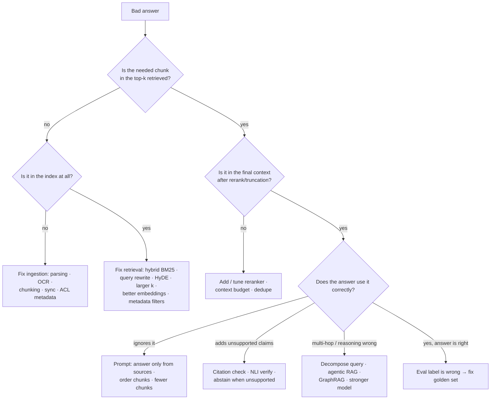
See [evaluating RAG](07-rag/05-evaluating-rag-systems.md), [advanced retrieval](07-rag/03-advanced-retrieval-techniques.md).

## 4. Model Selection and Routing
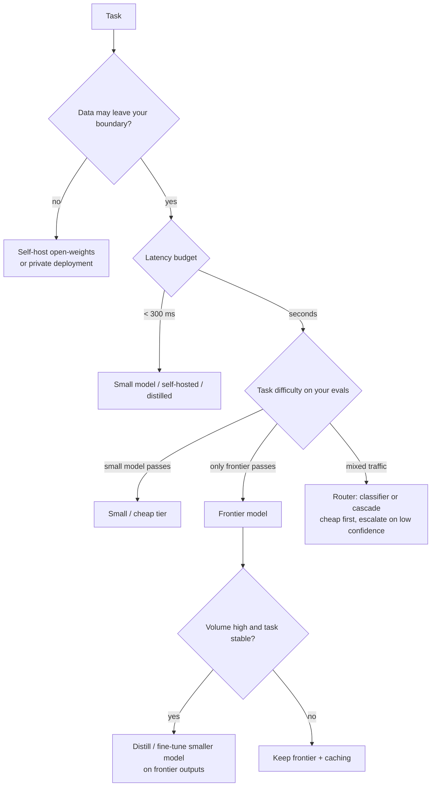
See [model selection and routing](13-llm-optimization/03-model-selection-and-routing.md), [self-hosting](13-llm-optimization/05-self-hosting-models.md).

## 5. Fine-Tuning Decision and Method
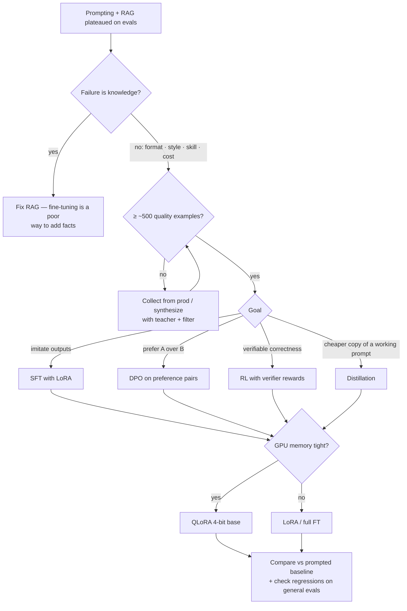
See [LoRA/QLoRA](17-fine-tuning/03-lora-qlora-and-peft.md), [preference tuning](17-fine-tuning/04-preference-tuning-dpo-and-rl.md).

## 6. Latency Debugging
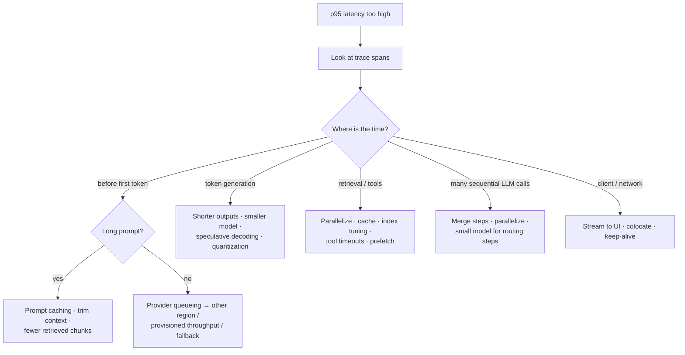
See [latency optimization](13-llm-optimization/04-latency-optimization.md).

## 7. Production Incident Triage
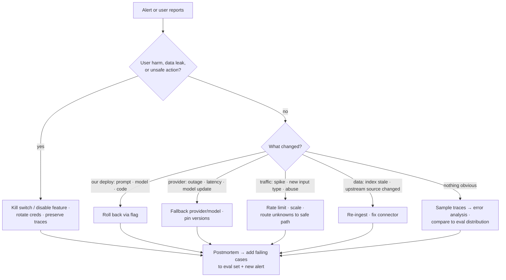
See [handling production incidents](12-production-deployment/04-handling-production-incidents.md).

## 8. The Eval-Driven Development Loop
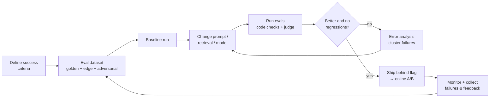
See [eval-driven development](16-evaluation/01-eval-driven-development.md), [error analysis](16-evaluation/02-building-eval-datasets-and-error-analysis.md).

## 9. Guardrail Placement
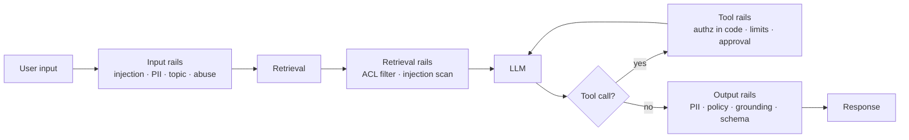
See [guardrails architecture](18-safety-and-governance/01-guardrails-architecture.md).

## 10. Handling an LLM API Call Robustly
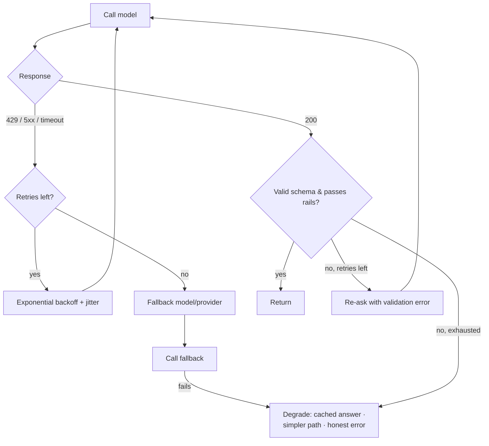
See [designing for reliability](11-ai-system-architecture/02-designing-for-reliability.md), [AI gateway](11-ai-system-architecture/05-the-ai-gateway-pattern.md).

## 11. AI System Design Interview Flow
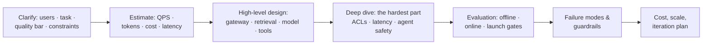
See [interview framework](19-ai-system-design-cases/01-ai-system-design-interview-framework.md).

## Related
- [Index](README.md) · [Cheatsheet](CHEATSHEET.md) · [Revision](REVISION.md) · [Glossary](GLOSSARY.md) · Repo: [FLOWCHARTS](../FLOWCHARTS.md)
