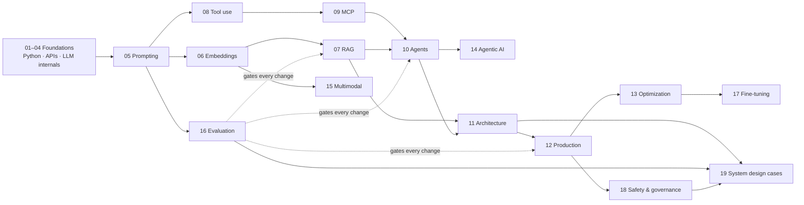

# AI Engineering

Lesson-by-lesson notes following the AlgoMaster *AI Engineering* roadmap (sections 01–15, 85 lessons) plus four added sections (16–19, 19 lessons) covering evaluation, fine-tuning, safety, and system-design cases. Each file is self-contained: a diagram, core concepts, tables, original Python code, takeaways, and links to related lessons. Material beyond the course is marked **(additions)** inside each file.

**Source legend:** 📘 = course content (free lesson, restructured) · ✍️ = original notes (lesson paywalled: intro from the course, body written from the lesson outline) · ➕ = addition, not in the course.

## 01 — Introduction to AI Engineering

- 📘 [What is AI Engineering](01-introduction/01-what-is-ai-engineering.md)
- 📘 [The Three Layers of the AI Stack](01-introduction/02-three-layers-of-the-ai-stack.md)
- 📘 [The AI Landscape](01-introduction/03-the-ai-landscape.md)

## 02 — Python for AI

- 📘 [Python Essentials for AI](02-python-for-ai/01-python-essentials.md)
- 📘 [Functions, Decorators, and Generators](02-python-for-ai/02-functions-decorators-and-generators.md)
- 📘 [Object-Oriented Python and Dataclasses](02-python-for-ai/03-object-oriented-python-and-dataclasses.md)
- 📘 [Type Hints and Pydantic](02-python-for-ai/04-type-hints-and-pydantic.md)
- 📘 [Working with Files and Data](02-python-for-ai/05-working-with-files-and-data.md)
- 📘 [Async Python](02-python-for-ai/06-async-python.md)

## 03 — Your First AI Application

- 📘 [Making Your First LLM API Call](03-first-ai-application/01-making-your-first-llm-api-call.md)
- 📘 [Understanding LLM Parameters](03-first-ai-application/02-understanding-llm-parameters.md)
- 📘 [Structured Output from LLMs](03-first-ai-application/03-structured-output-from-llms.md)
- ✍️ [Streaming and Conversation Management](03-first-ai-application/04-streaming-and-conversation-management.md)

## 04 — How LLMs Work

- 📘 [What are LLMs](04-how-llms-work/01-what-are-llms.md)
- 📘 [Tokenization](04-how-llms-work/02-tokenization.md)
- 📘 [Transformer Architecture](04-how-llms-work/03-transformer-architecture.md)
- ✍️ [How LLMs Generate Text](04-how-llms-work/04-how-llms-generate-text.md)
- ✍️ [LLM Training Pipeline](04-how-llms-work/05-llm-training-pipeline.md)

## 05 — Prompt Engineering

- 📘 [What is Prompt Engineering](05-prompt-engineering/01-what-is-prompt-engineering.md)
- 📘 [Anatomy of an Effective Prompt](05-prompt-engineering/02-anatomy-of-an-effective-prompt.md)
- ✍️ [Advanced Prompting Techniques](05-prompt-engineering/03-advanced-prompting-techniques.md)
- ✍️ [Context Engineering](05-prompt-engineering/04-context-engineering.md)
- ✍️ [Prompt Templates and Pipelines](05-prompt-engineering/05-prompt-templates-and-pipelines.md)
- ✍️ [Defending Against Prompt Injection](05-prompt-engineering/06-defending-against-prompt-injection.md)
- ✍️ [Prompt Optimization and DSPy](05-prompt-engineering/07-prompt-optimization-and-dspy.md)

## 06 — Embeddings and Vector Search

- 📘 [What are Embeddings](06-embeddings-vector-search/01-what-are-embeddings.md)
- 📘 [Choosing Embedding Models](06-embeddings-vector-search/02-choosing-embedding-models.md)
- ✍️ [Vector Databases](06-embeddings-vector-search/03-vector-databases.md)
- ✍️ [Building a Semantic Search Engine](06-embeddings-vector-search/04-building-a-semantic-search-engine.md)
- ✍️ [Scaling Vector Search](06-embeddings-vector-search/05-scaling-vector-search.md)

## 07 — RAG and Retrieval

- 📘 [What is RAG](07-rag/01-what-is-rag.md)
- ✍️ [Building a Production RAG Pipeline](07-rag/02-building-a-production-rag-pipeline.md)
- ✍️ [Advanced Retrieval Techniques](07-rag/03-advanced-retrieval-techniques.md)
- ✍️ [RAG with Citations and Grounding](07-rag/04-rag-with-citations-and-grounding.md)
- ✍️ [Evaluating RAG Systems](07-rag/05-evaluating-rag-systems.md)
- ✍️ [Conversational RAG](07-rag/06-conversational-rag.md)
- ✍️ [GraphRAG and Knowledge Graphs](07-rag/07-graphrag-and-knowledge-graphs.md)
- ✍️ [Multimodal RAG](07-rag/08-multimodal-rag.md)
- ✍️ [Agentic RAG](07-rag/09-agentic-rag.md)

## 08 — Function Calling and Tool Use

- 📘 [From Text Generation to Action](08-tool-use/01-from-text-generation-to-action.md)
- ✍️ [Designing Tool Schemas](08-tool-use/02-designing-tool-schemas.md)
- ✍️ [Multi-Tool Orchestration](08-tool-use/03-multi-tool-orchestration.md)
- ✍️ [Structured Workflows with Tool Use](08-tool-use/04-structured-workflows-with-tool-use.md)

## 09 — Model Context Protocol (MCP)

- 📘 [What is MCP](09-mcp/01-what-is-mcp.md)
- ✍️ [Building MCP Clients from Scratch](09-mcp/02-building-mcp-clients.md)
- ✍️ [Remote MCP Servers with Streamable HTTP](09-mcp/03-remote-mcp-servers.md)
- ✍️ [Production MCP Server Patterns](09-mcp/04-production-mcp-server-patterns.md)

## 10 — Building AI Agents

- 📘 [What are AI Agents](10-agents/01-what-are-ai-agents.md)
- ✍️ [Agent Memory Systems](10-agents/02-agent-memory-systems.md)
- ✍️ [Multi-Agent Systems](10-agents/03-multi-agent-systems.md)
- ✍️ [Agent Frameworks](10-agents/04-agent-frameworks.md)
- ✍️ [Agent Reliability and Debugging](10-agents/05-agent-reliability-and-debugging.md)
- ✍️ [Agent Evaluation and Testing](10-agents/06-agent-evaluation-and-testing.md)
- ✍️ [Human-in-the-Loop Patterns](10-agents/07-human-in-the-loop-patterns.md)
- ✍️ [Building AI Workflows](10-agents/08-building-ai-workflows.md)

## 11 — AI System Architecture

- 📘 [Architecture Patterns for AI Applications](11-ai-system-architecture/01-architecture-patterns-for-ai-applications.md)
- ✍️ [Designing for Reliability](11-ai-system-architecture/02-designing-for-reliability.md)
- ✍️ [Data Architecture for AI](11-ai-system-architecture/03-data-architecture-for-ai.md)
- ✍️ [Scaling AI Applications](11-ai-system-architecture/04-scaling-ai-applications.md)
- ✍️ [The AI Gateway Pattern](11-ai-system-architecture/05-the-ai-gateway-pattern.md)
- ✍️ [Building AI-Powered UX](11-ai-system-architecture/06-building-ai-powered-ux.md)
- ✍️ [Caching Strategies for LLM Applications](11-ai-system-architecture/07-caching-strategies-for-llm-applications.md)
- ✍️ [Rate Limiting and API Management](11-ai-system-architecture/08-rate-limiting-and-api-management.md)

## 12 — Production Deployment

- ✍️ [Containerizing AI Applications](12-production-deployment/01-containerizing-ai-applications.md)
- ✍️ [CI/CD for AI Applications](12-production-deployment/02-ci-cd-for-ai-applications.md)
- ✍️ [Monitoring and Observability](12-production-deployment/03-monitoring-and-observability.md)
- ✍️ [Handling Production Incidents](12-production-deployment/04-handling-production-incidents.md)
- ✍️ [Iterating in Production](12-production-deployment/05-iterating-in-production.md)
- ✍️ [The AI Engineering Lifecycle](12-production-deployment/06-the-ai-engineering-lifecycle.md)

## 13 — LLM Optimization

- 📘 [Understanding AI Application Costs](13-llm-optimization/01-understanding-ai-application-costs.md)
- ✍️ [Prompt Optimization](13-llm-optimization/02-prompt-optimization.md)
- ✍️ [Model Selection and Routing](13-llm-optimization/03-model-selection-and-routing.md)
- ✍️ [Latency Optimization](13-llm-optimization/04-latency-optimization.md)
- ✍️ [Self-Hosting Models](13-llm-optimization/05-self-hosting-models.md)

## 14 — Agentic AI

- 📘 [Computer Use Agents](14-agentic-ai/01-computer-use-agents.md)
- ✍️ [Coding Agents](14-agentic-ai/02-coding-agents.md)
- ✍️ [Deep Research Agents](14-agentic-ai/03-deep-research-agents.md)
- ✍️ [Agent Protocols](14-agentic-ai/04-agent-protocols.md)
- ✍️ [Long-Running and Async Agents](14-agentic-ai/05-long-running-agents.md)
- ✍️ [Agent Sandboxing and Security](14-agentic-ai/06-agent-sandboxing-and-security.md)

## 15 — Multimodal and Generative AI

- 📘 [Vision Models and Image Understanding](15-multimodal/01-vision-models-and-image-understanding.md)
- ✍️ [Text-to-Image Generation](15-multimodal/02-text-to-image-generation.md)
- ✍️ [Audio and Speech](15-multimodal/03-audio-and-speech.md)
- ✍️ [Video Understanding and Generation](15-multimodal/04-video-understanding-and-generation.md)
- ✍️ [Building Multimodal Applications](15-multimodal/05-building-multimodal-applications.md)

## 16 — Evaluation ➕

- ➕ [Eval-Driven Development](16-evaluation/01-eval-driven-development.md)
- ➕ [Building Eval Datasets and Error Analysis](16-evaluation/02-building-eval-datasets-and-error-analysis.md)
- ➕ [LLM-as-a-Judge](16-evaluation/03-llm-as-a-judge.md)
- ➕ [Online Evaluation and Experiments](16-evaluation/04-online-evaluation-and-experiments.md)

## 17 — Fine-Tuning ➕

- ➕ [When to Fine-Tune](17-fine-tuning/01-when-to-fine-tune.md)
- ➕ [Preparing Fine-Tuning Data](17-fine-tuning/02-preparing-fine-tuning-data.md)
- ➕ [LoRA, QLoRA, and PEFT](17-fine-tuning/03-lora-qlora-and-peft.md)
- ➕ [Preference Tuning: DPO and RL](17-fine-tuning/04-preference-tuning-dpo-and-rl.md)
- ➕ [Distillation and Serving Fine-Tuned Models](17-fine-tuning/05-distillation-and-serving-fine-tuned-models.md)

## 18 — Safety and Governance ➕

- ➕ [Guardrails Architecture](18-safety-and-governance/01-guardrails-architecture.md)
- ➕ [Hallucination Detection and Mitigation](18-safety-and-governance/02-hallucination-detection-and-mitigation.md)
- ➕ [Red Teaming LLM Applications](18-safety-and-governance/03-red-teaming-llm-applications.md)
- ➕ [Responsible AI and Compliance](18-safety-and-governance/04-responsible-ai-and-compliance.md)

## 19 — AI System Design Cases ➕

- ➕ [AI System Design Interview Framework](19-ai-system-design-cases/01-ai-system-design-interview-framework.md)
- ➕ [Case: Customer-Support Agent](19-ai-system-design-cases/02-customer-support-agent.md)
- ➕ [Case: Enterprise RAG Knowledge Assistant](19-ai-system-design-cases/03-enterprise-rag-knowledge-assistant.md)
- ➕ [Case: Coding Assistant](19-ai-system-design-cases/04-coding-assistant.md)
- ➕ [Case: Document Extraction Pipeline](19-ai-system-design-cases/05-document-extraction-pipeline.md)
- ➕ [Case: Voice Agent](19-ai-system-design-cases/06-voice-agent.md)

## Learning Paths

| Goal | Path |
|---|---|
| Ship a first LLM feature (1–2 weeks) | 03 → 05.01–05.04 → 06.01 → 07.01–07.02 → 16.01 → 12.03 |
| RAG specialist | 06 → 07 → 16.02–16.03 → 18.02 → 19.03 |
| Agent builder | 08 → 09 → 10 → 14 → 18.01, 18.03 → 19.02 |
| Production / platform | 11 → 12 → 13 → 16.04 → 18 |
| Model customization | 04 → 16.01–16.02 → 17 |
| Interview in a week | [Cheatsheet](CHEATSHEET.md) → [Flowcharts](FLOWCHARTS.md) → 19 → [Revision](REVISION.md) → [Flashcards](FLASHCARDS.md) |

## Appendix — System Design Foundations

Classical system-design notes that support sections 11–13 (moved here from the earlier system-design version of this folder).

- [System Design Interviews — What, Which Kinds, and What Each Level Must Show](appendix-system-design/01-foundations/01-introduction.md)
- [Must-Know Concepts](appendix-system-design/01-foundations/02-must-know-concepts.md)
- [Must-Know Technologies — The Interview Toolbox](appendix-system-design/01-foundations/03-must-know-technologies.md)
- [Core Tradeoffs](appendix-system-design/01-foundations/04-tradeoffs.md)
- [Data Structures That Show Up in System Design](appendix-system-design/01-foundations/05-data-structures.md)
- [Networking for System Design](appendix-system-design/02-concept-deep-dives/01-networking.md)
- [Caching](appendix-system-design/02-concept-deep-dives/02-caching.md)
- [API Design](appendix-system-design/02-concept-deep-dives/03-api-design.md)
- [Database Design](appendix-system-design/02-concept-deep-dives/04-database-design.md)
- [Distributed Systems](appendix-system-design/02-concept-deep-dives/05-distributed-systems.md)

## Study Aids

- [Revision sheet](REVISION.md): one screen per section, the facts to recall
- [Flashcards](FLASHCARDS.md): `#flashcard` Q→A format
- [Cheatsheet](CHEATSHEET.md): numbers, defaults, decision tables, production checklist
- [Flowcharts](FLOWCHARTS.md): decision and debugging flows (technique choice, RAG debugging, incidents, fine-tuning)
- [Glossary](GLOSSARY.md): one-line definitions with section pointers

## Related Repo Sections

- [11 — LLM Applications](../11-llm-applications/README.md) · [12 — Systems and Scale](../12-systems-and-scale/README.md) · [13 — Production ML](../13-production-ml/README.md)
- [14 — Responsible AI](../14-responsible-ai/README.md) · [15 — System Design](../15-system-design/README.md) · [20 — AI Infrastructure](../20-ai-infrastructure/README.md) · [21 — Practice](../21-practice/README.md)
