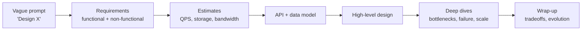

# System Design Interviews — What, Which Kinds, and What Each Level Must Show

## 1. What a System Design Interview Actually Tests

A 45–60 minute open-ended conversation where you design a large-scale system from a vague prompt. There is no single right answer. The interviewer is scoring **how you think**, not whether you reproduce a known architecture.

| Signal | What they look for | Failure mode |
|---|---|---|
| Problem scoping | You ask questions that change the design (scale, read/write ratio, consistency) | Jumping into boxes in minute 2 |
| Technical breadth | You know the toolbox: caches, queues, DBs, CDNs, sharding | Naming tech without saying why |
| Technical depth | You can go 2–3 levels deep on one component (e.g. how Kafka partitions give ordering) | Shallow everywhere |
| Tradeoff reasoning | Every choice is "X because Y, at the cost of Z" | "We'll use Cassandra because it scales" |
| Communication | Structured, drives the conversation, checks in | Silent drawing or rambling |
| Pragmatism | Starts simple, scales when numbers demand it | Over-engineering a 100 QPS service |

**Key mindset:** the interviewer is a collaborator. Narrate, state assumptions out loud, and invite pushback.

## 2. Types of System Design Questions

| Type | Example prompts | What's emphasized |
|---|---|---|
| **Product / end-to-end** | Design Instagram, Uber, WhatsApp | Breadth: full request path, data model, scale |
| **Infrastructure / building block** | Design a rate limiter, KV store, distributed cache, message queue | Depth: algorithms, replication, consistency, failure |
| **Data-intensive / pipeline** | Ad click aggregator, Top-K, metrics system | Stream vs batch, exactly-once, windowing |
| **API / object-oriented-ish** | Design the API for a parking lot service, payment API | Resource modeling, idempotency, versioning |
| **ML system design** | Design a feed ranker, fraud detector | Labels, features, training/serving skew, eval — see [`15-system-design/`](../../../15-system-design/README.md) |
| **GenAI / AI engineering** | Design ChatGPT, enterprise RAG, an LLM gateway, an agent platform | Token economics, latency (TTFT/TPOT), retrieval quality, guardrails, eval — see [AI Engineering index](../../README.md) |
| **Domain-specific deep dive** | "You built X at your last job — how would you scale it 10x?" | Real-world judgment, ops experience |

**Variants of format:**
- *Whiteboard / Excalidraw* — standard.
- *Take-home design doc* — evaluated on writing clarity and completeness.
- *Reverse design* — "here's our architecture, what breaks at 10x?"
- *Production-problem* — "p99 latency doubled overnight, walk me through it."

## 3. Expectations by Level / Years of Experience

| Level | YoE | Expected to drive? | Depth expected | Differentiator |
|---|---|---|---|---|
| Junior (L3/E3) | 0–2 | Often not asked SD; if asked, guided | Know the building blocks | Clear reasoning, asks good questions |
| Mid (L4/E4) | 2–5 | Mostly drives, some hints OK | A working HLD + 1 deep dive | Correct use of caches/queues/DB choice; reasonable estimates |
| Senior (L5/E5) | 5–8 | Fully drives | 2+ deep dives, proactively finds bottlenecks | Tradeoffs articulated unprompted; failure modes; data consistency |
| Staff (L6/E6) | 8–12 | Drives + reframes problem | Can go arbitrarily deep where it matters, skips where it doesn't | Org/operational concerns: migrations, cost, multi-region, team boundaries, evolution path |
| Principal (L7+) | 12+ | Treats it as a strategy discussion | Picks the 1–2 decisions that actually determine success | Business constraints, build-vs-buy, multi-year evolution |

**Senior vs Staff in one line:** Senior designs a system that works at scale; Staff designs one that can be *built, operated, migrated, and evolved* by real teams, and knows which parts don't matter.

## 4. Time Budget (45 min)

| Phase | Minutes | Output |
|---|---|---|
| Requirements | 5 | 3–5 functional reqs, NFRs with numbers |
| Estimates | 3–5 | QPS (avg/peak), storage/yr, bandwidth — only what drives decisions |
| API + data model | 5 | Core endpoints, entities, key access patterns |
| High-level design | 10 | Boxes and arrows that satisfy every functional req |
| Deep dives | 15 | 2–3 hardest parts: scale, consistency, failure |
| Wrap-up | 2–3 | Bottlenecks, monitoring, what you'd do next |

See the full framework in [Design interview framework](../../../15-system-design/01-design-interview-framework.md).

## 5. What AI Engineering Interviews Add

GenAI system design rounds reuse every classical concept here, then layer on:

- **New unit of cost:** tokens, not requests. A request can cost 1000× another.
- **New latency model:** TTFT (time-to-first-token) and TPOT (time-per-output-token), streamed responses.
- **New stateful resource:** KV cache and GPU memory, not just DB connections.
- **Non-deterministic outputs:** correctness becomes evaluation, not unit tests.
- **New failure modes:** hallucination, prompt injection, tool-call loops, provider outages.
- **New data plane:** embeddings, vector indexes, chunking pipelines.

Every classical pattern in this folder has an AI-flavored analog — caching → semantic/prefix caching; rate limiting → token-bucket per tenant on *tokens*; queues → async batch inference; idempotency → safe agent tool retries. The [AI Engineering section](../../README.md) maps them explicitly.
