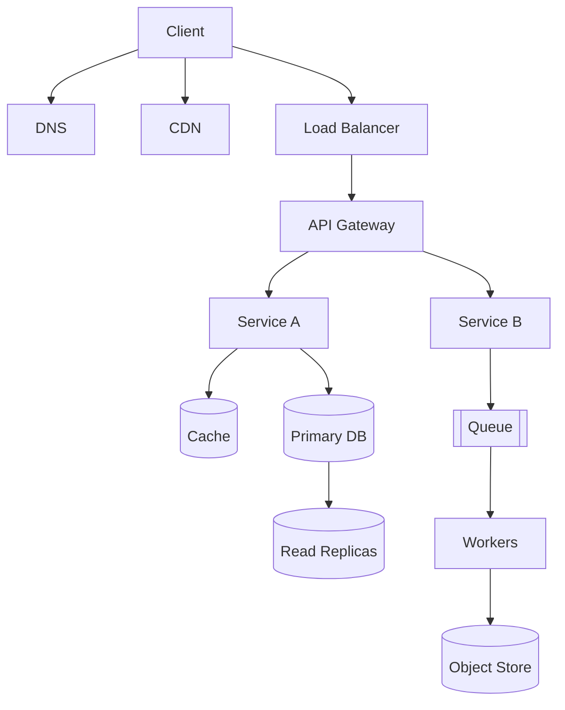

# Must-Know Concepts

The vocabulary every design is built from. Each entry: **what it is → when to reach for it → the cost.**

## 1. Scalability

| Concept | What | When | Cost |
|---|---|---|---|
| **Vertical scaling** | Bigger machine | First move; until ~a few 100K QPS for simple workloads | Hard ceiling, single point of failure, expensive at top end |
| **Horizontal scaling** | More machines | Once one box can't keep up or you need HA | Requires statelessness or partitioning; coordination overhead |
| **Stateless services** | No session state in app servers; state lives in DB/cache | Always for app tier | Every request pays to fetch state |
| **Partitioning / sharding** | Split data by key across nodes | Data or write throughput exceeds one node | Cross-shard queries, rebalancing, hot shards |
| **Replication** | Copies of data on multiple nodes | Read scaling, durability, HA | Replication lag, conflict resolution, write amplification |

**Rule of thumb:** scale reads with caching + replicas; scale writes with sharding + async (queues, batching).

## 2. Latency vs Throughput

- **Latency** = time for one request. Report p50/p95/p99, never just average.
- **Throughput** = requests (or bytes, tokens) per unit time.
- They trade off: batching raises throughput, raises latency. This is *the* central lever in LLM serving (continuous batching).
- **Tail latency amplification:** a request fanning out to 100 backends each with 1% chance of 1s latency → 63% of requests hit ≥1 slow backend. Mitigate with hedged requests, timeouts, fewer fan-outs.
- **Little's Law:** `concurrency = throughput × latency`. 1000 QPS at 200ms = 200 in-flight requests. Use it to size thread pools, connection pools, GPU batch slots.

## 3. Availability and Reliability

| Availability | Downtime/year | Downtime/month |
|---|---|---|
| 99% | 3.65 days | 7.3 h |
| 99.9% | 8.76 h | 43.8 min |
| 99.99% | 52.6 min | 4.38 min |
| 99.999% | 5.26 min | 26 s |

- **Serial components multiply:** two 99.9% components in series = 99.8%.
- **Parallel redundancy:** two 99.9% in parallel = 1 − 0.001² = 99.9999%.
- **SLI / SLO / SLA:** indicator (measured) → objective (internal target) → agreement (contract with penalties). Error budget = 1 − SLO.
- **Redundancy types:** active-active (both serve), active-passive (standby takes over), N+1, N+2.
- **Failover:** detection (heartbeats) + promotion + client redirect. Hardest part: avoiding split brain.

## 4. Consistency

| Model | Guarantee | Example |
|---|---|---|
| **Strong / linearizable** | Every read sees the latest write, single global order | Spanner, etcd, ZooKeeper, single-leader with sync reads |
| **Sequential** | All nodes see same order, not necessarily real-time | — |
| **Causal** | Causally related ops seen in order | Comment after post |
| **Read-your-writes** | You see your own writes | Profile update |
| **Monotonic reads** | Never go back in time | Sticky replica routing |
| **Eventual** | Replicas converge if writes stop | DynamoDB default, Cassandra ONE, DNS |

**CAP:** during a network **P**artition you choose **C**onsistency (reject some requests) or **A**vailability (serve possibly stale). Not a 3-way choice — P is not optional.

**PACELC:** if Partition → A or C; **E**lse → **L**atency or **C**onsistency. Captures the everyday tradeoff: sync replication costs latency even without failures.

- PA/EL: Cassandra, DynamoDB (default)
- PC/EC: Spanner, HBase, traditional RDBMS with sync replicas
- PA/EC: MongoDB (default config)

## 5. Load Balancing

- **L4** (TCP/UDP): fast, no content awareness. **L7** (HTTP): route by path/header/cookie, TLS termination, retries.
- **Algorithms:** round robin, weighted RR, least connections, least response time, IP hash, consistent hashing (sticky by key), power-of-two-choices (pick 2 random, choose less loaded — near-optimal and cheap).
- **Health checks:** active (probe) vs passive (observe failures). Remove unhealthy, add back slowly.
- LLM twist: route by **KV-cache/prefix affinity** and queue depth, not connections — see [`20-ai-infrastructure/05-smart-routing-and-scheduling.md`](../../../20-ai-infrastructure/05-smart-routing-and-scheduling.md).

## 6. Caching (summary — see [deep dive](../02-concept-deep-dives/02-caching.md))

Cache-aside, write-through, write-back, write-around. Eviction: LRU/LFU/TTL. Problems: stampede, penetration, avalanche, hot keys, staleness.

## 7. Data Storage

- **SQL**: relational, ACID, joins, schema. Default choice.
- **NoSQL**: key-value, document, wide-column, graph. Choose for specific access patterns or scale.
- **Object storage**: blobs (images, video, model weights). Cheap, durable, high latency per op.
- **Indexes**: B-tree (range, reads), LSM-tree (writes), hash (point lookups), inverted (text), vector (ANN).
- **OLTP vs OLAP**: row stores for transactions; columnar (BigQuery, ClickHouse, Snowflake) for analytics.

## 8. Asynchronous Processing

- **Message queue** (SQS, RabbitMQ): task distribution, each message consumed once.
- **Log / stream** (Kafka, Kinesis): durable ordered log, multiple consumer groups, replay.
- **Pub/sub**: fan-out to many subscribers.
- Benefits: decoupling, load leveling, retries. Costs: eventual consistency, harder debugging, duplicate delivery → need idempotency.

## 9. Delivery Semantics

| Semantics | How | Risk |
|---|---|---|
| At-most-once | Ack before processing | Loss |
| At-least-once | Ack after processing | Duplicates → make consumers idempotent |
| Exactly-once | Idempotent producer + transactional consume-process-produce, or dedup store | Complex, scoped to a system boundary |

"Exactly-once" end-to-end = at-least-once delivery + idempotent processing.

## 10. Idempotency

An operation is idempotent if repeating it has the same effect as doing it once. Required anywhere there are retries.
- Natural: `PUT /users/1 {name}`, `DELETE`.
- Engineered: client-generated **idempotency key** stored with the result; on retry, return stored result.
- Store key → (status, response) with TTL; use unique constraint to make the check-and-insert atomic.

## 11. Rate Limiting and Backpressure

- **Rate limiting**: token bucket, leaky bucket, fixed window, sliding window log, sliding window counter. See [Rate limiting and API management](../../11-ai-system-architecture/08-rate-limiting-and-api-management.md).
- **Backpressure**: signal upstream to slow down (bounded queues, 429/503 + Retry-After, TCP windows).
- **Load shedding**: drop low-priority work when overloaded to protect core.

## 12. Service Communication

- Sync: REST, gRPC, GraphQL. Async: queues, events.
- **Service discovery**: DNS, Consul, K8s services.
- **Circuit breaker**: closed → open (fail fast) after N failures → half-open probe.
- **Timeouts + retries with exponential backoff + jitter**; cap total retries (retry budget) to avoid retry storms.
- **Bulkheads**: isolate resource pools so one bad dependency can't exhaust all threads.

## 13. Observability

- **Metrics** (Prometheus): RED (Rate, Errors, Duration) for services; USE (Utilization, Saturation, Errors) for resources.
- **Logs**: structured JSON, correlation IDs.
- **Traces** (OpenTelemetry): span tree across services — essential for fan-out and LLM agent chains.
- **Golden signals**: latency, traffic, errors, saturation.

## 14. Security Basics

- AuthN (who: OAuth2/OIDC, JWT, API keys) vs AuthZ (what: RBAC, ABAC, ReBAC).
- TLS in transit, encryption at rest (KMS envelope encryption).
- Least privilege, secrets management (Vault, KMS), input validation.
- AI-specific: prompt injection, data exfiltration via tools, PII in prompts/logs.

## 15. Content Delivery

- **CDN**: edge caches for static and cacheable dynamic content. Push (you upload) vs pull (edge fetches on miss).
- **DNS**: GeoDNS / latency-based routing to nearest region; TTL tradeoff (fast failover vs resolver load).
- **Anycast**: same IP announced from many locations; BGP routes to nearest.

## 16. Concept → Where It Goes Deeper

| Concept | Deep dive |
|---|---|
| Networking, protocols | [Networking](../02-concept-deep-dives/01-networking.md) |
| Caching | [Caching](../02-concept-deep-dives/02-caching.md) |
| APIs | [API Design](../02-concept-deep-dives/03-api-design.md) |
| Schemas, indexes, sharding | [Database Design](../02-concept-deep-dives/04-database-design.md) |
| Consensus, replication, clocks | [Distributed Systems](../02-concept-deep-dives/05-distributed-systems.md) |
