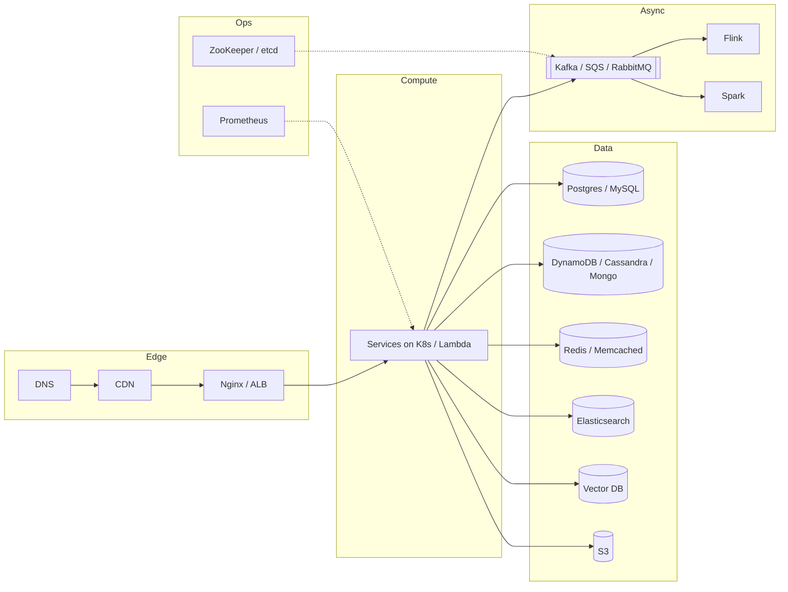

# Must-Know Technologies — The Interview Toolbox

You don't need to know 50 tools. You need ~20, each with: **what it's for, the one-sentence internal model, the limits, and when NOT to use it.** Concept deep dives are in [02-concept-deep-dives](../02-concept-deep-dives/01-networking.md).

## 1. The Cheat Table

| Category | Tech | Use for | Internal model | Avoid when |
|---|---|---|---|---|
| Relational DB | **PostgreSQL** | Default for anything transactional; JSONB, PostGIS, pgvector | MVCC, B-tree indexes, WAL, single primary + replicas | Write throughput > single primary (~10–50K writes/s) without sharding |
| Relational DB | **MySQL** | Same as Postgres; huge ecosystem (Vitess for sharding) | InnoDB clustered index on PK, binlog replication | Need advanced types/extensions |
| Document DB | **MongoDB** | Flexible schema, nested docs, rapid iteration | BSON docs, replica sets, range/hash sharding | Heavy cross-entity joins / multi-doc transactions are core |
| KV / cache | **Redis** | Cache, sessions, rate limits, leaderboards (ZSET), pub/sub, locks, streams | Single-threaded in-memory, rich data structures, async replication | Primary durable store for critical data |
| Cache | **Memcached** | Simple, multi-threaded large-object cache | Slab allocator, LRU, no persistence/replication | Need data structures, persistence |
| KV / wide-col | **DynamoDB** | Serverless KV at any scale, predictable latency | Partition key → hash → partition; sort key for ranges; GSIs | Ad-hoc queries, complex joins, large items (>400KB) |
| Wide-column | **Cassandra** | Massive write throughput, time series, multi-DC | Leaderless, consistent hash ring, LSM, tunable consistency | Need strong consistency, joins, many query patterns |
| Search | **Elasticsearch** | Full-text search, log analytics, faceting, autocomplete | Inverted index on Lucene shards, near-real-time refresh | Primary source of truth; heavy write+update |
| Log / stream | **Kafka** | Event streaming, CDC, decoupling, replay | Partitioned append-only log, consumer groups, offsets | Simple task queue with per-message ack & delay |
| Broker | **RabbitMQ** | Task queues, complex routing (topic/fanout), RPC | AMQP exchanges → queues, push to consumers, acks | Replay, very high throughput retention |
| Queue | **SQS** | Managed, zero-ops task queue | Visibility timeout, at-least-once, FIFO variant | Strict global ordering at high throughput, fan-out (use SNS+SQS) |
| Stream proc | **Flink** | Stateful stream processing, windows, exactly-once | Operators with keyed state, checkpoints (Chandy-Lamport), event-time watermarks | Simple stateless transforms (use consumers) |
| Batch proc | **Spark** | Large-scale ETL, ML feature backfills, analytics | DAG of RDD/DataFrame stages, lazy, shuffles | Low-latency (<1s) |
| Object store | **S3** | Blobs, data lake, backups, model weights | Flat key namespace, 11 9s durability, strong read-after-write | Low-latency small random reads, file locking |
| Serverless | **AWS Lambda** | Spiky/event-driven glue, low-traffic APIs | Ephemeral containers, scale per request | Long jobs (>15 min), latency-critical (cold start), GPU |
| Proxy | **Nginx** | Reverse proxy, L7 LB, TLS termination, static serving, rate limiting | Event-driven worker processes | Need service-mesh features (use Envoy) |
| Coordination | **ZooKeeper / etcd** | Leader election, config, locks, membership | Consensus (ZAB / Raft), znodes with watches | Storing lots of data or high write rates |
| Container | **Docker** | Package app + deps | Namespaces + cgroups + layered images | — |
| Orchestrator | **Kubernetes** | Run containers at scale: scheduling, self-healing, autoscaling | Declarative desired state, control loops, etcd | Tiny team, few services (overhead) |
| Monitoring | **Prometheus** | Metrics + alerting | Pull-based scraping, TSDB, PromQL | Long-term storage at huge scale alone (add Thanos/Mimir), logs |

## 2. AI-Engineering Additions (Not in Classic Toolbox)

| Tech | Use for | Notes |
|---|---|---|
| **Vector DB** (pgvector, Pinecone, Weaviate, Qdrant, Milvus) | ANN search over embeddings for RAG, recsys | HNSW (graph, fast, memory-heavy) vs IVF-PQ (compressed). Start with pgvector unless >10M vectors or need hybrid at scale |
| **Inference engines** (vLLM, SGLang, TensorRT-LLM) | Serving open-weight LLMs | PagedAttention, continuous batching, prefix caching — [`20-ai-infrastructure/01`](../../../20-ai-infrastructure/01-inference-engines-landscape.md) |
| **LLM gateway** (LiteLLM, Portkey, Envoy AI Gateway) | Unified API, routing, fallbacks, keys, token rate limits, cost tracking | Build-vs-buy: almost always buy/OSS first |
| **Orchestration** (LangGraph, LlamaIndex, DSPy) | Agent / RAG workflows | Thin wrappers; know what they do underneath |
| **Workflow engines** (Temporal, Airflow, Step Functions) | Durable long-running multi-step jobs, agents with retries | Temporal is the go-to for durable agent execution |
| **Feature store** (Feast, Tecton) | Online/offline consistent features | See [`13-production-ml/07`](../../../13-production-ml/07-feature-store-architecture.md) |
| **Eval / observability** (Langfuse, Arize, Braintrust) | LLM traces, eval datasets, prompt versions | See [`11-llm-applications/11`](../../../11-llm-applications/11-eval-and-observability.md) |
| **OLAP** (ClickHouse, Druid, Pinot) | Real-time analytics on events, ad dashboards | Columnar, very fast aggregations |

## 3. Choosing Quickly

- "I need transactions and relations" → **Postgres**.
- "I need 1M+ writes/s, simple key access" → **Cassandra / DynamoDB**.
- "I need sub-ms reads of hot data" → **Redis**.
- "I need text search / fuzzy / facets" → **Elasticsearch** (fed via CDC from source of truth).
- "I need semantic search" → **vector index** (+ BM25 for hybrid).
- "I need to decouple producers from N consumers with replay" → **Kafka**.
- "I need a simple job queue" → **SQS** (managed) / **RabbitMQ** / Redis-based queue.
- "I need stateful real-time aggregation" → **Flink** (or Kafka Streams).
- "I need to store files" → **S3** + CDN.
- "I need leader election / distributed lock with correctness" → **etcd / ZooKeeper** (not Redis for safety-critical locks).

Full decision tree: [Database design](../02-concept-deep-dives/04-database-design.md).

## 4. Numbers to Remember (Order-of-Magnitude)

| Component | Rough capacity per node |
|---|---|
| Postgres (simple queries) | 10–50K QPS reads; ~5–20K writes/s; up to ~several TB comfortably |
| Redis | 100K–1M ops/s; memory-bound (tens–hundreds GB) |
| Cassandra | ~10–50K writes/s per node |
| Kafka broker | ~100s MB/s; a partition ~10 MB/s; millions msgs/s per cluster |
| Elasticsearch | ~thousands of queries/s per node depending on query |
| Nginx | 10K–100K+ concurrent conns |
| App server (stateless) | 1–10K QPS depending on work |
| S3 | 3,500 PUT / 5,500 GET per second **per prefix** |
| One H100 serving 8B model | ~thousands of output tokens/s with batching |

These are interview-grade approximations: use them to justify "one node is enough" or "we need N shards".
