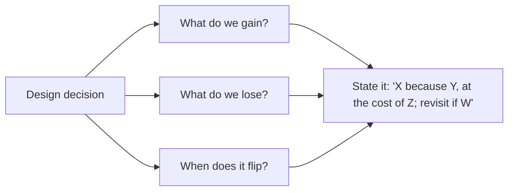

# Core Tradeoffs

Senior signal = naming the tradeoff **before** the interviewer asks. Every decision below has a "default" and a "flip condition".

## 1. The Big Tradeoffs

| # | Tradeoff | Choose left when | Choose right when |
|---|---|---|---|
| 1 | **Consistency vs Availability** | Money, inventory, bookings, auth | Feeds, likes, view counts, recommendations |
| 2 | **Latency vs Consistency** (PACELC) | Need low latency globally; tolerate staleness | Reads must reflect latest write |
| 3 | **SQL vs NoSQL** | Relations, transactions, ad-hoc queries, < few TB | Known access patterns, huge scale, flexible schema |
| 4 | **Normalization vs Denormalization** | Write-heavy, integrity matters | Read-heavy, latency-critical, known queries |
| 5 | **Sync vs Async** | User needs the result now; simple flow | Work is slow, spiky, or fan-out; user can be notified later |
| 6 | **Push vs Pull** (fan-out on write vs read) | Few followers, read-heavy, low latency feeds | Celebrities, write-heavy, rarely-read |
| 7 | **Batch vs Stream** | Accuracy, cost efficiency, backfills | Freshness < minutes matters |
| 8 | **Throughput vs Latency** | Offline jobs, batch inference | Interactive APIs |
| 9 | **Strong vs Eventual replication** (sync vs async) | Zero data loss on failover (RPO=0) | Write latency matters; tolerate small loss window |
| 10 | **Monolith vs Microservices** | Small team, early product | Many teams, independent scaling/deploys |
| 11 | **Polling vs Long-polling vs WebSocket vs SSE** | Rare updates (poll) | Real-time bidirectional (WS) / server→client streaming (SSE) |
| 12 | **REST vs gRPC vs GraphQL** | Public APIs (REST) | Internal low-latency, streaming (gRPC); flexible client queries (GraphQL) |
| 13 | **Cache freshness vs hit rate** (TTL length) | Data changes often / correctness | Data rarely changes; load protection |
| 14 | **Read-optimized (B-tree) vs Write-optimized (LSM)** | Read-heavy, range scans | Write-heavy ingestion |
| 15 | **Precompute vs compute on demand** | Expensive, predictable queries | Long tail of rare queries |
| 16 | **Exact vs approximate** | Billing, payments | Analytics counts, unique visitors (HLL), Top-K (count-min) |
| 17 | **Build vs Buy** (managed service) | Core differentiator, extreme scale/cost | Undifferentiated heavy lifting |
| 18 | **Cost vs Performance** | — | Always quantify: "this adds $X/month to cut p99 by Y ms" |
| 19 | **Simplicity vs Flexibility** | Almost always simplicity first | Requirements genuinely demand extensibility |
| 20 | **Single-region vs Multi-region** | Most systems; cheaper, simpler | Latency for global users, regulatory, DR requirements |

## 2. AI-Engineering Tradeoffs

| Tradeoff | Left | Right |
|---|---|---|
| **Large model vs small model** | Quality on hard tasks | Latency, cost; route easy queries to small (model cascade/router) |
| **API provider vs self-host** | Speed to market, frontier quality, no GPU ops | Cost at high volume, data residency, latency control, fine-tuning |
| **RAG vs fine-tuning** | Fresh/changing knowledge, citations, access control | Style/format/behavior, latency (no retrieval), narrow domain |
| **Long context vs retrieval** | Simplicity, cross-document reasoning | Cost (tokens), latency, "lost in the middle", scale beyond window |
| **Agentic vs fixed workflow** | Open-ended tasks | Reliability, cost, debuggability — prefer workflows when steps are known |
| **Streaming vs buffered output** | UX (perceived latency) | Need to run output guardrails on full text before showing |
| **Semantic cache vs no cache** | Cost/latency savings on repeated intents | Risk of wrong answer for subtly different queries; personalization |
| **Batch inference vs online** | 50% cost discounts, max throughput | Interactive SLAs |
| **Dense vs sparse vs hybrid retrieval** | Semantic match (dense) | Exact terms, IDs, rare words (BM25); hybrid usually wins |
| **Chunk size small vs large** | Precision | Context completeness |
| **LLM-as-judge vs human eval** | Scale, speed | Ground truth, calibration |
| **Determinism (temp=0) vs diversity** | Reproducibility, extraction | Creative generation |

## 3. How to Phrase a Tradeoff in the Interview

> "I'll use **fan-out-on-write** for normal users **because** feeds are read 100× more than written and we need <200ms feed loads, **at the cost of** write amplification. **For celebrities** (>1M followers) that cost explodes, so I'll switch to **fan-out-on-read** for them and merge at read time."

Template: **Decision → Reason (tied to a requirement/number) → Cost → Flip condition / mitigation.**

## 4. Common Traps

- Choosing NoSQL "for scale" at 1K QPS. One Postgres handles it.
- Picking microservices in an interview when the question is about data flow — the box count doesn't matter.
- Saying "eventual consistency" without saying *how stale* and *what the user sees*.
- Adding a cache without saying how it's invalidated.
- Adding a queue without saying what happens on duplicate or poison messages.
- Saying "exactly-once" without naming the boundary.
